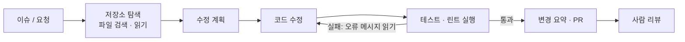

# 코딩 어시스턴트

!!! spec "핵심 논문 · 연도"
    Chen 외, "Evaluating Large Language Models Trained on Code (Codex, HumanEval)" (2021) · Austin 외, "MBPP" (2021) · Li 외, "AlphaCode" (2022) · Rozière 외, "Code Llama" (2023) · Jimenez 외, "SWE-bench" (2023) · Yang 외, "SWE-agent" (2024) · Jain 외, "LiveCodeBench" (2024) · Guo 외, "DeepSeek-Coder" (2024)

!!! basic "한눈에 보기"
    프로그래밍 언어도 언어입니다. 공개된 코드가 인터넷에 엄청나게 많아서 LLM은 코드를 특히 잘 배웁니다. 게다가 코드는 **실행해서 맞는지 확인할 수 있다**는 큰 장점이 있습니다. 글은 잘 썼는지 판단하기 어렵지만, 코드는 테스트를 통과하면 맞은 것입니다.

    코드 생성 AI는 세 단계로 발전했습니다.

    1. **자동 완성** (2021~): 편집기에서 다음 몇 줄을 제안합니다.
    2. **채팅 도우미** (2023~): "이 함수에 버그가 있어?", "이 코드를 설명해 줘"에 답합니다.
    3. **코딩 에이전트** (2024~): 저장소 전체를 읽고, 파일을 고치고, 테스트를 돌리고, 실패하면 다시 고쳐서 PR까지 만듭니다(→ [에이전트](agents.md)).

    2026년 11월 기준으로 코드 생성은 LLM이 가장 큰 경제적 가치를 만드는 분야 중 하나이며, 많은 개발팀에서 새 코드의 상당 부분을 AI가 초안으로 씁니다. 사람의 역할은 **무엇을 만들지 정하고, 결과를 검토하는 쪽**으로 옮겨 가고 있습니다.

## 코딩 에이전트의 작업 흐름 { .l2 }



모델의 능력만큼 중요한 것이 **환경**입니다. 테스트가 잘 갖춰진 저장소, 빠른 빌드, 명확한 코드 규칙 문서(예: 저장소 안의 에이전트용 안내 파일)가 있으면 에이전트 성공률이 크게 올라갑니다.

## 무엇으로 학습하나 { .l2 }

| 단계 | 데이터 | 목적 |
|---|---|---|
| 사전학습 | 공개 저장소 코드(라이선스·중복 필터링), 문서, Q&A | 문법, 라이브러리 사용법, 관용구 |
| 중간 학습 | 저장소 단위로 묶은 긴 코드, FIM(가운데 채우기) | 여러 파일에 걸친 맥락, 자동 완성 |
| 지시 미세조정 | 요청 → 코드, 버그 → 수정 예시 | 대화형 도움 |
| 강화학습 | 테스트 통과 여부를 보상으로 하는 문제·저장소 환경 | 스스로 디버깅하고 끝까지 해내는 능력 (→ [추론 모델](../llm/reasoning.md)) |

코드는 "검증 가능한 보상"을 쉽게 만들 수 있어 강화학습과 궁합이 좋습니다. 다만 모델이 테스트를 고치거나 특수 처리로 통과시키는 **보상 해킹**이 생길 수 있어, 숨겨진 테스트와 행동 감시가 필요합니다.

## 벤치마크 { .l2 }

| 벤치마크 | 과제 | 비고 |
|---|---|---|
| HumanEval / MBPP | 함수 하나 작성 (164 / 약 1,000문제) | 2024년 이후 상위 모델은 90%+로 포화 |
| LiveCodeBench | 대회 문제를 시기별로 새로 수집 | 학습 데이터 오염을 피함 |
| SWE-bench Verified | 실제 오픈소스 이슈 500개를 고쳐 테스트 통과 | 2026년 11월 기준 상위 에이전트는 대부분을 해결 |
| Terminal-Bench 등 | 터미널에서 환경 설정·디버깅 등 긴 작업 | 에이전트 능력 측정 |

## 코드로 보기 { .l2 }

코드 벤치마크의 대표 지표 **pass@k**는 "k개를 생성했을 때 하나라도 테스트를 통과할 확률"입니다. 문제마다 n개(k보다 많이)를 생성해 c개가 통과했다면, 아래 **불편 추정식**으로 계산합니다(Chen 외 2021).

```python
import numpy as np
from math import comb

def pass_at_k(n, c, k):
    """n개 샘플 중 c개 정답일 때 pass@k의 불편 추정 (Chen 외 2021)"""
    if n - c < k:
        return 1.0
    return 1.0 - comb(n - c, k) / comb(n, k)

n, c = 20, 3                     # 문제 하나에 20개 생성, 3개가 테스트 통과
for k in (1, 5, 10):
    naive = 1 - (1 - c / n) ** k
    print(f"pass@{k:<2}  불편추정 {pass_at_k(n, c, k):.3f}   단순식 {naive:.3f}")

rng = np.random.default_rng(0)
cs = rng.binomial(20, 0.15, size=164)   # 164문제 각각의 정답 개수(가상)
print("벤치마크 pass@1 =", round(np.mean([pass_at_k(20, c, 1) for c in cs]), 3),
      " pass@10 =", round(np.mean([pass_at_k(20, c, 10) for c in cs]), 3))
```

20개 중 3개가 맞은 문제에서 pass@1은 0.150으로 같지만, pass@5는 불편 추정 0.601 대 단순식 0.556, pass@10은 0.895 대 0.803으로 차이가 납니다. 단순식 1−(1−c/n)ᵏ은 **복원 추출**을 가정하지만, 실제로는 n개 중 서로 다른 k개를 고르기 때문입니다(비복원). 벤치마크 점수는 문제별 값을 평균한 것으로, 가상 데이터에서 pass@1 = 0.158, pass@10 = 0.809입니다. 여러 번 시도할 수 있으면 성공률이 크게 오르므로, **테스트로 정답을 골라낼 수 있는 환경**에서는 여러 개를 생성하는 전략이 유효합니다.

??? expert "전문가 노트 — FIM, 저장소 문맥, 검증과 보안"
    **FIM (Fill-in-the-Middle).** 자동 완성은 커서 앞뒤 코드를 모두 봐야 합니다. 학습 문서를 (앞, 가운데, 뒤)로 잘라 `<PRE>앞<SUF>뒤<MID>가운데` 순서로 재배열해 학습하면, 좌→우 모델이 그대로 가운데 채우기를 할 수 있습니다(Bavarian 외 2022). 일반 생성 능력은 거의 잃지 않습니다.

    **저장소 문맥.** 실제 작업은 여러 파일에 걸칩니다. 에이전트는 grep·파일 목록·정의로 이동 같은 도구로 필요한 부분만 읽고, 긴 문맥 모델은 관련 파일을 통째로 넣습니다. 어떤 파일을 읽을지 고르는 **탐색 능력**이 SWE-bench류 성능의 큰 부분을 차지합니다.

    **오염과 평가의 함정.** 공개 벤치마크 문제와 정답이 학습 데이터에 섞이면 점수가 부풀려집니다. 시기별로 새 문제를 쓰거나(LiveCodeBench), 사람이 검증한 부분집합(SWE-bench Verified)을 씁니다. 테스트 통과가 곧 좋은 코드는 아니므로 가독성, 유지보수성, 불필요한 변경 여부는 사람 리뷰가 여전히 필요합니다.

    **보안.** 생성된 코드에는 SQL 인젝션, 하드코딩된 비밀번호 같은 취약점이 들어갈 수 있고, 모델이 **존재하지 않는 패키지 이름**을 지어내면 공격자가 그 이름으로 악성 패키지를 올리는 공격(slopsquatting)이 가능합니다. 에이전트에는 샌드박스, 네트워크 제한, 비밀 정보 접근 차단, 의존성 검증을 적용합니다.

## 관련 페이지

- [에이전트와 도구 사용](agents.md)
- [추론 모델](../llm/reasoning.md) — 검증 가능한 보상으로 강화학습
- [평가와 벤치마크](evaluation.md) — 오염과 신뢰구간
- [로컬 LLM 실행](../practice/local-llm.md) — 로컬 코드 모델
