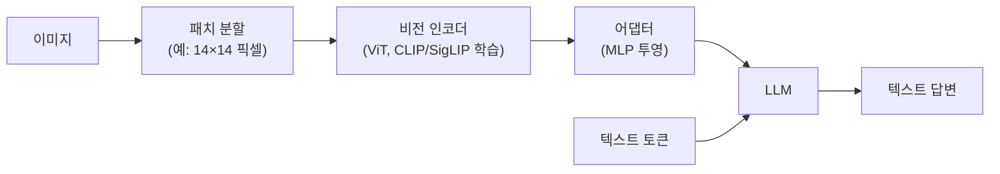

# 멀티모달 (비전·음성)

!!! spec "핵심 논문 · 연도"
    Radford 외, "CLIP: Learning Transferable Visual Models From Natural Language Supervision" (2021) · Dosovitskiy 외, "ViT" (2020) · Alayrac 외, "Flamingo" (2022) · Li 외, "BLIP-2" (2023) · Liu 외, "LLaVA: Visual Instruction Tuning" (2023) · Radford 외, "Whisper" (2022) · OpenAI, "GPT-4o" (2024) · Zhai 외, "SigLIP" (2023)

!!! basic "한눈에 보기"
    사람은 글만 읽지 않고 사진을 보고, 소리를 듣고, 그림을 그립니다. **멀티모달 모델**은 텍스트 외에 **이미지, 음성, 영상** 같은 여러 종류(모달리티)의 데이터를 함께 이해하거나 만들어 냅니다.

    비결은 모든 것을 **같은 말(벡터)**로 바꾸는 것입니다. 이미지는 작은 조각(패치)으로 잘라 각 조각을 벡터로, 소리는 짧은 구간마다 벡터로 바꿉니다. 그러면 LLM은 이 벡터들을 "외국어 단어"처럼 텍스트 토큰과 나란히 읽을 수 있습니다.

    - **이해**: 사진 속 표를 읽어 요약, 영수증에서 금액 추출, 그래프 해석, 음성 받아쓰기
    - **생성**: 글로 설명한 그림 만들기(→ [확산 모델](../arch/diffusion.md)), 자연스러운 음성 합성
    - **실시간 대화**: 음성으로 말하고 듣는 비서, 카메라로 보면서 설명하기

## 이미지를 LLM에 넣는 방법 { .l2 }



가장 널리 쓰이는 구조(LLaVA 계열)는 세 부분입니다. 미리 학습된 **비전 인코더**가 이미지를 패치 벡터로 바꾸고, 작은 **어댑터**가 그 벡터를 LLM의 임베딩 공간 크기로 맞추고, **LLM**이 텍스트와 이미지 토큰을 함께 읽습니다. 학습은 보통 ① 이미지-캡션 쌍으로 어댑터만 정렬 → ② 이미지가 들어간 지시 데이터로 전체 미세조정, 두 단계입니다.

## 구조 비교 { .l2 }

| 방식 | 원리 | 예 | 특징 |
|---|---|---|---|
| 대조 학습 이중 인코더 | 이미지·텍스트를 같은 공간에 놓아 짝끼리 가깝게 | CLIP, SigLIP | 검색, 분류(제로샷), 다른 모델의 부품 |
| 인코더 + 어댑터 + LLM | 이미지 벡터를 LLM 입력에 끼움 | LLaVA, Qwen-VL 계열 | 오픈 모델에서 가장 흔함 |
| 교차 어텐션 삽입 | LLM 층 사이에 이미지를 보는 어텐션 추가 | Flamingo, Llama 3.2 Vision | LLM 본체를 덜 건드림 |
| 처음부터 통합(네이티브) | 텍스트·이미지·음성 토큰을 한 모델이 처음부터 함께 학습 | GPT-4o, Gemini 계열 | 음성 실시간 대화, 이미지 생성까지 한 모델 |

## 모달리티별 요점 { .l2 }

| 모달리티 | 입력 표현 | 대표 과제 | 주의점 |
|---|---|---|---|
| 이미지 | 패치 임베딩, 해상도 따라 토큰 수 증가 | 문서·표·차트 읽기(OCR), 시각 질의응답 | 고해상도는 토큰이 많아 비쌈. 작은 글씨·개수 세기에 약함 |
| 음성 | 로그 멜 스펙트로그램 또는 음성 토큰(코덱) | 받아쓰기(Whisper), 음성 대화, 화자 구분 | 지연 시간. 음성→텍스트→음성 파이프라인은 감정·억양을 잃음 |
| 영상 | 프레임 샘플링 + 시간 정보 | 영상 요약, 장면 검색 | 토큰 폭증. 초당 1–2프레임 샘플링이 흔함 |

## 코드로 보기 { .l2 }

CLIP의 핵심인 **대조 손실**을 작은 가짜 데이터로 구현합니다. 배치 안의 이미지 8개와 텍스트 8개 중 **같은 행끼리만 짝**이고, 나머지 56쌍은 모두 오답입니다. 유사도 행렬의 대각선을 정답으로 하는 분류 문제를 양방향(이미지→텍스트, 텍스트→이미지)으로 풉니다.

```python
import torch, torch.nn.functional as F
torch.manual_seed(0)
B, d = 8, 32
concept = torch.randn(B, d)                       # 배치 안 8개의 '개념'
img = concept @ torch.randn(d, d) + 0.3 * torch.randn(B, d)   # 같은 개념의 이미지 특징
txt = concept @ torch.randn(d, d) + 0.3 * torch.randn(B, d)   # 같은 개념의 텍스트 특징

Wi = torch.nn.Linear(d, 16, bias=False); Wt = torch.nn.Linear(d, 16, bias=False)
log_t = torch.nn.Parameter(torch.tensor(2.659))   # 온도 1/0.07을 log로 학습 (CLIP 초기값)
opt = torch.optim.Adam(list(Wi.parameters()) + list(Wt.parameters()) + [log_t], lr=1e-2)

def clip_loss():
    zi = F.normalize(Wi(img), dim=-1); zt = F.normalize(Wt(txt), dim=-1)
    logits = log_t.exp() * zi @ zt.T              # B×B 유사도 행렬
    y = torch.arange(B)                           # 정답은 대각선
    return (F.cross_entropy(logits, y) + F.cross_entropy(logits.T, y)) / 2, logits

for step in range(201):
    loss, logits = clip_loss()
    opt.zero_grad(); loss.backward(); opt.step()
    if step % 100 == 0:
        acc = (logits.argmax(1) == torch.arange(B)).float().mean().item()
        print(f"step {step:3d}  loss {loss.item():.3f}  이미지→텍스트 정확도 {acc:.2f}")
```

처음에는 손실 2.83, 짝 맞추기 정확도 0.25(무작위라면 1/8 = 0.125)에서 시작해, 100스텝 뒤에는 8쌍을 모두 맞힙니다. 실제 CLIP은 같은 손실을 **배치 3만 2천 개, 이미지-텍스트 쌍 4억 개**로 학습했습니다. 배치가 클수록 한 번에 비교하는 오답이 많아 표현이 정교해집니다. 학습이 끝나면 "강아지 사진", "고양이 사진" 같은 문장을 임베딩해 가장 가까운 것을 고르는 것만으로 별도 학습 없이(제로샷) 이미지를 분류할 수 있습니다.

??? expert "전문가 노트 — 대조 손실의 세부, 해상도 처리, 음성 실시간화"
    **InfoNCE와 온도.** 위 손실은 InfoNCE의 대칭형입니다. 이미지 i에 대해 $-\log \frac{\exp(s_{ii}/\tau)}{\sum_j \exp(s_{ij}/\tau)}$이고, 온도 τ를 학습 파라미터로 두되 CLIP은 1/τ ≤ 100으로 잘라 불안정을 막았습니다. SigLIP은 소프트맥스 대신 각 쌍을 독립 이진 분류(시그모이드)로 바꿔 배치 전체 정규화가 필요 없게 했고, 작은 배치에서도 잘 되며 분산 학습 통신이 줄어듭니다.

    **해상도와 토큰 수.** 224×224 이미지를 14×14 패치로 자르면 256개 토큰입니다. 문서·차트는 고해상도가 필요해 이미지를 여러 타일로 자르고(AnyRes), 토큰 수를 줄이기 위해 인접 패치를 합치거나(pixel shuffle) 학습 가능한 쿼리로 요약합니다(Q-Former, Perceiver resampler). 위치 정보를 2D로 다루는 회전 위치 인코딩(2D RoPE, M-RoPE)으로 임의 해상도를 그대로 넣는 방식도 쓰입니다.

    **음성 실시간 대화.** 음성 인식(ASR) → LLM → 음성 합성(TTS)을 잇는 파이프라인은 단순하지만 지연이 수 초에 달하고 억양·감정 정보를 잃습니다. 네이티브 음성 모델은 신경 오디오 코덱(예: 초당 12.5–75 프레임의 이산 토큰)을 직접 입출력해 수백 밀리초 지연으로 말을 끊고 끼어드는 자연스러운 대화를 합니다. Moshi(2024)는 사용자와 모델의 음성 스트림을 동시에 모델링하는 전이중(full-duplex) 구조를 공개했습니다.

    **환각과 평가.** 멀티모달 모델은 이미지에 없는 물체를 있다고 말하는 **물체 환각**이 잦습니다. MMMU(대학 수준 다학제 문제), ChartQA·DocVQA(문서·차트), MathVista, Video-MME 등이 대표 벤치마크이며, 개수 세기·공간 관계·작은 글씨는 2026년 11월 기준으로도 상대적 약점으로 남아 있습니다.

## 관련 페이지

- [임베딩과 표현 학습](../arch/embeddings.md) — 대조 학습의 기초
- [트랜스포머](../arch/transformer.md) — ViT는 이미지 패치를 토큰으로 쓰는 트랜스포머
- [확산 모델](../arch/diffusion.md) — 텍스트로 이미지·영상 생성
- [평가와 벤치마크](evaluation.md)
