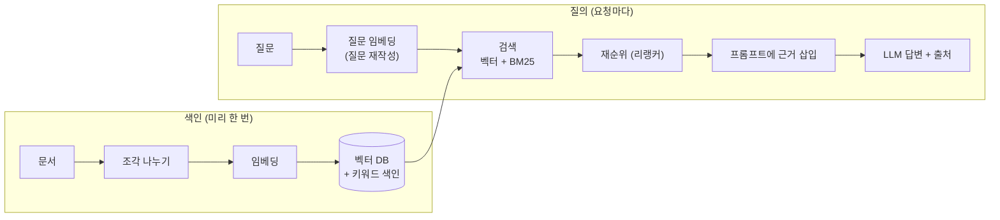

# RAG (검색 증강 생성)

!!! spec "핵심 논문 · 연도"
    Robertson·Zaragoza, "The Probabilistic Relevance Framework: BM25" (2009) · Karpukhin 외, "Dense Passage Retrieval" (2020) · Lewis 외, "Retrieval-Augmented Generation for Knowledge-Intensive NLP" (2020) · Guu 외, "REALM" (2020) · Borgeaud 외, "RETRO" (2021) · Khattab·Zaharia, "ColBERT" (2020) · Edge 외, "GraphRAG" (2024) · Es 외, "RAGAS" (2023)

!!! basic "한눈에 보기"
    LLM은 학습 시점 이후의 일이나 회사 내부 문서를 모릅니다. 모르는 것을 물으면 그럴듯하게 지어내기도 합니다(**환각**).

    **RAG**는 **오픈북 시험**입니다. 질문을 받으면 먼저 관련 자료를 **검색**하고, 찾은 자료를 질문과 함께 모델에게 건네 "이 자료를 근거로 답하라"고 합니다.

    1. **준비**: 문서를 적당한 크기의 조각으로 나누고, 각 조각을 임베딩 벡터로 바꿔 저장합니다.
    2. **검색**: 질문도 벡터로 바꿔 가장 비슷한 조각 몇 개를 찾습니다.
    3. **생성**: 찾은 조각을 프롬프트에 넣어 답을 만들고, 어느 문서를 근거로 했는지 출처를 붙입니다.

    모델을 다시 학습시킬 필요 없이 문서만 바꾸면 최신 정보가 반영되고, 출처를 보여 줄 수 있어 신뢰도도 높아집니다.

## 파이프라인 { .l2 }



## 설계 선택 { .l2 }

| 단계 | 선택지 | 실무 팁 |
|---|---|---|
| 조각 나누기 | 고정 길이(예: 300–800토큰, 10–20% 겹침), 제목·문단 단위 | 문서 구조(제목, 표)를 살리고 조각에 문서 제목·섹션명을 붙임 |
| 임베딩 | 다국어 임베딩 모델 | 한국어 성능을 직접 평가해 고름 |
| 검색 | 밀집(벡터), 희소(BM25), **하이브리드** | 제품명·코드·숫자는 BM25가 강함. 둘을 섞는 것이 안전 |
| 재순위 | 교차 인코더(질문과 조각을 함께 넣어 점수) | 상위 50개를 가져와 재순위 후 5–10개 사용 |
| 프롬프트 | 근거 블록 + "근거에 없으면 모른다고 답하라" + 출처 표기 지시 | 근거마다 ID를 붙여 인용하게 함 |
| 갱신 | 문서 변경 시 해당 조각만 재색인 | 접근 권한을 조각 메타데이터로 관리 |

## 검색 방식 비교 { .l2 }

| 방식 | 원리 | 강점 | 약점 |
|---|---|---|---|
| BM25 (희소) | 단어 일치, 드문 단어에 가중치 | 고유명사·코드·정확한 용어 | 동의어·바꿔 말하기에 약함 |
| 밀집 임베딩 | 의미 벡터의 코사인 유사도 | 의미가 비슷한 다른 표현 | 정확한 키워드·숫자에 약할 수 있음 |
| 하이브리드 | 두 점수를 합침 (RRF 등) | 양쪽 장점 | 튜닝 필요 |

## 실패 유형 { .l2 }

| 증상 | 원인 | 대책 |
|---|---|---|
| 엉뚱한 문서를 근거로 답 | 검색 실패 | 하이브리드 검색, 질문 재작성, 재순위 |
| 근거가 있는데 답이 틀림 | 조각이 정보를 잘라 먹음, 모델이 근거 무시 | 조각 크기·겹침 조정, 근거 인용 강제 |
| 근거가 없는데 지어냄 | 거절 지시 부족 | "근거에 없으면 모른다" 지시 + 평가 |
| 여러 문서를 종합해야 하는 질문 | 상위 k개로는 부족 | 다단계 검색, 에이전트형 RAG, 긴 문맥 |

## 코드로 보기 { .l2 }

외부 모델 없이 TF-IDF(BM25와 비슷한 희소 검색)로 작은 RAG의 검색 단계와 프롬프트 조립을 구현합니다. 실제로는 임베딩 모델과 LLM API를 연결합니다.

```python
from sklearn.feature_extraction.text import TfidfVectorizer
from sklearn.metrics.pairwise import cosine_similarity

docs = {
    "휴가규정-3조": "연차 휴가는 입사 1년 후 15일이 부여되며, 2년마다 1일씩 추가된다.",
    "휴가규정-5조": "병가는 연 10일까지 유급이며, 3일 이상이면 진단서를 제출한다.",
    "출장규정-2조": "해외 출장 시 일비는 하루 미화 60달러를 지급한다.",
    "보안규정-1조": "사내 문서를 외부 AI 서비스에 입력할 때는 보안팀 승인이 필요하다.",
}
ids, texts = list(docs), list(docs.values())
vec = TfidfVectorizer(analyzer="char_wb", ngram_range=(2, 3))   # 한국어는 글자 n-그램이 간단하고 견고
X = vec.fit_transform(texts)

def retrieve(q, k=2):
    sims = cosine_similarity(vec.transform([q]), X)[0]
    order = sims.argsort()[::-1][:k]
    return [(ids[i], texts[i], round(float(sims[i]), 3)) for i in order]

question = "병가를 4일 쓰려면 뭐가 필요해?"
hits = retrieve(question)
for h in hits:
    print(h[0], h[2])

context = "\n".join(f"[{i}] {t}" for i, t, _ in hits)
prompt = f"""아래 근거만 사용해 질문에 답하고, 사용한 근거의 ID를 [ ]로 표시하세요.
근거에 없는 내용이면 "규정에서 찾을 수 없습니다"라고 답하세요.

<근거>
{context}
</근거>

질문: {question}"""
print(prompt)
```

실행하면 "병가를 4일" 질문에 `휴가규정-5조`(0.244)가 1위, `보안규정-1조`(0.148)가 2위로 검색됩니다. 2위는 사실 관련이 없는 조각입니다. 이처럼 상위 k개에는 잡음이 섞이기 마련이므로, 프롬프트에서 "근거에 없으면 모른다고 답하라"와 출처 표기를 요구하고, 실무에서는 재순위 모델이나 점수 임계값으로 걸러 냅니다.

??? expert "전문가 노트 — 평가 지표, 에이전트형 RAG, GraphRAG, 보안"
    **RAG 평가.** 검색과 생성을 나눠 잽니다. 검색: 정답 조각이 상위 k개에 들어갔는가(Recall@k, MRR, nDCG). 생성: 답이 근거에 충실한가(faithfulness, 근거에 없는 주장 비율), 질문에 맞는가(answer relevance), 정답과 일치하는가. RAGAS 같은 도구는 LLM 심판으로 이를 자동화하지만, 실제 사용자 질문으로 만든 수백 개 규모의 골든 세트가 가장 중요합니다.

    **에이전트형 RAG.** 한 번 검색하고 끝내는 대신, 모델이 검색어를 여러 번 바꿔 가며 검색하고, 결과를 읽고, 부족하면 다시 검색합니다. 다단계 질문(“A 제품을 만든 팀의 리더가 쓴 보고서”)에 강하지만 지연과 비용이 늘어납니다. 2025년 이후 "딥 리서치" 기능이 이 방식의 대표 사례입니다.

    **GraphRAG.** 문서에서 개체와 관계를 추출해 지식 그래프를 만들고, 그래프의 군집 요약을 검색 대상으로 씁니다. "이 문서 모음 전체의 주요 주제는?" 같은 전역 질문에 일반 RAG보다 강합니다. 색인 비용이 큽니다.

    **보안.** 검색된 문서는 **데이터이지 지시가 아닙니다**. 문서 안에 숨겨진 지시(간접 프롬프트 인젝션)가 모델 행동을 바꿀 수 있으므로, 근거 블록을 명확히 구분하고, 사용자 권한에 맞는 문서만 검색되게 하고(문서 수준 접근 제어), 민감 정보가 다른 사용자 답변에 섞이지 않게 해야 합니다 → [저작권과 개인정보](../society/copyright-privacy.md).

## 관련 페이지

- [임베딩과 표현 학습](../arch/embeddings.md) — 문장 임베딩
- [긴 문맥과 메모리](../llm/long-context.md) — 긴 문맥 vs RAG
- [에이전트와 도구 사용](agents.md) — 검색을 도구로 쓰는 에이전트
- [평가와 벤치마크](evaluation.md)
