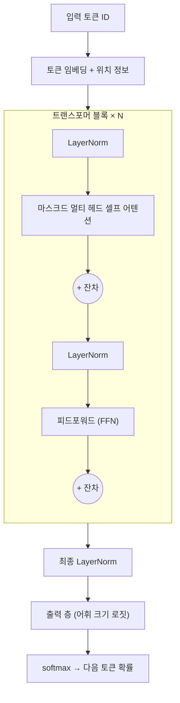
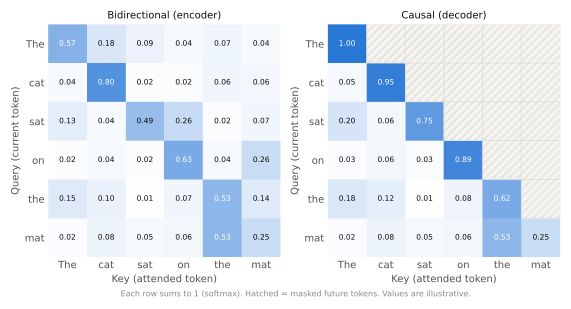

# 트랜스포머

!!! spec "핵심 논문 · 연도"
    Vaswani 외, "Attention Is All You Need" (2017, arXiv:1706.03762) · Ba 외, "Layer Normalization" (2016) · Xiong 외, "On Layer Normalization in the Transformer Architecture" (2020, Pre-LN) · Su 외, "RoFormer" (2021, RoPE) · Dao 외, "FlashAttention" (2022)
    2017 인코더-디코더 원형 → 2018 BERT(인코더만)·GPT(디코더만) → 2019–2020 GPT-2·GPT-3, Pre-LN 정착 → 2021 RoPE → 2022 FlashAttention → 2023 LLaMA(RMSNorm·SwiGLU·RoPE 조합), GQA → 이후 MoE·긴 문맥으로 확장

!!! basic "한눈에 보기"
    트랜스포머는 문장을 **한 번에 통째로** 보고, 각 단어가 다른 단어를 **얼마나 참고할지 스스로 정하는** 신경망입니다.

    회의실을 떠올려 보세요. 참석자(단어)마다 손에 **질문 카드(Query)**를 들고 있고, 가슴에는 **명찰(Key)**을 달고 있으며, 머릿속에는 **할 말(Value)**이 있습니다. 각자 자기 질문과 다른 사람의 명찰을 맞춰 보고, 잘 맞는 사람의 말을 더 크게 들어 자기 생각을 고칩니다. 이것이 **셀프 어텐션**입니다.

    1. 이전의 RNN은 귓속말 전달 게임처럼 단어를 하나씩 순서대로 넘겨서, 문장이 길면 앞 내용이 흐려지고 병렬로 계산하기 어려웠습니다.
    2. 트랜스포머는 모든 단어가 모든 단어를 **직접** 보므로 먼 거리의 관계도 한 단계에 잡고, GPU에서 행렬 곱 몇 번으로 계산됩니다.
    3. 블록 하나는 "모여서 대화(어텐션)"와 "각자 정리(피드포워드)"의 반복입니다. 이 블록을 수십 층 쌓은 것이 오늘날의 LLM입니다.

## 전체 구조 { .l2 }

오늘날 LLM 대부분이 쓰는 **디코더 전용(decoder-only)** 트랜스포머의 흐름입니다.



| 구성 요소 | 하는 일 | 크기 (d = d_model) |
|---|---|---|
| 토큰 임베딩 | 토큰 ID를 d차원 벡터로 바꿈 | 어휘 수 × d |
| 셀프 어텐션 | 토큰끼리 정보를 섞음 (토큰 **사이**) | 약 4d² |
| 피드포워드 (FFN) | 토큰마다 따로 비선형 변환 (토큰 **안**) | 약 8d² (은닉 4d일 때) |
| 잔차 연결 | 입력을 출력에 더해 깊은 층에서도 기울기가 흐르게 함 | 0 |
| LayerNorm | 벡터마다 평균 0·분산 1로 맞춰 학습을 안정시킴 | 2d |

## 셀프 어텐션 한 번 계산하기 { .l2 }

토큰 T개가 담긴 입력 \(X\) (T × d)에 세 가중치 행렬을 곱해 질문·명찰·내용을 만듭니다.

\[
Q = XW_Q,\quad K = XW_K,\quad V = XW_V
\]

\[
\text{Attention}(Q, K, V) = \text{softmax}\!\left(\frac{QK^\top}{\sqrt{d_k}} + M\right)V
\]

1. **점수**: \(QK^\top\)는 T × T 행렬로, (i, j) 칸은 "토큰 i의 질문이 토큰 j의 명찰과 얼마나 맞는가"입니다.
2. **스케일**: \(\sqrt{d_k}\)로 나눠 값이 너무 커지지 않게 합니다 (이유는 전문가 노트).
3. **마스크 \(M\)**: 디코더에서는 아직 생성되지 않은 미래 토큰 칸에 \(-\infty\)를 더해 가립니다.
4. **softmax**: 행마다 합이 1인 가중치로 바꿉니다.
5. **가중합**: 가중치로 \(V\)를 섞으면 각 토큰은 "문맥을 반영한 새 벡터"가 됩니다.

<figure markdown>

<figcaption>왼쪽은 인코더(BERT 계열)처럼 모든 토큰을 보는 양방향 어텐션, 오른쪽은 디코더(GPT 계열)처럼 자기 자신과 앞 토큰만 보는 인과 어텐션입니다. 빗금 칸은 마스크로 가려져 가중치가 0입니다. 값은 설명을 위한 예시입니다.</figcaption>
</figure>

### 멀티 헤드 어텐션

d차원을 h개 **헤드**로 쪼개(\(d_k = d/h\)) 어텐션을 h번 따로 계산한 뒤 이어 붙이고 출력 행렬 \(W_O\)를 곱합니다. 헤드마다 다른 관계(주어와 동사, 대명사가 가리키는 대상, 바로 앞 토큰 등)를 맡을 수 있습니다. 계산량은 헤드가 하나일 때와 거의 같습니다.

## 피드포워드, 잔차, 정규화 { .l2 }

- **FFN**: \(\text{FFN}(x) = W_2\,\sigma(W_1 x)\). 보통 은닉 차원을 4d로 넓혔다가 다시 d로 줄입니다. 어텐션이 "누구 말을 들을지"라면 FFN은 "들은 것으로 무엇을 할지"이고, 블록 파라미터의 약 2/3가 여기 있습니다. 사실 지식이 주로 FFN에 저장된다는 분석도 있습니다.
- **잔차 연결**: 각 하위 층의 출력을 입력에 **더합니다** (\(x + f(x)\)). 층이 수십 개여도 기울기가 지름길로 흘러 학습이 됩니다.
- **Pre-LN**: 원 논문은 더한 **뒤에** 정규화(Post-LN)했지만, 지금은 하위 층에 들어가기 **전에** 정규화(Pre-LN)하는 것이 표준입니다. 깊은 모델에서 훨씬 안정적입니다.

## 위치 정보 { .l2 }

어텐션 자체는 순서를 모릅니다. "개가 사람을 물었다"와 "사람이 개를 물었다"는 같은 토큰 집합이기 때문입니다. 그래서 위치 정보를 따로 넣습니다.

| 방식 | 방법 | 쓰는 모델 예 |
|---|---|---|
| 사인파 위치 인코딩 | 위치마다 다른 주파수의 sin·cos 값을 임베딩에 더함 | 원조 트랜스포머 (2017) |
| 학습형 위치 임베딩 | 위치마다 학습되는 벡터를 더함 (최대 길이 고정) | BERT, GPT-2 |
| RoPE (회전 위치 임베딩) | Q와 K를 위치에 비례한 각도만큼 회전 → 점수가 **상대 거리**에 따라 달라짐 | LLaMA 계열 등 최근 LLM 대부분 |
| ALiBi | 점수에 거리에 비례한 벌점을 더함 | BLOOM 등 |

## 세 가지 계열 { .l2 }

| 계열 | 어텐션 | 학습 목표 | 대표 모델 | 잘하는 일 |
|---|---|---|---|---|
| 인코더 전용 | 양방향 | 가려진 단어 맞히기 (MLM) | BERT, RoBERTa | 분류, 검색용 임베딩 |
| 디코더 전용 | 인과 (앞만 봄) | 다음 토큰 예측 | GPT 계열, LLaMA 등 대부분의 LLM | 생성, 대화, 범용 |
| 인코더-디코더 | 인코더 양방향 + 디코더 인과 + 교차 어텐션 | 입력 → 출력 변환 | 원조 트랜스포머, T5, Whisper | 번역, 요약, 음성 인식 |

디코더 전용이 주류가 된 이유는 구조가 단순하고, "다음 토큰 예측" 하나로 거의 모든 텍스트를 학습 데이터로 쓸 수 있으며, 규모를 키울수록 성능이 꾸준히 오르기 때문입니다.

## 코드로 보기 { .l2 }

PyTorch로 쓴 Pre-LN 디코더 블록입니다. 실제 LLM도 이 블록을 쌓고 앞뒤에 임베딩과 출력 층을 붙인 것입니다.

```python
import torch
import torch.nn as nn
import torch.nn.functional as F


class Block(nn.Module):
    """Pre-LN 디코더 블록: x + Attn(LN(x)) → x + FFN(LN(x))"""

    def __init__(self, d_model=256, n_heads=4):
        super().__init__()
        self.h, self.dk = n_heads, d_model // n_heads
        self.ln1, self.ln2 = nn.LayerNorm(d_model), nn.LayerNorm(d_model)
        self.qkv = nn.Linear(d_model, 3 * d_model, bias=False)
        self.out = nn.Linear(d_model, d_model, bias=False)
        self.ffn = nn.Sequential(
            nn.Linear(d_model, 4 * d_model), nn.GELU(), nn.Linear(4 * d_model, d_model))

    def attn(self, x):
        B, T, D = x.shape
        q, k, v = self.qkv(x).split(D, dim=-1)
        # (B, T, D) → (B, h, T, dk): 헤드마다 따로 어텐션
        q, k, v = (t.view(B, T, self.h, self.dk).transpose(1, 2) for t in (q, k, v))
        scores = q @ k.transpose(-2, -1) / self.dk ** 0.5          # (B, h, T, T)
        mask = torch.ones(T, T, dtype=torch.bool, device=x.device).tril()
        scores = scores.masked_fill(~mask, float("-inf"))          # 미래 토큰 가리기
        y = F.softmax(scores, dim=-1) @ v                           # (B, h, T, dk)
        return self.out(y.transpose(1, 2).reshape(B, T, D))

    def forward(self, x):
        x = x + self.attn(self.ln1(x))
        return x + self.ffn(self.ln2(x))


x = torch.randn(2, 10, 256)          # 배치 2, 토큰 10개, d_model 256
blk = Block()
print(blk(x).shape)                   # torch.Size([2, 10, 256])
print(sum(p.numel() for p in blk.parameters()))   # 788736 ≈ 12 × 256²
```

실무에서는 `attn` 안의 네 줄(점수·마스크·softmax·가중합)을 `F.scaled_dot_product_attention(q, k, v, is_causal=True)` 한 줄로 바꿉니다. 결과는 같고, 가능한 경우 FlashAttention 커널을 써서 더 빠르고 메모리를 덜 씁니다. (PyTorch 2.x 기준, 위 코드로 두 결과가 같은지 확인했습니다.)

## 파라미터와 연산량 어림하기 { .l2 }

층 하나의 파라미터는 어텐션 \(4d^2\)(Q·K·V·출력) + FFN \(8d^2\) ≈ **\(12d^2\)** 입니다. 층이 L개면 \(12Ld^2\)에 임베딩(어휘 수 × d)을 더합니다.

| 예 | d | L | 블록 \(12Ld^2\) | 임베딩 | 합계 |
|---|---|---|---|---|---|
| GPT-2 small | 768 | 12 | 84.9 M | 토큰 38.6 M (50,257 × 768) + 위치 0.8 M | 약 124 M |

연산량은 토큰 하나를 처리할 때 파라미터 하나마다 곱셈·덧셈 한 번씩이므로 순전파 약 **2N FLOPs**(N = 파라미터 수)이고, 학습(순전파+역전파)은 약 **6N FLOPs**입니다. 70억(7B) 파라미터 모델은 토큰 하나 생성에 약 14 GFLOPs가 듭니다. 여기에 어텐션 점수 계산이 문맥 길이 T에 비례해 더해지고, 문장 전체로 보면 \(T^2\)에 비례합니다. 긴 문맥이 비싼 이유입니다.

??? expert "전문가 노트 — √d_k 스케일, Post-LN과 Pre-LN, KV 캐시 크기, 최신 변형"
    **왜 √d_k로 나누나.** q와 k의 각 성분이 평균 0·분산 1로 독립이면, 내적 \(q\cdot k = \sum_{i=1}^{d_k} q_i k_i\)의 분산은 \(d_k\)입니다. \(d_k = 128\)이면 점수의 표준편차가 약 11이 되어 softmax가 거의 원-핫으로 포화하고, 기울기가 0에 가까워집니다. \(\sqrt{d_k}\)로 나누면 분산이 1로 돌아옵니다.

    **Post-LN과 Pre-LN.** Post-LN(\(\text{LN}(x + f(x))\))은 출력 근처 층의 기울기가 크게 시작해 학습률 워밍업 없이는 발산하기 쉽습니다(Xiong 외 2020). Pre-LN(\(x + f(\text{LN}(x))\))은 잔차 경로가 정규화를 거치지 않는 "고속도로"가 되어 워밍업 의존이 줄고 깊게 쌓기 쉽습니다. 대신 마지막에 LayerNorm을 한 번 더 둡니다. 최근 모델은 평균을 빼지 않는 **RMSNorm**(Zhang·Sennrich 2019)으로 계산을 줄이는 경우가 많습니다.

    **KV 캐시 크기.** 생성할 때는 이전 토큰의 K·V를 다시 계산하지 않도록 저장해 둡니다. 토큰 하나당 크기는

    \[
    2 \times L \times n_{kv} \times d_{head} \times \text{바이트 수}
    \]

    입니다. 예를 들어 L = 32, KV 헤드 32개, \(d_{head}\) = 128, FP16(2바이트)이면 토큰당 \(2 \times 32 \times 32 \times 128 \times 2 = 524{,}288\) 바이트 = 0.5 MiB이고, 문맥 4,096 토큰이면 요청 하나에 2 GiB입니다. **GQA**(Ainslie 외 2023)로 KV 헤드를 8개로 줄이면 1/4인 0.5 GiB가 됩니다. 추론 시스템의 메모리 병목은 대부분 여기서 나옵니다 → [추론 최적화](../systems/inference.md).

    **FFN 변형.** LLaMA 계열은 GELU FFN 대신 **SwiGLU**(Shazeer 2020)를 씁니다: \(W_2(\text{SiLU}(W_1x)\odot W_3x)\). 행렬이 3개가 되므로 은닉 차원을 4d 대신 약 \(\tfrac{8}{3}d\)로 줄여 파라미터 수를 맞춥니다.

    **FlashAttention.** 수식은 그대로이고 계산 순서만 바꿉니다. Q·K·V를 블록 단위로 GPU의 빠른 SRAM에 올려 softmax를 온라인으로 누적하므로 T × T 점수 행렬 전체를 HBM에 쓰지 않습니다. 추가 메모리가 \(O(T^2)\)에서 \(O(T)\)로 줄고, 메모리 대역폭이 병목인 GPU에서 속도도 크게 오릅니다 → [GPU와 행렬 연산](../systems/gpu.md).

    **실무 팁.** 학습이 갑자기 발산하면 (1) 어텐션 로짓이 지나치게 커졌는지(QK-norm이나 로짓 상한으로 완화), (2) 학습률 워밍업과 그래디언트 클리핑이 있는지, (3) 혼합 정밀도에서 softmax와 정규화를 FP32로 계산하는지부터 확인합니다.

## RNN · CNN · 트랜스포머 비교

| 항목 | RNN·LSTM | CNN | 트랜스포머 |
|---|---|---|---|
| 먼 토큰 사이 경로 길이 | T 단계 | T/k 단계 (팽창 합성곱이면 log T) | 1 단계 |
| 학습 병렬화 | 어려움 (순차) | 쉬움 | 쉬움 |
| 길이에 따른 연산량 | T에 비례 | T에 비례 | T²에 비례 (어텐션) |
| 생성 시 토큰당 메모리 | 고정 (상태 벡터) | 커널 크기만큼 | 문맥 길이에 비례 (KV 캐시) |
| 귀납 편향 | 순서 | 지역성 | 거의 없음 (데이터로 학습) |

## 관련 페이지

- [어텐션](attention.md) — 트랜스포머 이전의 어텐션과 Q·K·V의 유래
- [임베딩과 표현 학습](embeddings.md) — 토큰이 벡터가 되는 과정
- [토큰화](../llm/tokenization.md) — 입력 토큰 ID는 어디서 오나
- [사전 학습과 스케일링 법칙](../llm/pretraining.md) — 블록을 얼마나 크게 쌓을까
- [추론 최적화 (KV 캐시·배칭·추측 디코딩)](../systems/inference.md) — KV 캐시를 줄이고 나누는 법
- [작은 트랜스포머 직접 만들기](../practice/mini-transformer.md) — 이 블록으로 문자 단위 언어 모델 학습
