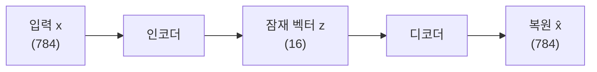

# 오토인코더와 VAE

!!! spec "핵심 논문 · 연도"
    Hinton·Salakhutdinov, "Reducing the Dimensionality of Data with Neural Networks" (2006) · Vincent 외, "Denoising Autoencoders" (2008) · Kingma·Welling, "Auto-Encoding Variational Bayes" (2013, VAE) · Rezende 외 (2014) · van den Oord 외, "VQ-VAE" (2017) · Rombach 외, "Latent Diffusion" (2022) · He 외, "Masked Autoencoders" (2021)

!!! basic "한눈에 보기"
    **오토인코더**는 데이터를 **좁은 통로로 압축했다가 다시 복원**하도록 배우는 신경망입니다. 784픽셀짜리 숫자 그림을 숫자 16개로 줄였다가 다시 784픽셀로 되살리게 하면, 그 16개 숫자에는 "어떤 숫자인지, 얼마나 기울었는지, 획이 굵은지" 같은 핵심만 남습니다. 이 압축된 공간을 **잠재 공간(latent space)**이라고 합니다.

    **VAE(변분 오토인코더)**는 여기서 한 걸음 더 나갑니다. 잠재 공간을 **빈틈없이 매끄럽게** 정리해서, 잠재 공간의 아무 점이나 골라 복원하면 그럴듯한 **새 그림**이 나오게 합니다. 압축기가 생성기가 되는 것입니다.

    오늘날 Stable Diffusion 같은 이미지 생성 모델도 VAE로 이미지를 작은 잠재 공간으로 압축한 뒤 그 안에서 그림을 만듭니다.

## 오토인코더 { .l2 }



손실은 복원 오차 \(\|\mathbf{x} - \hat{\mathbf{x}}\|^2\)입니다. 정답 라벨이 필요 없는 비지도(자기 지도) 학습입니다.

| 변형 | 아이디어 | 쓰임 |
|---|---|---|
| 기본 오토인코더 | 병목으로 압축 | 차원 축소, 이상 탐지(복원 오차가 크면 이상) |
| 디노이징 | 잡음 섞인 입력에서 깨끗한 원본 복원 | 잡음 제거, 견고한 특징 |
| 희소 오토인코더 (SAE) | 잠재 벡터의 대부분이 0이 되도록 | LLM 내부 특징 해석 |
| 마스크 오토인코더 (MAE) | 입력 대부분을 가리고 복원 | 비전 사전 학습 |

## VAE: 잠재 공간을 확률 분포로 { .l2 }

기본 오토인코더의 잠재 공간에는 빈 구멍이 많아, 학습 데이터에서 나온 점이 아닌 곳을 복원하면 엉터리가 나옵니다. VAE는 인코더가 점 하나 대신 **분포**(평균 μ, 표준편차 σ)를 내게 하고, 그 분포가 표준 정규 분포 \(\mathcal{N}(0, I)\)에 가깝도록 벌점을 줍니다.

\[
\mathcal{L} = \underbrace{\mathbb{E}_{q(\mathbf{z}\mid\mathbf{x})}\big[-\log p(\mathbf{x}\mid\mathbf{z})\big]}_{\text{복원 오차}} + \underbrace{D_{\mathrm{KL}}\big(q(\mathbf{z}\mid\mathbf{x})\,\|\,\mathcal{N}(0, I)\big)}_{\text{잠재 공간 정리}}
\]

두 항은 서로 당깁니다. 복원 항은 데이터마다 잠재 영역을 따로 차지하려 하고, KL 항은 모두를 원점 근처로 모으려 합니다. 그 결과 잠재 공간이 겹치지도 비지도 않게 매끄럽게 채워집니다. 생성할 때는 \(\mathbf{z}\sim\mathcal{N}(0, I)\)를 뽑아 디코더에 넣습니다.

**재매개변수화 트릭**: 무작위 샘플링은 미분할 수 없으므로 \(\mathbf{z} = \boldsymbol{\mu} + \boldsymbol{\sigma}\odot\boldsymbol{\epsilon}\), \(\boldsymbol{\epsilon}\sim\mathcal{N}(0, I)\)로 바꿔 μ와 σ로 기울기가 흐르게 합니다.

## 생성 모델 비교 { .l2 }

| 모델 | 학습 | 샘플 품질 | 샘플 속도 | 잠재 공간 |
|---|---|---|---|---|
| VAE | 안정적 (하나의 손실) | 흐릿한 경향 | 빠름 (한 번) | 의미 있고 매끄러움 |
| GAN | 불안정 (적대적) | 선명 | 빠름 (한 번) | 있음 (덜 정돈) |
| 확산 모델 | 안정적 | 매우 좋음 | 느림 (수십 단계) | 잡음 공간 |
| 자기회귀 (LLM식) | 안정적 | 좋음 | 토큰 수만큼 | 없음 (토큰 순서) |

## 코드로 보기 { .l2 }

2차원 잠재 공간을 가진 작은 VAE의 구조와 손실입니다(입력은 무작위 데이터로 모양만 확인).

```python
import torch
import torch.nn as nn
import torch.nn.functional as F

class VAE(nn.Module):
    def __init__(self, d_in=784, d_h=256, d_z=2):
        super().__init__()
        self.enc = nn.Sequential(nn.Linear(d_in, d_h), nn.ReLU())
        self.mu, self.logvar = nn.Linear(d_h, d_z), nn.Linear(d_h, d_z)
        self.dec = nn.Sequential(nn.Linear(d_z, d_h), nn.ReLU(), nn.Linear(d_h, d_in))

    def forward(self, x):
        h = self.enc(x)
        mu, logvar = self.mu(h), self.logvar(h)
        z = mu + torch.exp(0.5 * logvar) * torch.randn_like(mu)    # 재매개변수화
        return self.dec(z), mu, logvar

def vae_loss(x, logits, mu, logvar):
    recon = F.binary_cross_entropy_with_logits(logits, x, reduction="sum") / len(x)
    kl = -0.5 * torch.sum(1 + logvar - mu ** 2 - logvar.exp()) / len(x)   # 가우시안 KL 닫힌 식
    return recon + kl, recon, kl

torch.manual_seed(0)
model = VAE()
x = torch.rand(32, 784)                                  # 픽셀 0–1 (가짜 데이터)
logits, mu, logvar = model(x)
total, recon, kl = vae_loss(x, logits, mu, logvar)
print(logits.shape, mu.shape, f"recon={recon.item():.1f} kl={kl.item():.3f}")

new_images = torch.sigmoid(model.dec(torch.randn(5, 2)))  # 생성: 잠재 공간에서 뽑아 복원
print(new_images.shape)
```

MNIST로 학습하면 2차원 잠재 공간에 숫자들이 영역을 나눠 자리 잡고, 그 사이를 따라 이동하면 숫자가 서서히 다른 숫자로 바뀌는 것을 볼 수 있습니다.

??? expert "전문가 노트 — ELBO, 사후 붕괴, VQ-VAE와 잠재 확산, 희소 오토인코더"
    **ELBO.** VAE 손실의 부호를 뒤집은 것은 로그 우도의 하한 \(\log p(\mathbf{x}) \ge \mathbb{E}_q[\log p(\mathbf{x}\mid\mathbf{z})] - D_{\mathrm{KL}}(q(\mathbf{z}\mid\mathbf{x})\|p(\mathbf{z}))\)입니다(evidence lower bound). 간극은 \(D_{\mathrm{KL}}(q(\mathbf{z}\mid\mathbf{x})\|p(\mathbf{z}\mid\mathbf{x}))\), 즉 인코더가 진짜 사후 분포를 얼마나 잘 근사하느냐입니다.

    **흐릿함과 사후 붕괴.** 픽셀별 가우시안 복원 손실은 여러 가능성의 평균을 내므로 흐릿한 이미지가 나옵니다. 디코더가 너무 강력하면(예: 자기회귀 디코더) 잠재 변수를 무시하고 KL을 0으로 만드는 **사후 붕괴**가 생기며, KL 가중치를 0에서 서서히 올리는(annealing) 방법, β-VAE 등이 대응책입니다.

    **VQ-VAE와 잠재 확산.** VQ-VAE는 연속 잠재 대신 학습된 코드북의 이산 코드를 써서, 이미지를 "토큰"으로 바꿔 트랜스포머로 생성할 수 있게 했습니다. Latent Diffusion(Stable Diffusion)은 512×512×3 이미지를 64×64×4 잠재로 압축하는 오토인코더(KL 정규화 + 지각·적대적 손실)를 먼저 학습하고, 확산 모델은 이 잠재 공간에서만 돌려 계산을 약 48배 줄였습니다 → [확산 모델](diffusion.md).

    **희소 오토인코더와 해석 가능성.** LLM 은닉 상태를 수십만–수백만 차원의 희소한 잠재로 펼치는 SAE를 학습하면, 각 잠재 차원이 "금문교", "코드의 버그", "아첨" 같은 사람이 이해할 수 있는 개념에 대응하는 경우가 많습니다(Anthropic 2023–2024 등). 모델 내부를 들여다보는 주요 도구가 되었습니다 → [정렬과 AI 안전](../society/safety.md).

## 관련 페이지

- [군집과 차원 축소](../ml/unsupervised.md) — PCA와 오토인코더
- [정보이론](../math/information.md) — KL 발산
- [GAN](gan.md), [확산 모델](diffusion.md) — 다른 생성 모델
