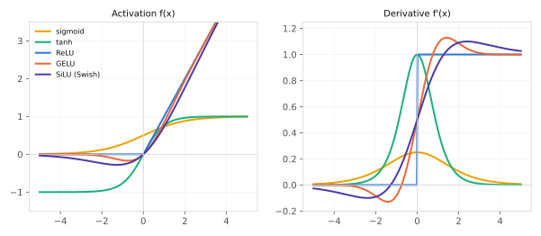

# 활성화 함수

!!! spec "핵심 논문 · 연도"
    Nair·Hinton, "Rectified Linear Units Improve Restricted Boltzmann Machines" (2010) · Glorot·Bordes·Bengio, "Deep Sparse Rectifier Neural Networks" (2011) · Hendrycks·Gimpel, "GELU" (2016) · Ramachandran 외, "Searching for Activation Functions" (2017, Swish) · Shazeer, "GLU Variants Improve Transformer" (2020, SwiGLU)

!!! basic "한눈에 보기"
    활성화 함수는 뉴런의 출력을 **구부리는** 함수입니다. 이것이 없으면 층을 100개 쌓아도 직선 하나와 같습니다. 직선을 곱하고 더하면 여전히 직선이기 때문입니다.

    - 옛날에는 0–1 사이로 부드럽게 눌러 주는 **시그모이드**를 썼습니다. 그런데 층이 깊어지면 기울기가 점점 작아져 앞쪽 층이 학습되지 않았습니다.
    - 2010년 무렵부터 "음수면 0, 양수면 그대로"인 **ReLU**가 표준이 되었습니다. 단순하고 빠르며 기울기가 잘 전달됩니다.
    - 지금의 트랜스포머는 ReLU를 부드럽게 다듬은 **GELU**나, 게이트를 더한 **SwiGLU**를 주로 씁니다.

<figure markdown>

<figcaption>왼쪽은 함수, 오른쪽은 도함수입니다. 시그모이드의 기울기는 최대 0.25라 층을 지날 때마다 기울기가 4분의 1 이하로 줄어듭니다. ReLU는 양수 구간에서 기울기가 정확히 1입니다. GELU와 SiLU는 0 근처에서 부드럽고 음수 쪽에 작은 값을 남깁니다.</figcaption>
</figure>

## 주요 활성화 함수 { .l2 }

| 함수 | 식 | 출력 범위 | 장점 | 단점 | 주로 쓰는 곳 |
|---|---|---|---|---|---|
| 시그모이드 | \(\frac{1}{1+e^{-x}}\) | (0, 1) | 확률로 해석 | 기울기 소실, 출력이 0 중심 아님 | 이진 출력, 게이트 |
| tanh | \(\frac{e^x-e^{-x}}{e^x+e^{-x}}\) | (−1, 1) | 0 중심 | 기울기 소실 | RNN·LSTM |
| ReLU | \(\max(0, x)\) | [0, ∞) | 빠름, 기울기 1 | 음수에서 기울기 0 (죽은 뉴런) | CNN, MLP |
| Leaky ReLU | \(\max(0.01x, x)\) | (−∞, ∞) | 죽은 뉴런 완화 | 기울기 하나 더 정해야 함 | GAN 판별자 |
| GELU | \(x\,\Phi(x)\) | ≈[−0.17, ∞) | 부드러움, 트랜스포머에서 성능 좋음 | 계산 약간 비쌈 | BERT, GPT-2/3, ViT |
| SiLU (Swish) | \(x\,\sigma(x)\) | ≈[−0.28, ∞) | 부드러움 | 계산 약간 비쌈 | EfficientNet, SwiGLU 안 |
| softmax | \(\frac{e^{x_i}}{\sum_j e^{x_j}}\) | 합이 1 | 다중 분류 확률 | — | 출력층, 어텐션 |

\(\Phi\)는 표준 정규 분포의 누적 분포 함수입니다. GELU는 "입력이 클수록 통과시킬 확률이 높은" 확률적 게이트의 기댓값으로 해석됩니다.

## 기울기 소실 { .l2 }

역전파는 층마다 활성화 함수의 도함수를 곱합니다. 시그모이드의 도함수는 최대 0.25이므로 10층을 지나면 기울기가 최대 \(0.25^{10} \approx 10^{-6}\)배로 줄어듭니다. 앞쪽 층은 거의 학습되지 않습니다. ReLU는 양수 구간에서 도함수가 1이라 이 문제가 크게 줄었고, 이것이 깊은 신경망을 학습할 수 있게 된 핵심 요인 중 하나입니다.

## 게이트형 FFN: SwiGLU { .l2 }

최근 LLM(LLaMA 계열 등)의 FFN은 활성화 함수 하나 대신 **게이트**를 씁니다.

\[
\text{SwiGLU}(\mathbf{x}) = W_2\big(\text{SiLU}(W_1\mathbf{x}) \odot W_3\mathbf{x}\big)
\]

한쪽 경로(\(W_3\mathbf{x}\))의 값을 다른 경로(\(\text{SiLU}(W_1\mathbf{x})\))가 원소별로 얼마나 통과시킬지 정합니다. 같은 파라미터 수에서 GELU FFN보다 언어 모델 손실이 일관되게 낮게 나와 널리 채택되었습니다. 행렬이 3개라 은닉 차원은 4d 대신 약 \(\frac{8}{3}d\)로 잡습니다.

## 코드로 보기 { .l2 }

같은 깊은 MLP(20층)에서 시그모이드와 ReLU를 쓸 때 첫 층까지 전달되는 기울기 크기를 비교합니다.

```python
import torch
import torch.nn as nn

def first_layer_grad(act, depth=20, width=64):
    torch.manual_seed(0)
    layers = []
    for _ in range(depth):
        lin = nn.Linear(width, width)
        if act in (nn.ReLU, nn.GELU):
            nn.init.kaiming_normal_(lin.weight)      # ReLU 계열에 맞는 He 초기화
        else:
            nn.init.xavier_normal_(lin.weight)       # 시그모이드·tanh에 맞는 Xavier 초기화
        layers += [lin, act()]
    net = nn.Sequential(*layers, nn.Linear(width, 1))
    x = torch.randn(256, width)
    net(x).pow(2).mean().backward()
    return net[0].weight.grad.norm().item(), net[-1].weight.grad.norm().item()

for act in (nn.Sigmoid, nn.Tanh, nn.ReLU, nn.GELU):
    first, last = first_layer_grad(act)
    print(f"{act.__name__:8s} 첫 층 기울기={first:.2e}  마지막 층 기울기={last:.2e}")
```

시그모이드는 첫 층 기울기가 마지막 층보다 약 \(10^{13}\)배 작아져 사실상 0입니다. tanh·ReLU는 한 자릿수(약 10–20배) 차이, GELU는 거의 같은 크기를 유지합니다. 각 활성화에 맞는 초기화를 썼다는 점에도 주목하세요. 초기화가 맞지 않으면 ReLU 계열도 기울기가 크게 줄어듭니다.

??? expert "전문가 노트 — 죽은 ReLU, 활성값 이상치, 부드러움과 최적화"
    **죽은 ReLU.** 큰 학습률이나 나쁜 초기화로 어떤 뉴런의 입력이 모든 샘플에서 음수가 되면 기울기가 영원히 0이 되어 회복되지 않습니다. 학습 후 뉴런의 상당 비율이 죽어 있는 경우도 있습니다. Leaky ReLU, GELU, 적절한 초기화와 정규화가 완화책입니다.

    **활성값 이상치.** 대형 트랜스포머에서는 특정 채널(차원)에 다른 값보다 수십–수백 배 큰 활성값이 체계적으로 나타납니다(Dettmers 외 2022, LLM.int8()). 이 이상치가 INT8 양자화를 어렵게 만드는 주원인이며, SmoothQuant 같은 기법은 이 큰 값을 가중치 쪽으로 옮겨 균형을 맞춥니다 → [양자화와 경량화](../systems/quantization.md).

    **부드러움.** GELU·SiLU는 2차 미분이 연속이라 손실 지형이 더 부드럽고, 큰 모델에서 ReLU보다 약간 좋은 결과를 냅니다. 다만 차이는 보통 크지 않으며, 추론 효율을 위해 ReLU로 되돌리면 활성값이 희소해져(0이 많아져) 계산을 건너뛸 수 있다는 연구도 있습니다(ReLU Strikes Back, 2023).

    **softmax의 포화.** 어텐션 softmax 입력이 커지면 거의 원-핫이 되어 기울기가 사라집니다. √d_k 스케일, QK-norm, 로짓 상한(soft-capping)이 이를 막습니다 → [트랜스포머](../arch/transformer.md).

## 관련 페이지

- [퍼셉트론과 MLP](mlp.md)
- [초기화와 학습 안정성](training-stability.md) — 활성화에 맞는 초기화 (Xavier, He)
- [트랜스포머](../arch/transformer.md) — FFN과 SwiGLU
