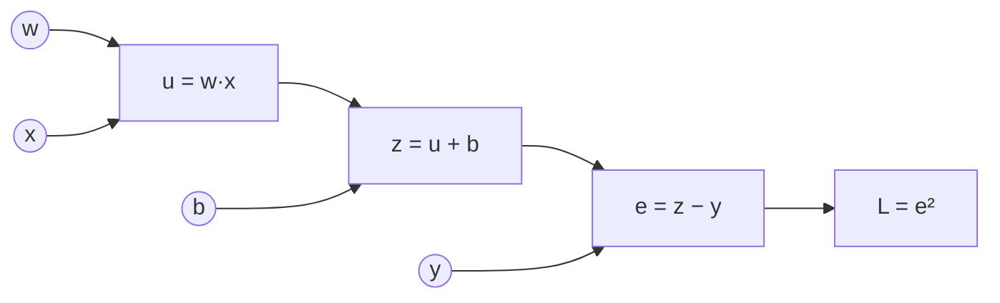

# 역전파

!!! spec "핵심 논문 · 연도"
    Linnainmaa (1970, 역방향 자동 미분) · Werbos (1974, 박사 논문) · Rumelhart·Hinton·Williams, "Learning representations by back-propagating errors" (Nature, 1986) · Griewank·Walther, *Evaluating Derivatives* (2008) · Chen 외, "Training Deep Nets with Sublinear Memory Cost" (2016, 그래디언트 체크포인팅)

!!! basic "한눈에 보기"
    공장에서 불량품이 나왔다고 합시다. 마지막 공정에서 "내 탓이 얼마인가"를 계산하고, 그 책임을 바로 앞 공정에 넘기고, 앞 공정은 다시 자기 몫을 계산해 그 앞에 넘깁니다. 이렇게 **출력에서 입력 쪽으로 책임(기울기)을 거꾸로 전달**하는 것이 **역전파**입니다.

    - **순전파**: 입력 → 층1 → 층2 → … → 출력 → 손실. 계산하면서 중간값을 저장해 둡니다.
    - **역전파**: 손실 → … → 층2 → 층1. 저장한 중간값과 연쇄 법칙으로 각 파라미터의 기울기를 구합니다.

    역전파 한 번으로 **모든 파라미터의 기울기를 한꺼번에** 얻습니다. 파라미터가 수십억 개여도 비용은 순전파의 약 2배입니다. 이 효율 덕분에 거대한 신경망 학습이 가능해졌습니다.

## 계산 그래프로 보기 { .l2 }

간단한 식 \(L = (wx + b - y)^2\)을 단계로 쪼갭니다.



역전파는 오른쪽 끝에서 \(\partial L/\partial L = 1\)로 시작해 각 노드의 **국소 미분**을 곱하며 왼쪽으로 갑니다.

| 노드 | 국소 미분 | 누적 기울기 |
|---|---|---|
| \(L = e^2\) | \(\partial L/\partial e = 2e\) | \(2e\) |
| \(e = z - y\) | \(\partial e/\partial z = 1\) | \(2e\) |
| \(z = u + b\) | \(\partial z/\partial u = 1\), \(\partial z/\partial b = 1\) | \(\partial L/\partial b = 2e\) |
| \(u = w\cdot x\) | \(\partial u/\partial w = x\) | \(\partial L/\partial w = 2e\cdot x\) |

규칙은 단순합니다. **덧셈 노드는 기울기를 그대로 나눠 주고, 곱셈 노드는 상대편 값을 곱해 줍니다.** 하나의 값이 여러 곳에 쓰였다면 돌아오는 기울기를 **더합니다**.

## 층 단위 역전파 { .l2 }

선형 층 \(Y = XW\) (X: B × d_in, W: d_in × d_out)에서 위에서 내려온 기울기가 \(G = \partial L/\partial Y\)일 때:

\[
\frac{\partial L}{\partial W} = X^\top G
\qquad
\frac{\partial L}{\partial X} = G\,W^\top
\]

두 기울기 모두 행렬 곱 하나씩이므로, 역전파의 계산량은 순전파(행렬 곱 하나)의 약 2배입니다. 학습 한 스텝 = 순전파 1 + 역전파 2 ≈ **3배**, 그래서 트랜스포머 학습이 토큰당 약 6N FLOPs(순전파 2N의 3배)입니다.

## 메모리: 활성값 저장 { .l2 }

\(\partial L/\partial W = X^\top G\)를 계산하려면 순전파 때의 입력 X가 필요합니다. 그래서 순전파 중 모든 층의 중간값(**활성값**)을 메모리에 보관합니다. 큰 모델 학습에서 GPU 메모리를 가장 많이 차지하는 것은 종종 파라미터가 아니라 이 활성값입니다.

| 메모리 항목 | 크기 (파라미터 N개, 혼합 정밀도 + Adam 기준) |
|---|---|
| 파라미터 (BF16) | 2N 바이트 |
| 기울기 (BF16) | 2N 바이트 |
| Adam 상태 + FP32 마스터 가중치 | 12N 바이트 |
| 활성값 | 배치 × 문맥 길이 × 층 수 × d에 비례 |

7B 모델이면 활성값을 빼고도 약 16 × 7 = 112 GB가 필요해, GPU 한 장(80 GB)에 들어가지 않습니다 → [분산 학습](../systems/distributed.md).

## 코드로 보기 { .l2 }

위 표의 손 계산과 PyTorch 자동 미분을 비교하고, 2층 MLP의 역전파를 NumPy로 직접 구현해 PyTorch와 맞춰 봅니다.

```python
import numpy as np
import torch

# 1) 손 계산 vs autograd
w, b = torch.tensor(2.0, requires_grad=True), torch.tensor(0.5, requires_grad=True)
x, y = 3.0, 4.0
L = (w * x + b - y) ** 2
L.backward()
e = 2.0 * 3.0 + 0.5 - 4.0
print(w.grad.item(), 2 * e * x, "|", b.grad.item(), 2 * e)

# 2) 2층 MLP 역전파 직접 구현 (ReLU, MSE)
rng = np.random.default_rng(0)
X = rng.normal(size=(8, 3)); Y = rng.normal(size=(8, 1))
W1 = rng.normal(size=(3, 5)); W2 = rng.normal(size=(5, 1))

H = X @ W1; A = np.maximum(H, 0); P = A @ W2          # 순전파 (중간값 저장)
G = 2 * (P - Y) / len(X)                               # dL/dP (MSE 평균)
dW2 = A.T @ G
dA = G @ W2.T
dH = dA * (H > 0)                                      # ReLU의 역전파
dW1 = X.T @ dH

tW1 = torch.tensor(W1, requires_grad=True); tW2 = torch.tensor(W2, requires_grad=True)
loss = ((torch.relu(torch.tensor(X) @ tW1) @ tW2 - torch.tensor(Y)) ** 2).mean()
loss.backward()
print(np.allclose(dW1, tW1.grad.numpy()), np.allclose(dW2, tW2.grad.numpy()))
```

첫 줄은 `15.0 15.0 | 5.0 5.0`, 둘째 줄은 `True True`입니다.

??? expert "전문가 노트 — 체크포인팅, 그래디언트 누적, 기울기 확인, 역전파의 생물학적 타당성"
    **그래디언트 체크포인팅.** 일부 층의 활성값만 저장하고 나머지는 역전파 때 순전파를 다시 계산합니다. L개 층에서 \(\sqrt{L}\)개마다 저장하면 메모리가 \(O(\sqrt{L})\)로 줄고 계산은 순전파 한 번 분량(약 33%)이 늘어납니다. LLM 학습에서는 트랜스포머 블록 단위나 어텐션 내부만 선택적으로 재계산하는 방식이 흔합니다.

    **그래디언트 누적.** 메모리 때문에 배치를 크게 못 잡으면 작은 배치 여러 번의 기울기를 더한 뒤 한 번 업데이트합니다. 손실을 누적 횟수로 나누는 것을 잊으면 학습률이 그만큼 커진 것과 같습니다. BatchNorm을 쓰는 모델은 통계가 작은 배치 기준이라 완전히 같지는 않습니다.

    **기울기 확인(gradient check).** 직접 역전파를 구현했다면 중앙 차분 \(\frac{f(\theta+h)-f(\theta-h)}{2h}\)와 비교합니다. FP64로, h ≈ 1e-5–1e-6, 상대 오차 1e-7 이하면 정상입니다. ReLU 꺾인 점 근처에서는 오차가 클 수 있습니다. PyTorch는 `torch.autograd.gradcheck`를 제공합니다.

    **생물학적 타당성.** 뇌가 역전파를 그대로 쓰기는 어렵다는 것이 통설입니다(순전파와 같은 가중치를 거꾸로 쓰는 "가중치 대칭" 문제 등). 피드백 정렬, 순전파-순전파(forward-forward), 평형 전파 같은 대안이 연구되지만 대규모에서는 역전파를 따라가지 못하고 있습니다.

## 관련 페이지

- [미분과 경사하강법](../math/calculus.md) — 연쇄 법칙과 자동 미분
- [초기화와 학습 안정성](training-stability.md) — 기울기 소실과 폭주
- [분산 학습](../systems/distributed.md) — 메모리를 여러 GPU에 나누기
