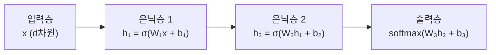

# 퍼셉트론과 MLP

!!! spec "핵심 논문 · 연도"
    McCulloch·Pitts (1943, 인공 뉴런) · Rosenblatt, "The Perceptron" (1958) · Minsky·Papert, *Perceptrons* (1969, XOR 한계) · Cybenko, "Approximation by superpositions of a sigmoidal function" (1989) · Hornik, "Multilayer feedforward networks are universal approximators" (1989/1991)

!!! basic "한눈에 보기"
    **인공 뉴런**은 아주 단순한 계산기입니다. 입력마다 중요도(가중치)를 곱해 더하고, 합이 어느 정도 넘으면 신호를 내보냅니다. "비가 오나(×3), 약속이 있나(×5), 피곤한가(×−4)를 더해서 0보다 크면 외출한다."

    뉴런 하나로는 직선 하나밖에 못 긋습니다. 그래서 뉴런을 **층으로 여러 개** 놓고, 그 층을 **여러 겹** 쌓습니다. 이것이 **MLP(다층 퍼셉트론)**입니다. 앞 층의 뉴런이 "모서리가 있다", "둥글다" 같은 간단한 특징을 잡으면, 뒤 층은 그것들을 조합해 "고양이 귀" 같은 복잡한 개념을 잡습니다.

    층 사이에 **구부리는 함수(활성화 함수)**가 있어야 합니다. 없으면 아무리 쌓아도 직선 하나와 같습니다.

## 뉴런 하나 { .l2 }

\[
y = \sigma\!\left(\sum_{i=1}^{d} w_i x_i + b\right) = \sigma(\mathbf{w}^\top\mathbf{x} + b)
\]

| 부품 | 역할 |
|---|---|
| 가중치 \(w_i\) | 입력 i의 중요도와 방향 |
| 편향 b | 문턱값 (얼마나 쉽게 켜지나) |
| 활성화 \(\sigma\) | 비선형 변환 (계단, 시그모이드, ReLU …) |

활성화가 시그모이드면 뉴런 하나가 곧 [로지스틱 회귀](../ml/linear-models.md)입니다.

## XOR 문제와 은닉층 { .l2 }

XOR(둘 중 하나만 1이면 1)은 직선 하나로 나눌 수 없습니다. 1969년 이 한계가 지적되며 신경망 연구가 침체했지만, **은닉층** 하나를 넣으면 풀립니다. 은닉 뉴런 둘이 각각 OR과 NAND를 계산하고, 출력 뉴런이 둘의 AND를 계산하면 XOR이 됩니다.

| x₁ | x₂ | OR | NAND | AND(OR, NAND) = XOR |
|---|---|---|---|---|
| 0 | 0 | 0 | 1 | 0 |
| 0 | 1 | 1 | 1 | 1 |
| 1 | 0 | 1 | 1 | 1 |
| 1 | 1 | 1 | 0 | 0 |

## MLP의 구조 { .l2 }



| 설계 선택 | 보통의 값 |
|---|---|
| 은닉층 수 (깊이) | 2–4 (MLP 단독), 트랜스포머 블록 안의 FFN은 2층 |
| 은닉 차원 (폭) | 입력의 수 배. 트랜스포머 FFN은 4d |
| 활성화 | ReLU, GELU |
| 출력 | 회귀: 그대로, 분류: softmax |

파라미터 수는 층마다 (입력 차원 × 출력 차원 + 출력 차원)입니다. 784 → 256 → 10 MLP는 \(784\times256 + 256 + 256\times10 + 10 = 203{,}530\)개입니다.

## 보편 근사 정리 { .l2 }

은닉층이 **하나만** 있어도 뉴런이 충분히 많으면 연속 함수를 원하는 정밀도로 근사할 수 있습니다. 다만 "충분히 많은" 뉴런이 기하급수적으로 많을 수 있습니다. **깊게** 쌓으면 같은 함수를 훨씬 적은 뉴런으로 표현할 수 있는 경우가 많고, 이것이 "딥"러닝이 잘 되는 이유 중 하나입니다.

## 코드로 보기 { .l2 }

PyTorch로 XOR을 학습합니다.

```python
import torch
import torch.nn as nn

torch.manual_seed(0)
X = torch.tensor([[0., 0.], [0., 1.], [1., 0.], [1., 1.]])
y = torch.tensor([[0.], [1.], [1.], [0.]])

model = nn.Sequential(nn.Linear(2, 4), nn.Tanh(), nn.Linear(4, 1))   # 은닉 뉴런 4개
opt = torch.optim.Adam(model.parameters(), lr=0.05)
loss_fn = nn.BCEWithLogitsLoss()                  # 시그모이드 + 이진 교차 엔트로피

for step in range(500):
    loss = loss_fn(model(X), y)
    opt.zero_grad(); loss.backward(); opt.step()

print(torch.sigmoid(model(X)).detach().round(decimals=3).squeeze())   # 0, 1, 1, 0 근처
print("파라미터 수:", sum(p.numel() for p in model.parameters()))      # 2*4+4 + 4*1+1 = 17
```

`nn.Tanh()`를 지우고 다시 돌려 보세요. 선형 층 두 개만 남으면 XOR을 풀지 못하고 네 출력이 모두 0.5 근처에 머뭅니다.

??? expert "전문가 노트 — 퍼셉트론 학습 규칙, 깊이의 이점, 폭과 깊이의 균형"
    **퍼셉트론 학습 규칙.** 로젠블랫의 퍼셉트론은 계단 함수를 쓰고, 틀린 샘플마다 \(\mathbf{w} \leftarrow \mathbf{w} + \eta\,y\,\mathbf{x}\)로 고쳤습니다. 데이터가 선형 분리 가능하면 유한 번 안에 수렴함이 증명됐지만(Novikoff 1962), 계단 함수는 미분이 0이라 다층으로 확장할 수 없었습니다. 미분 가능한 시그모이드와 역전파가 그 벽을 넘었습니다.

    **깊이의 이점.** 일부 함수(예: 많은 입력의 패리티, 톱니 함수의 반복 합성)는 깊이 k인 신경망으로는 다항 크기면 되지만 깊이를 줄이면 지수적으로 많은 뉴런이 필요하다는 결과가 있습니다(Telgarsky 2016 등). ReLU 신경망은 입력 공간을 선형 조각으로 나누는데, 층이 깊어질수록 조각 수가 곱으로 늘어납니다.

    **폭과 깊이.** 같은 파라미터 예산에서 너무 깊으면 학습이 불안정하고 병렬화가 어려우며, 너무 얕으면 표현력이 떨어집니다. 트랜스포머 LLM은 경험적으로 \(d_{model}/L\)이 대략 50–200 범위인 설계가 많습니다(예: GPT-2 small 768/12 = 64, GPT-3 175B 12288/96 = 128).

    **MLP의 귀환.** MLP-Mixer(2021)는 어텐션·합성곱 없이 MLP만으로 이미지 분류에서 경쟁력 있는 성능을 냈고, 트랜스포머 파라미터의 2/3도 FFN(MLP)입니다. 구조보다 규모와 데이터가 중요하다는 관점을 뒷받침합니다.

## 관련 페이지

- [역전파](backprop.md) — MLP의 기울기 계산
- [활성화 함수](activations.md)
- [선형 회귀와 로지스틱 회귀](../ml/linear-models.md) — 뉴런 하나와 같은 모델
- [손글씨 숫자 분류 (MNIST)](../practice/mnist.md) — MLP로 실습
