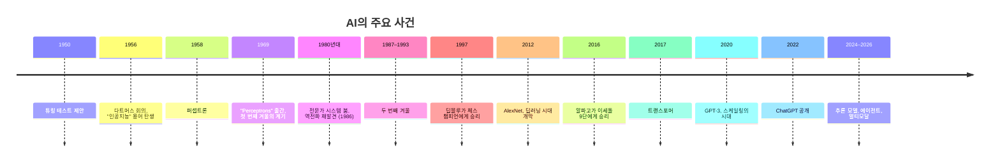

# AI의 역사와 세 번의 봄

!!! spec "핵심 논문 · 연도"
    Turing, "Computing Machinery and Intelligence" (1950) · McCarthy 외, 다트머스 제안서 (1955) · Rosenblatt, "The Perceptron" (1958) · Minsky·Papert, "Perceptrons" (1969) · Rumelhart·Hinton·Williams, "Learning representations by back-propagating errors" (1986) · Krizhevsky·Sutskever·Hinton, "ImageNet Classification with Deep CNNs" (2012, AlexNet) · Vaswani 외, "Attention Is All You Need" (2017)

!!! basic "한눈에 보기"
    AI의 역사는 **기대 → 실망 → 재도전**의 반복입니다. 크게 보면 봄이 세 번, 겨울이 두 번 있었습니다.

    1. **첫 번째 봄 (1956–1973)** — "생각하는 기계"를 규칙과 논리로 만들 수 있다고 믿었습니다. 체스·정리 증명 같은 장난감 문제에서는 잘 됐지만 현실 문제에서는 막혔습니다.
    2. **두 번째 봄 (1980년대)** — 전문가의 지식을 규칙으로 옮긴 **전문가 시스템**이 기업에 팔렸습니다. 규칙을 유지보수하기가 너무 어려워 다시 식었습니다.
    3. **세 번째 봄 (2012–현재)** — 규칙을 사람이 쓰는 대신 **데이터에서 배우는** 신경망이, GPU와 인터넷 규모 데이터를 만나 폭발적으로 성장했습니다. 지금 우리가 쓰는 LLM이 이 흐름의 결과입니다.

    교훈은 하나입니다. **사람이 지식을 직접 넣는 방법보다, 계산과 데이터로 스스로 배우게 하는 방법이 결국 이겼습니다.**

## 연표 { .l2 }

## 첫 번째 봄과 겨울: 기호주의 { .l2 }

1956년 다트머스 여름 연구회에서 존 매카시 등이 "인공지능(Artificial Intelligence)"이라는 이름을 붙였습니다. 당시 주류는 **기호주의(symbolic AI)**로, 지능을 기호와 규칙을 조작하는 일로 보았습니다.

| 성과 | 내용 |
|---|---|
| Logic Theorist (1956) | 수학 정리를 자동으로 증명 |
| ELIZA (1966) | 패턴 매칭만으로 심리 상담사 흉내를 낸 대화 프로그램 |
| 퍼셉트론 (1958) | 데이터에서 가중치를 배우는 최초의 신경망 하드웨어 |

1969년 민스키와 페퍼트는 단층 퍼셉트론이 XOR 같은 간단한 문제도 못 푼다는 것을 보였고, 1973년 영국의 라이트힐 보고서가 AI 연구의 성과를 혹평하면서 연구비가 끊겼습니다. 이것이 **첫 번째 AI 겨울**입니다. 문제는 컴퓨터가 너무 느렸고, 현실의 "상식"을 규칙으로 다 쓸 수 없었다는 점입니다.

## 두 번째 봄과 겨울: 전문가 시스템 { .l2 }

1980년대에는 특정 분야 전문가의 지식을 "만약 ~이면 ~이다" 규칙 수천 개로 옮긴 **전문가 시스템**이 유행했습니다. DEC의 XCON은 컴퓨터 주문 구성을 자동화해 큰 비용을 절약했습니다. 일본은 제5세대 컴퓨터 프로젝트에 막대한 예산을 걸었습니다.

같은 시기 신경망 쪽에서는 1986년 **역전파(backpropagation)**가 널리 알려지며 다층 신경망을 학습할 수 있게 됐습니다. 하지만 데이터와 계산이 부족해 실용화되지 못했습니다.

전문가 시스템은 규칙이 늘수록 서로 충돌하고, 새 상황마다 사람이 규칙을 고쳐야 했습니다. 전용 LISP 머신 시장이 무너지면서 **두 번째 겨울(1987–1993)**이 왔습니다.

## 조용한 성장: 통계적 머신러닝 (1990–2011) { .l2 }

겨울 동안에도 "AI"라는 이름 대신 **머신러닝**이라는 이름으로 연구는 이어졌습니다. SVM, 결정 트리와 랜덤 포레스트, 베이즈 방법 같은 통계적 기법이 스팸 필터, 검색 순위, 추천 시스템에 조용히 들어갔습니다. 1998년 르쿤의 LeNet은 수표의 손글씨 숫자를 읽었고, 2006년 힌턴은 깊은 신경망을 층별로 사전 학습하는 방법을 내놓으며 "딥러닝"이라는 말을 퍼뜨렸습니다.

## 세 번째 봄: 딥러닝과 LLM (2012–) { .l2 }

2012년 이미지 인식 대회 ImageNet에서 **AlexNet**이 2위와 큰 차이로 우승했습니다. 비결은 세 가지가 동시에 갖춰진 것입니다.

| 요소 | 2012년에 달라진 것 |
|---|---|
| 데이터 | ImageNet 약 120만 장의 라벨 붙은 이미지 (인터넷과 크라우드소싱 덕분) |
| 계산 | 게임용 GPU 2장으로 신경망 학습 |
| 알고리즘 | ReLU, 드롭아웃, 깊은 CNN |

이후 음성 인식, 번역, 바둑(2016 알파고)까지 딥러닝이 차례로 기존 방법을 넘어섰습니다. 2017년 **트랜스포머**가 나오고, 2018년 BERT와 GPT가 "대량의 텍스트로 사전 학습한 뒤 조금 미세 조정한다"는 방식을 정착시켰습니다. 2020년 GPT-3는 모델을 크게 키우면 예시 몇 개만 보여 줘도 새 과제를 푸는 능력이 생긴다는 것을 보였고, 2022년 11월 ChatGPT가 공개되면서 AI는 연구실 밖 일상 도구가 되었습니다.

2024년 이후에는 답하기 전에 길게 생각하는 **추론 모델**, 도구를 쓰고 여러 단계를 스스로 진행하는 **에이전트**, 텍스트·이미지·음성을 함께 다루는 **멀티모달 모델**이 중심이 되었습니다 (2026년 11월 기준).

??? expert "전문가 노트 — '쓰라린 교훈'과 역사를 읽는 관점"
    **쓰라린 교훈(The Bitter Lesson).** 강화 학습 연구자 리처드 서턴은 2019년 짧은 글에서 "70년 AI 연구의 가장 큰 교훈은, 계산을 활용하는 일반적인 방법이 결국 가장 효과적이었다는 것"이라고 썼습니다. 체스·바둑·음성·비전 모두 사람의 지식을 정교하게 넣은 방법이 단기적으로 이겼지만, 탐색과 학습을 규모로 밀어붙인 방법이 장기적으로 이겼습니다. 스케일링 법칙([사전 학습과 스케일링 법칙](../llm/pretraining.md))은 이 관찰을 정량화한 것으로 볼 수 있습니다.

    **연결주의 대 기호주의.** 신경망(연결주의)과 규칙·논리(기호주의)의 대립은 지금도 이어집니다. LLM이 도구 호출로 계산기·코드 실행기·검색을 쓰는 것은 두 전통의 결합으로 볼 수도 있습니다.

    **겨울의 원인은 기술보다 기대.** 두 번의 겨울 모두 기술 자체의 실패보다 **과장된 약속과 실제 성능의 격차**가 연구비 삭감으로 이어진 결과였습니다. 현재의 투자 규모를 평가할 때도 같은 관점이 유용합니다. 다만 지금은 이미 수억 명이 매일 쓰는 제품이 있다는 점이 과거와 다릅니다.

    **하드웨어가 알고리즘을 고른다.** 사라 후커의 "하드웨어 복권(The Hardware Lottery, 2020)"은 어떤 아이디어가 성공하는지가 당시 하드웨어와 얼마나 잘 맞는지에 크게 좌우된다고 지적합니다. 신경망은 GPU의 행렬 곱과 잘 맞았기 때문에 이겼다고도 볼 수 있습니다 → [GPU와 행렬 연산](../systems/gpu.md).

## 관련 페이지

- [AI·머신러닝·딥러닝·생성형 AI](landscape.md) — 용어 정리
- [퍼셉트론과 MLP](../dl/mlp.md) — XOR 문제와 다층 신경망
- [CNN](../arch/cnn.md) — LeNet과 AlexNet
- [트랜스포머](../arch/transformer.md) — 세 번째 봄의 엔진
- [핵심 논문 연표](../reference/papers.md) — 연도별 논문 목록
