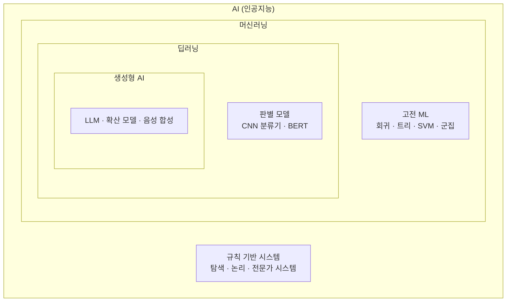

# AI·머신러닝·딥러닝·생성형 AI

!!! spec "핵심 논문 · 연도"
    Samuel, "Some Studies in Machine Learning Using the Game of Checkers" (1959, "머신러닝" 용어) · Mitchell, *Machine Learning* (1997, 학습의 정의) · LeCun·Bengio·Hinton, "Deep learning" (Nature, 2015) · Goodfellow 외, "Generative Adversarial Nets" (2014) · Bommasani 외, "On the Opportunities and Risks of Foundation Models" (2021, "파운데이션 모델" 용어)

!!! basic "한눈에 보기"
    네 용어는 **양파 껍질**처럼 안쪽으로 갈수록 좁아집니다.

    1. **AI (인공지능)** — 사람이 지능을 써서 하는 일을 기계가 하게 만드는 모든 시도. 규칙을 손으로 짠 프로그램도 포함됩니다.
    2. **머신러닝** — 그중 규칙을 사람이 쓰지 않고 **데이터에서 배우는** 방법.
    3. **딥러닝** — 그중 **여러 층의 신경망**으로 배우는 방법.
    4. **생성형 AI** — 딥러닝 모델 중 분류·예측을 넘어 글·그림·음성·코드를 **새로 만들어 내는** 모델. LLM이 대표입니다.

    전통적 프로그래밍은 "규칙 + 데이터 → 답"이고, 머신러닝은 "데이터 + 답 → 규칙"입니다.

## 포함 관계 { .l2 }

## 전통적 프로그래밍과 머신러닝 { .l2 }

| 항목 | 전통적 프로그래밍 | 머신러닝 |
|---|---|---|
| 사람이 주는 것 | 규칙 (코드) | 데이터와 정답 예시 |
| 컴퓨터가 만드는 것 | 답 | 규칙 (모델 파라미터) |
| 잘 맞는 문제 | 규칙을 명확히 쓸 수 있는 문제 (세금 계산, 정렬) | 규칙을 말로 쓰기 어려운 문제 (얼굴 인식, 번역) |
| 틀렸을 때 | 버그를 찾아 코드 수정 | 데이터·모델·학습 방법을 바꿔 다시 학습 |
| 동작 보장 | 논리적으로 검증 가능 | 통계적으로만 평가 가능 (테스트셋 정확도) |

## 머신러닝과 딥러닝의 차이 { .l2 }

고전 머신러닝은 사람이 **특징(feature)**을 먼저 설계해야 했습니다. 예를 들어 스팸 필터라면 "‘무료’라는 단어 개수", "링크 개수" 같은 숫자를 사람이 뽑아 모델에 넣었습니다. 딥러닝은 원본 데이터(픽셀, 글자, 파형)를 그대로 넣으면 **층을 거치며 특징을 스스로 만듭니다**. 이것을 **표현 학습(representation learning)**이라고 합니다.

| 항목 | 고전 머신러닝 | 딥러닝 |
|---|---|---|
| 특징 | 사람이 설계 | 모델이 학습 |
| 데이터 양 | 수백–수십만 개로도 충분 | 많을수록 계속 좋아짐 |
| 계산 | CPU로 충분 | GPU·NPU 필요 |
| 해석 | 비교적 쉬움 (트리, 계수) | 어려움 |
| 강한 분야 | 표 형식 데이터 (금융, 센서 로그) | 이미지, 음성, 텍스트 |

표 형식(엑셀 같은) 데이터에서는 지금도 그래디언트 부스팅 트리가 딥러닝보다 나은 경우가 많습니다 → [결정 트리와 앙상블](../ml/trees.md).

## 판별 모델과 생성 모델 { .l2 }

| 구분 | 배우는 것 | 예 |
|---|---|---|
| 판별 모델 | 입력 x가 주어졌을 때 라벨 y의 확률 \(p(y \mid x)\) | 스팸 분류, 이미지 분류, 감정 분석 |
| 생성 모델 | 데이터 자체의 분포 \(p(x)\) 또는 \(p(x \mid \text{조건})\) | LLM, 이미지 생성, 음성 합성 |

LLM은 "앞 글자들이 주어졌을 때 다음 토큰의 확률"을 배우는 생성 모델입니다. 그런데 이 확률을 잘 배우면 분류·요약·번역·코딩까지 대부분의 과제를 "글 이어 쓰기"로 풀 수 있게 되어, 하나의 모델이 여러 일을 하는 **파운데이션 모델(foundation model)**이 되었습니다.

## 자주 섞어 쓰는 용어 { .l2 }

| 용어 | 뜻 |
|---|---|
| 모델 | 학습으로 정해진 숫자(파라미터)와 그 계산 구조. "가중치 파일 + 코드" |
| 파라미터 | 모델 안의 학습되는 숫자. "7B 모델" = 파라미터 70억 개 |
| 학습 (training) | 데이터로 파라미터를 정하는 과정. 비싸고 한 번 (또는 가끔) 한다 |
| 추론 (inference) | 학습된 모델로 새 입력에 답을 내는 과정. 서비스할 때 매번 한다 |
| LLM | 대규모 언어 모델. 보통 수십억 개 이상 파라미터의 트랜스포머 |
| 파운데이션 모델 | 넓은 데이터로 사전 학습해 여러 과제에 적응시킬 수 있는 큰 모델 |
| 에이전트 | 모델이 도구를 쓰고 여러 단계를 스스로 계획·실행하는 시스템 |
| AGI | 사람이 할 수 있는 대부분의 지적 작업을 해내는 범용 AI (정의가 합의되지 않음) |

??? expert "전문가 노트 — 학습의 정의, 귀납 편향, '공짜 점심은 없다'"
    **미첼의 정의.** "어떤 작업 T에 대해 경험 E로부터 학습해 성능 척도 P가 좋아지면, 그 프로그램은 학습한다고 말한다." 이 정의 덕분에 머신러닝 문제는 언제나 **(작업, 데이터, 평가 지표)** 세 가지를 명확히 정하는 것에서 시작합니다. 평가 지표를 잘못 고르면 모델은 엉뚱한 것을 최적화합니다 → [평가 지표와 검증](../ml/evaluation.md).

    **귀납 편향.** 유한한 데이터로 보지 못한 입력을 맞히려면 모델에 어떤 가정이 들어가야 합니다. 선형 모델은 "관계가 직선", CNN은 "가까운 픽셀끼리 관련 있고 위치가 바뀌어도 같은 물체", RNN은 "순서가 중요"라는 가정을 품습니다. 트랜스포머는 이런 가정이 약해서 데이터가 적으면 불리하지만, 데이터가 많아질수록 유리해집니다.

    **공짜 점심은 없다 (No Free Lunch).** 모든 가능한 문제에 대해 평균을 내면 어떤 학습 알고리즘도 다른 알고리즘보다 낫지 않다는 정리입니다(Wolpert 1996). 실제로는 현실 세계의 문제가 특정 구조(매끄러움, 계층성, 지역성)를 갖기 때문에 좋은 귀납 편향을 가진 모델이 이깁니다.

    **"AI"라는 말의 이동.** 어떤 기술이 잘 작동하게 되면 더 이상 AI라고 부르지 않는 경향을 "AI 효과"라고 합니다. 문자 인식, 경로 탐색, 스팸 필터가 그런 예입니다.

## 관련 페이지

- [AI의 역사와 세 번의 봄](history.md)
- [지도·비지도·강화 학습](../ml/paradigms.md) — 머신러닝의 세 갈래
- [임베딩과 표현 학습](../arch/embeddings.md) — 딥러닝이 특징을 만드는 방식
- [사전 학습과 스케일링 법칙](../llm/pretraining.md) — 파운데이션 모델은 어떻게 만들어지나
