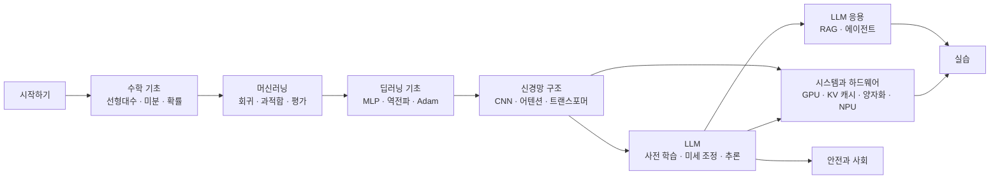

# 학습 로드맵

!!! basic "한눈에 보기"
    수준과 목적에 따라 읽는 순서를 추천합니다. 각 페이지 안에서도 기초 → 중급 → 전문가 순서로 깊어지므로,
    처음에는 기초 부분(한눈에 보기)만 읽고 넘어가도 됩니다.

## 경로 1 — 처음 공부하는 사람 { .l1 }

목표: ChatGPT 같은 AI가 무엇을 배우고 어떻게 답하는지 큰 그림 잡기. 수식은 건너뛰어도 됩니다.

1. [AI의 역사와 세 번의 봄](history.md) → [AI·머신러닝·딥러닝·생성형 AI](landscape.md)
2. [지도·비지도·강화 학습](../ml/paradigms.md) → [과적합과 정규화](../ml/overfitting.md)
3. [퍼셉트론과 MLP](../dl/mlp.md) → [역전파](../dl/backprop.md) (한눈에 보기만)
4. [임베딩과 표현 학습](../arch/embeddings.md) → [어텐션](../arch/attention.md) → [트랜스포머](../arch/transformer.md)
5. [토큰화](../llm/tokenization.md) → [사전 학습과 스케일링 법칙](../llm/pretraining.md) → [선호 학습 (RLHF·DPO)](../llm/alignment-training.md)
6. [프롬프트 설계](../llm/prompting.md) → [RAG](../apps/rag.md) → [에이전트와 도구 사용](../apps/agents.md)
7. [정렬과 AI 안전](../society/safety.md) → [저작권과 개인정보](../society/copyright-privacy.md)

## 경로 2 — 개발자 (AI 기능을 제품에 넣고 싶은 사람) { .l2 }

목표: LLM API와 오픈 모델을 골라 쓰고, RAG·에이전트를 설계하고, 품질을 측정하기

1. 경로 1의 4–5단계
2. [LLM API 쓰기](../practice/llm-api.md) → [프롬프트 설계](../llm/prompting.md) → [추론 모델과 사고 사슬](../llm/reasoning.md)
3. [임베딩과 표현 학습](../arch/embeddings.md) → [RAG](../apps/rag.md) → [에이전트와 도구 사용](../apps/agents.md) → [코딩 어시스턴트](../apps/coding.md)
4. [평가와 벤치마크](../apps/evaluation.md) → [평가 지표와 검증](../ml/evaluation.md)
5. [미세 조정 (SFT·LoRA)](../llm/finetuning.md) → [오픈 웨이트 모델](../next/open-weights.md) → [로컬 LLM 실행](../practice/local-llm.md)
6. [추론 최적화](../systems/inference.md) → [양자화와 경량화](../systems/quantization.md) (비용·지연 시간)

## 경로 3 — ML 엔지니어·연구자 지망 { .l2 }

목표: 모델을 직접 학습하고, 논문을 읽고 재현하기

1. 수학 기초 전체 → 머신러닝 전체 → 딥러닝 기초 전체
2. 신경망 구조 전체 (특히 [어텐션](../arch/attention.md), [트랜스포머](../arch/transformer.md), [확산 모델](../arch/diffusion.md))
3. LLM 전체 (각 페이지의 전문가 노트 포함)
4. 실습: [MNIST](../practice/mnist.md) → [작은 트랜스포머 직접 만들기](../practice/mini-transformer.md)
5. [논문과 모델 카드 읽는 법](reading-papers.md) → [핵심 논문 연표](../reference/papers.md)의 논문을 순서대로

## 경로 4 — 시스템·반도체·임베디드 엔지니어 { .l3 }

목표: AI 워크로드가 하드웨어에 무엇을 요구하는지 이해하고, 칩·메모리·시스템 설계에 연결하기

1. [벡터·행렬·텐서](../math/linear-algebra.md) → [퍼셉트론과 MLP](../dl/mlp.md) → [역전파](../dl/backprop.md)
2. [CNN](../arch/cnn.md) → [트랜스포머](../arch/transformer.md) (파라미터·연산량 어림하기, KV 캐시 전문가 노트)
3. [GPU와 행렬 연산](../systems/gpu.md) → [분산 학습](../systems/distributed.md) → [추론 최적화](../systems/inference.md)
4. [양자화와 경량화](../systems/quantization.md) → [NPU와 온디바이스 AI](../systems/npu.md) → [AI 반도체와 메모리 (HBM)](../systems/ai-chips.md)
5. [MoE](../llm/moe.md) → [긴 문맥과 메모리](../llm/long-context.md) (메모리 대역폭·용량 요구가 바뀌는 지점)
6. 실습: [로컬 LLM 실행 (라즈베리파이 포함)](../practice/local-llm.md)

## 공부 팁 { .l2 }

| 팁 | 이유 |
|---|---|
| 코드를 직접 돌린다 | 행렬 크기(shape)를 출력해 보면 수식이 갑자기 이해됨 |
| 작은 것부터 학습시켜 본다 | 노트북 CPU로도 MNIST·작은 트랜스포머는 몇 분이면 학습됨 |
| 수식은 차원부터 맞춘다 | (B, T, d) 같은 텐서 모양을 따라가면 대부분의 구조가 보임 |
| 최신 동향은 기준 시점을 본다 | 6개월이면 "최신 모델" 목록이 바뀜 |
| LLM에게 질문한다 | 이해 안 되는 수식을 단계별로 풀어 달라고 하되, 결과는 원 논문으로 확인 |
