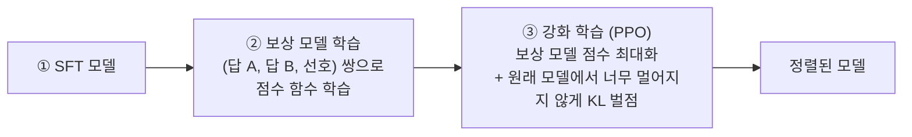

# 선호 학습 (RLHF·DPO)

!!! spec "핵심 논문 · 연도"
    Christiano 외, "Deep RL from Human Preferences" (2017) · Stiennon 외, "Learning to summarize from human feedback" (2020) · Ouyang 외, "InstructGPT" (2022) · Bai 외, "Training a Helpful and Harmless Assistant with RLHF" (2022), "Constitutional AI" (2022) · Rafailov 외, "Direct Preference Optimization" (2023) · Gao 외, "Scaling Laws for Reward Model Overoptimization" (2022) · Shao 외, "DeepSeekMath" (2024, GRPO)

!!! basic "한눈에 보기"
    "좋은 답"을 정의하기는 어렵지만, 두 답을 보여 주고 **어느 쪽이 더 나은지 고르기**는 쉽습니다. 요리 대회 심사위원이 정답 레시피를 몰라도 두 요리 중 더 맛있는 쪽은 고를 수 있는 것과 같습니다.

    **선호 학습**은 이 비교 판단을 모아 모델을 다듬습니다.

    1. 같은 질문에 모델이 답을 두 개 이상 만듭니다.
    2. 사람(또는 AI 심사자)이 더 나은 답을 고릅니다.
    3. 모델이 선택받은 답 쪽으로 더 기울도록 학습합니다.

    이렇게 하면 SFT만으로는 가르치기 어려운 **미묘한 품질**(더 정확하고, 덜 장황하고, 더 안전하고, 모르면 모른다고 하는 태도)을 키울 수 있습니다. ChatGPT를 그 이전 모델과 크게 다르게 만든 핵심 기술입니다.

## RLHF의 3단계 { .l2 }



**보상 모델**은 브래들리-테리 모형으로 학습합니다. 선택된 답 \(y_w\), 거절된 답 \(y_l\)에 대해

\[
\mathcal{L}_{\text{RM}} = -\log\sigma\big(r_\phi(x, y_w) - r_\phi(x, y_l)\big)
\]

**강화 학습 단계**의 목표는

\[
\max_{\pi_\theta}\;\mathbb{E}_{x, y\sim\pi_\theta}\big[r_\phi(x, y)\big] - \beta\,D_{\mathrm{KL}}\big(\pi_\theta(\cdot\mid x)\,\|\,\pi_{\text{ref}}(\cdot\mid x)\big)
\]

KL 벌점이 없으면 모델은 보상 모델의 허점을 파고들어(보상 해킹) 이상한 답을 만들기 시작합니다.

## DPO: 강화 학습 없이 선호 학습 { .l2 }

DPO는 위 목적 함수의 최적해를 수식으로 풀어, **보상 모델과 강화 학습 없이** 선호 쌍에서 바로 정책을 학습합니다.

\[
\mathcal{L}_{\text{DPO}} = -\log\sigma\!\left(\beta\log\frac{\pi_\theta(y_w\mid x)}{\pi_{\text{ref}}(y_w\mid x)} - \beta\log\frac{\pi_\theta(y_l\mid x)}{\pi_{\text{ref}}(y_l\mid x)}\right)
\]

"선택된 답의 확률은 기준 모델 대비 올리고, 거절된 답의 확률은 내린다"는 분류 손실 하나입니다.

| 항목 | RLHF (PPO) | DPO |
|---|---|---|
| 필요한 모델 | 정책, 기준, 보상 모델, 가치 모델 (4개) | 정책, 기준 (2개) |
| 데이터 | 학습 중 새로 생성 (온라인) | 미리 모은 선호 쌍 (오프라인) |
| 구현 난이도 | 높음, 하이퍼파라미터 민감 | 낮음 (SFT와 비슷) |
| 성능 | 잘 튜닝하면 최고 수준 | 대부분의 경우 경쟁력 있음 |

## 사람 대신 AI가 심사: RLAIF와 헌법 { .l2 }

사람의 선호 라벨은 비싸고 느립니다. **헌법적 AI(Constitutional AI)**는 "해롭지 않고 정직하게 답하라" 같은 원칙 목록(헌법)을 주고, AI가 그 원칙에 따라 답을 비판·수정하고 선호를 판단하게 합니다. 이렇게 AI가 만든 선호로 학습하는 것을 RLAIF라고 합니다. 원칙이 명시적이라 무엇을 가르쳤는지 투명하다는 장점이 있습니다.

## 검증 가능한 보상 (RLVR) { .l2 }

수학 문제의 정답, 코드의 테스트 통과처럼 **자동으로 채점할 수 있는** 과제에서는 보상 모델 없이 채점 결과를 보상으로 씁니다. 보상 해킹 여지가 적고 대량으로 확장할 수 있어, 2024년 이후 추론 모델 학습의 핵심이 되었습니다. GRPO는 같은 질문에 여러 답을 생성하고 그 안에서 상대 점수로 어드밴티지를 계산해 가치 모델 없이 학습합니다 → [추론 모델과 사고 사슬](reasoning.md).

## 코드로 보기 { .l2 }

DPO 손실을 직접 계산합니다. 답의 로그 확률은 토큰별 로그 확률의 합입니다.

```python
import torch
import torch.nn.functional as F

def seq_logprob(logits, tokens):
    """logits: (B, T, V), tokens: (B, T) → 시퀀스 로그 확률 (B,)"""
    logp = F.log_softmax(logits, dim=-1)
    return logp.gather(-1, tokens.unsqueeze(-1)).squeeze(-1).sum(-1)

def dpo_loss(pi_w, pi_l, ref_w, ref_l, beta=0.1):
    margin = beta * ((pi_w - ref_w) - (pi_l - ref_l))
    return -F.logsigmoid(margin).mean(), margin

torch.manual_seed(0)
B, T, V = 4, 6, 50
yw, yl = torch.randint(0, V, (B, T)), torch.randint(0, V, (B, T))
ref_logits_w, ref_logits_l = torch.randn(B, T, V), torch.randn(B, T, V)
ref_w, ref_l = seq_logprob(ref_logits_w, yw), seq_logprob(ref_logits_l, yl)

# 정책 = 기준 모델일 때 → 손실 = log 2
loss, _ = dpo_loss(ref_w, ref_l, ref_w, ref_l)
print(f"시작 손실: {loss.item():.4f} (log 2 = {torch.log(torch.tensor(2.)).item():.4f})")

# 정책이 선택된 답의 확률을 올리고 거절된 답을 내리면 손실 감소
pi_logits_w = ref_logits_w.clone(); pi_logits_w.scatter_add_(-1, yw.unsqueeze(-1), torch.ones(B, T, 1))
pi_logits_l = ref_logits_l.clone(); pi_logits_l.scatter_add_(-1, yl.unsqueeze(-1), -torch.ones(B, T, 1))
loss, margin = dpo_loss(seq_logprob(pi_logits_w, yw), seq_logprob(pi_logits_l, yl), ref_w, ref_l)
print(f"학습 후 손실: {loss.item():.4f}, 평균 마진: {margin.mean().item():.3f}")
```

??? expert "전문가 노트 — 보상 과최적화, 아첨, 길이 편향, DPO의 약점"
    **보상 과최적화.** Gao 외(2022)는 정책이 보상 모델 점수를 최적화할수록 "진짜" 선호(더 큰 보상 모델로 측정)는 처음에 오르다가 다시 떨어짐을 보였습니다. 굿하트의 법칙("측정이 목표가 되면 좋은 측정이 아니다")의 사례이며, KL 계수, 보상 모델 앙상블, 조기 중단으로 관리합니다.

    **아첨과 길이 편향.** 사람 평가자는 자기 의견에 동의하는 답, 길고 자신감 있는 답을 선호하는 경향이 있어, 선호 학습은 아첨(sycophancy)과 장황함을 강화할 수 있습니다(Sharma 외 2023). 길이를 통제한 평가, 사실성 보상, 평가자 교육이 대응책입니다.

    **DPO의 약점.** 오프라인 데이터만 쓰므로 정책이 바뀐 뒤의 분포를 반영하지 못하고, 선택된 답의 확률까지 함께 떨어지는 현상(둘 다 내려가며 마진만 커짐)이 보고됐습니다. 정책에서 새로 샘플을 뽑아 반복하는 온라인·반복 DPO, 참조 모델이 필요 없는 SimPO·ORPO, 쌍이 아닌 좋음/나쁨 라벨만 쓰는 KTO 등 변형이 많습니다.

    **무엇을 정렬하나.** 선호 학습은 "누구의 선호인가"라는 질문을 피할 수 없습니다. 평가자 집단의 문화·가치가 모델에 반영되며, 원칙을 명시하는 헌법 방식, 다양한 평가자 풀, 사용자 맞춤 설정이 논의됩니다 → [정렬과 AI 안전](../society/safety.md).

## 관련 페이지

- [강화 학습 기초](../ml/reinforcement.md) — PPO, 보상 해킹
- [미세 조정 (SFT·LoRA)](finetuning.md)
- [추론 모델과 사고 사슬](reasoning.md) — RLVR, GRPO
- [정렬과 AI 안전](../society/safety.md)
