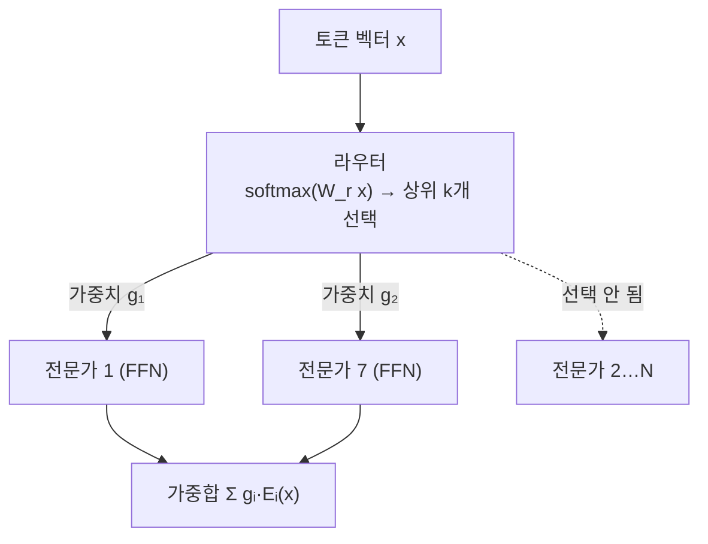

# MoE (전문가 혼합)

!!! spec "핵심 논문 · 연도"
    Jacobs 외, "Adaptive Mixtures of Local Experts" (1991) · Shazeer 외, "Outrageously Large Neural Networks: The Sparsely-Gated MoE Layer" (2017) · Lepikhin 외, "GShard" (2020) · Fedus 외, "Switch Transformers" (2021) · Jiang 외, "Mixtral of Experts" (2024) · Dai 외, "DeepSeekMoE" (2024) · DeepSeek-AI, "DeepSeek-V3 Technical Report" (2024)

!!! basic "한눈에 보기"
    큰 병원에는 내과, 외과, 안과 등 **전문의가 여럿** 있지만, 환자 한 명이 모든 의사를 만나지는 않습니다. 접수 창구가 증상을 보고 **맞는 전문의 한두 명에게만** 보냅니다. 병원 전체의 지식은 크지만, 환자 한 명을 진료하는 데 드는 시간은 적습니다.

    **MoE(Mixture of Experts)**는 트랜스포머의 FFN을 이렇게 바꿉니다.

    - FFN 하나 대신 **전문가 FFN 여러 개**(예: 64–256개)를 둡니다.
    - **라우터**가 토큰마다 가장 맞는 전문가 몇 개(예: 2–8개)를 고릅니다.
    - 그 결과 모델 전체 파라미터는 수천억 개지만, 토큰 하나를 처리할 때 실제로 계산하는 파라미터(**활성 파라미터**)는 그 일부뿐입니다.

    같은 계산 비용으로 더 많은 지식을 담을 수 있어, 2024년 이후 최대 규모 모델의 상당수가 MoE 구조입니다. 대신 **메모리는 전체 파라미터만큼** 필요합니다.

## 구조 { .l2 }



\[
\mathbf{y} = \sum_{i\in\text{TopK}(\mathbf{x})} g_i(\mathbf{x})\,E_i(\mathbf{x}),\qquad g(\mathbf{x}) = \text{softmax}(W_r\mathbf{x})
\]

어텐션 층은 보통 그대로 두고 FFN만 MoE로 바꿉니다.

## 총 파라미터와 활성 파라미터 { .l2 }

| 모델 (공개 정보 기준) | 전문가 구성 | 총 파라미터 | 활성 파라미터 |
|---|---|---|---|
| Mixtral 8x7B (2023) | 8개 중 2개 | 약 47B | 약 13B |
| DeepSeek-V3 (2024) | 공유 1 + 라우팅 256개 중 8개 | 671B | 37B |
| 밀집(dense) 70B 모델 | — | 70B | 70B |

DeepSeek-V3는 토큰당 계산은 약 37B 밀집 모델 수준이면서, 지식 용량은 훨씬 큰 모델처럼 동작합니다.

## 장점과 비용 { .l2 }

| 항목 | MoE | 같은 활성 크기의 밀집 모델 |
|---|---|---|
| 토큰당 계산 (FLOPs) | 같음 | 같음 |
| 품질 | 더 좋음 (총 파라미터가 많음) | 기준 |
| 메모리 (가중치 저장) | 총 파라미터만큼 → 훨씬 큼 | 작음 |
| 통신 | 전문가를 여러 GPU에 나누면 토큰 이동(all-to-all) 필요 | 적음 |
| 작은 배치 추론 | 메모리 대역폭 병목이 심함 | 상대적으로 유리 |
| 학습 안정성 | 라우팅 불균형·붕괴 위험 | 안정적 |

MoE는 **데이터센터에서 큰 배치로 서비스할 때** 가장 효율적입니다. 개인 PC·스마트폰처럼 메모리가 작고 배치가 1인 환경에서는 총 파라미터를 모두 메모리에 올려야 하는 부담이 큽니다.

## 부하 균형 { .l2 }

라우터를 그냥 학습시키면 몇몇 전문가만 계속 선택되고 나머지는 놀게 됩니다(라우팅 붕괴). 대책은 다음과 같습니다.

| 방법 | 설명 |
|---|---|
| 보조 균형 손실 | 전문가별 선택 비율이 고르게 되도록 벌점 (Switch Transformer) |
| 용량 제한 | 전문가당 처리 토큰 수 상한, 넘치면 버리거나 다음 순위로 |
| 편향 조정 (보조 손실 없음) | 많이 선택된 전문가의 라우팅 점수에 음의 편향을 동적으로 더함 (DeepSeek-V3) |
| 공유 전문가 | 모든 토큰이 거치는 공통 전문가를 두어 공통 지식을 담당 |

## 코드로 보기 { .l2 }

상위 2개 라우팅 MoE 층과 부하 균형 손실을 간단히 구현합니다.

```python
import torch
import torch.nn as nn
import torch.nn.functional as F

class MoE(nn.Module):
    def __init__(self, d=64, n_experts=8, k=2, d_ff=128):
        super().__init__()
        self.k, self.n = k, n_experts
        self.router = nn.Linear(d, n_experts, bias=False)
        self.experts = nn.ModuleList(
            nn.Sequential(nn.Linear(d, d_ff), nn.GELU(), nn.Linear(d_ff, d)) for _ in range(n_experts))

    def forward(self, x):                                  # x: (토큰 수, d)
        probs = F.softmax(self.router(x), dim=-1)
        topv, topi = probs.topk(self.k, dim=-1)
        topv = topv / topv.sum(-1, keepdim=True)           # 선택된 k개 가중치 재정규화
        y = torch.zeros_like(x)
        for e in range(self.n):                            # 전문가별로 배정된 토큰만 계산
            tok, slot = (topi == e).nonzero(as_tuple=True)
            if len(tok):
                y[tok] += topv[tok, slot, None] * self.experts[e](x[tok])
        # Switch식 균형 손실: (전문가별 배정 비율) · (평균 라우팅 확률) · 전문가 수
        frac = F.one_hot(topi, self.n).float().sum((0, 1)) / (len(x) * self.k)
        aux = self.n * (frac * probs.mean(0)).sum()
        return y, aux, frac

torch.manual_seed(0)
moe = MoE()
y, aux, frac = moe(torch.randn(1000, 64))
print(y.shape, f"균형 손실={aux.item():.3f} (완전 균형이면 1.0)")
print("전문가별 배정 비율:", [round(v, 3) for v in frac.tolist()])
total = sum(p.numel() for p in moe.parameters())
active = sum(p.numel() for p in moe.router.parameters()) + 2 * sum(p.numel() for p in moe.experts[0].parameters())
print(f"총 파라미터 {total:,}, 토큰당 활성 {active:,} ({100 * active / total:.0f}%)")
```

??? expert "전문가 노트 — 전문가 병렬화, 세분화된 전문가, 전문가는 정말 전문적인가"
    **전문가 병렬화(EP).** 전문가들을 여러 GPU에 나누고, 각 토큰을 담당 전문가가 있는 GPU로 보냈다가(dispatch) 결과를 돌려받습니다(combine). 두 번의 all-to-all 통신이 층마다 필요해 네트워크 대역폭이 병목이 됩니다. DeepSeek-V3는 노드당 라우팅 대상을 제한하고 통신과 계산을 겹치는 커널을 직접 작성해 이를 줄였습니다 → [분산 학습](../systems/distributed.md).

    **세분화된 전문가.** 큰 전문가 몇 개보다 작은 전문가를 많이 두고 더 많이 선택하는 것(예: 256개 중 8개)이 조합의 수를 늘려 품질이 좋다는 결과(DeepSeekMoE)가 이후 설계의 표준이 되었습니다. 스케일링 법칙 연구는 "희소도"(총/활성 비율)를 키울수록 같은 계산에서 손실이 줄지만 수익이 점차 감소함을 보입니다.

    **전문가의 특화.** 전문가가 "수학 담당", "한국어 담당"처럼 사람이 이해할 만한 주제로 나뉘는 경우는 드물고, 구두점·특정 토큰 유형·구문 패턴 같은 낮은 수준의 특징으로 나뉘는 경우가 많다고 보고됩니다(Mixtral 분석). 이름과 달리 "전문가"는 학습된 부분 네트워크일 뿐입니다.

    **추론 최적화.** 배치 1 추론에서는 토큰마다 다른 전문가 가중치를 메모리에서 읽어야 해 대역폭이 병목입니다. 자주 쓰는 전문가만 GPU에 두고 나머지는 CPU 메모리에 두는 오프로딩, 전문가 가중치의 공격적인 양자화가 로컬 실행에서 쓰입니다 → [로컬 LLM 실행](../practice/local-llm.md).

## 관련 페이지

- [트랜스포머](../arch/transformer.md) — FFN의 역할
- [분산 학습](../systems/distributed.md) — 전문가 병렬화
- [추론 최적화](../systems/inference.md) — 메모리 대역폭과 배치
- [오픈 웨이트 모델](../next/open-weights.md) — MoE 오픈 모델들
