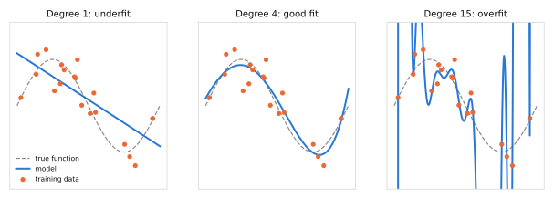
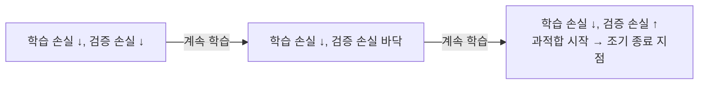

# 과적합과 정규화

!!! spec "핵심 논문 · 연도"
    Geman·Bienenstock·Doursat, "Neural Networks and the Bias/Variance Dilemma" (1992) · Srivastava 외, "Dropout" (2014) · Zhang 외, "Understanding deep learning requires rethinking generalization" (2017) · Belkin 외, "Reconciling modern machine learning practice and the bias-variance trade-off" (2019, 이중 하강) · Nakkiran 외, "Deep Double Descent" (2019) · Power 외, "Grokking" (2022)

!!! basic "한눈에 보기"
    시험 문제와 답을 **통째로 외운** 학생은 기출문제는 100점이지만 새 문제는 못 풉니다. 이것이 **과적합(overfitting)**입니다. 반대로 공부를 너무 대충 해서 기출문제도 못 푸는 것은 **과소적합(underfitting)**입니다.

    - 과적합의 신호: **학습 데이터 점수는 높은데 검증 데이터 점수는 낮다.**
    - 막는 법: 데이터를 늘리기, 모델을 단순하게 하기, 가중치가 너무 커지지 않게 벌점 주기(정규화), 일찍 멈추기, 드롭아웃.

    목표는 학습 데이터를 잘 맞히는 것이 아니라 **처음 보는 데이터를 잘 맞히는 것(일반화)**입니다.

<figure markdown>

<figcaption>같은 20개 점에 차수 1, 4, 15인 다항식을 맞춘 결과입니다. 직선(왼쪽)은 너무 단순해 패턴을 놓치고, 15차(오른쪽)는 점을 모두 지나려다 점 사이에서 크게 요동칩니다. 점선은 데이터를 만든 실제 함수입니다.</figcaption>
</figure>

## 편향과 분산 { .l2 }

예측 오차는 세 부분으로 나눌 수 있습니다(제곱 오차 기준).

\[
\mathbb{E}[(y - \hat{f}(x))^2] = \underbrace{\text{편향}^2}_{\text{너무 단순}} + \underbrace{\text{분산}}_{\text{데이터에 민감}} + \underbrace{\sigma^2}_{\text{줄일 수 없는 잡음}}
\]

| 상태 | 학습 오차 | 검증 오차 | 원인 | 처방 |
|---|---|---|---|---|
| 과소적합 (고편향) | 높음 | 높음 | 모델이 너무 단순, 학습 부족 | 모델 키우기, 특징 추가, 더 오래 학습 |
| 적당 | 낮음 | 낮음 | — | — |
| 과적합 (고분산) | 매우 낮음 | 높음 | 모델이 너무 복잡, 데이터 부족 | 데이터 늘리기, 정규화, 단순화 |

## 정규화 기법 모음 { .l2 }

| 기법 | 방법 | 주로 쓰는 곳 |
|---|---|---|
| L2 (가중치 감쇠) | 손실에 \(\lambda\|\mathbf{w}\|^2\) 추가 | 거의 모든 모델. AdamW의 weight decay |
| L1 | 손실에 \(\lambda\|\mathbf{w}\|_1\) 추가 → 희소한 가중치 | 특징 선택, 라소 |
| 조기 종료 | 검증 손실이 다시 오르기 시작하면 멈춤 | 신경망, 부스팅 |
| 드롭아웃 | 학습 중 뉴런 일부를 무작위로 끔 | MLP, 예전 CNN, 일부 트랜스포머 미세 조정 |
| 데이터 증강 | 뒤집기·자르기·잡음 등으로 데이터 늘리기 | 이미지, 음성 |
| 모델 단순화 | 층·차원·트리 깊이 줄이기 | 데이터가 적을 때 |
| 앙상블 | 여러 모델 평균 | 대회, 높은 신뢰성이 필요한 곳 |
| 라벨 스무딩 | 원-핫 대신 부드러운 정답 | 분류, 번역 |

## 학습 곡선 읽기 { .l2 }



검증 손실이 가장 낮았던 시점의 모델을 저장해 두는 것이 조기 종료의 실제 구현입니다.

## LLM 사전 학습에서는 왜 과적합이 드문가 { .l2 }

수조 토큰의 데이터를 대부분 **한 번만**(1 에폭 이하) 보기 때문에, 모델이 같은 예시를 외울 기회가 적습니다. 학습 손실과 검증 손실이 거의 같이 내려갑니다. 반면 **미세 조정**은 수천–수만 개 예시를 여러 번 보므로 과적합이 쉽게 일어나고, 그래서 학습률을 작게, 에폭을 적게, LoRA처럼 학습하는 파라미터를 줄이는 방법을 씁니다 → [미세 조정](../llm/finetuning.md).

## 코드로 보기 { .l2 }

위 그림의 실험을 숫자로 확인하고, 15차 다항식에 L2 정규화(릿지)를 걸면 어떻게 되는지 봅니다.

```python
import numpy as np
from sklearn.preprocessing import PolynomialFeatures, StandardScaler
from sklearn.linear_model import LinearRegression, Ridge
from sklearn.pipeline import make_pipeline
from sklearn.metrics import mean_squared_error

rng = np.random.default_rng(1)
f = lambda t: np.sin(2 * np.pi * t)
xtr = rng.uniform(0, 1, 20); ytr = f(xtr) + rng.normal(0, 0.25, 20)
xte = rng.uniform(0, 1, 500); yte = f(xte) + rng.normal(0, 0.25, 500)

def fit(deg, model):
    m = make_pipeline(PolynomialFeatures(deg), StandardScaler(), model)
    m.fit(xtr[:, None], ytr)
    tr = mean_squared_error(ytr, m.predict(xtr[:, None]))
    te = mean_squared_error(yte, m.predict(xte[:, None]))
    return tr, te

for deg in (1, 4, 15):
    tr, te = fit(deg, LinearRegression())
    print(f"차수 {deg:2d}: 학습 MSE={tr:.3f}  테스트 MSE={te:.3f}")
tr, te = fit(15, Ridge(alpha=1e-2))
print(f"차수 15 + 릿지: 학습 MSE={tr:.3f}  테스트 MSE={te:.3f}")
```

차수 15는 학습 MSE가 가장 작지만 테스트 MSE는 폭발합니다. 같은 15차라도 릿지 정규화(α = 0.01)를 걸면 테스트 MSE가 차수 4와 거의 같은 수준(약 0.11)으로 돌아옵니다. α를 바꿔 가며 검증 오차가 가장 작은 값을 고르는 것이 하이퍼파라미터 튜닝입니다.

??? expert "전문가 노트 — 이중 하강, 암기와 일반화, 그로킹"
    **이중 하강.** 고전적 그림은 "모델이 복잡해질수록 테스트 오차가 U자"입니다. Belkin 외(2019)와 Nakkiran 외(2019)는 파라미터 수가 학습 데이터를 정확히 맞출 수 있는 **보간 임계점** 근처에서 테스트 오차가 치솟았다가, 그보다 훨씬 커지면 **다시 내려가는** 이중 하강을 보였습니다. 임계점 근처에서는 데이터를 맞추는 해가 거의 하나뿐이라 잡음까지 억지로 맞추지만, 훨씬 크면 맞추는 해가 많아지고 경사하강법이 그중 "매끄러운"(노름이 작은) 해를 고르기 때문으로 설명됩니다. 큰 신경망이 고전 이론의 예상보다 잘 일반화하는 현상의 한 설명입니다.

    **무작위 라벨도 외운다.** Zhang 외(2017)는 CIFAR-10의 라벨을 무작위로 섞어도 CNN이 학습 정확도 100%에 도달함을 보였습니다. 즉 신경망은 외울 능력이 충분하며, 실제 데이터에서 일반화하는 것은 모델 용량이 아니라 데이터 구조와 학습 방법(SGD의 암묵적 정규화)의 결과라는 뜻입니다.

    **그로킹.** 작은 알고리즘 데이터셋(모듈러 덧셈)에서 학습 정확도가 100%에 도달한 후에도 한참 동안 검증 정확도가 낮다가, 가중치 감쇠와 함께 오래 학습하면 어느 순간 검증 정확도가 급상승하는 현상입니다(Power 외 2022). 외운 해에서 일반화되는 해(푸리에 기반 회로)로 천천히 옮겨 가는 과정으로 분석됩니다.

    **LLM의 암기.** LLM은 학습 데이터에 여러 번 나온 문장(라이선스 문구, 유명 글귀)을 그대로 재현할 수 있습니다. 중복 제거(dedup)는 품질뿐 아니라 개인정보·저작권 위험을 줄이기 위해서도 중요합니다 → [저작권과 개인정보](../society/copyright-privacy.md).

## 관련 페이지

- [평가 지표와 검증](evaluation.md) — 학습·검증·테스트 분할과 교차 검증
- [정규화 기법 (BatchNorm·LayerNorm·Dropout)](../dl/normalization.md) — 신경망의 정규화
- [옵티마이저 (SGD·Adam)](../dl/optimizers.md) — AdamW의 가중치 감쇠
