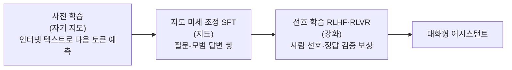

# 지도·비지도·강화 학습

!!! spec "핵심 논문 · 연도"
    Vapnik, *The Nature of Statistical Learning Theory* (1995) · Sutton·Barto, *Reinforcement Learning: An Introduction* (1998/2018) · Chapelle 외, *Semi-Supervised Learning* (2006) · Devlin 외, "BERT" (2018, 자기 지도 사전 학습) · Chen 외, "SimCLR" (2020, 대조 학습)

!!! basic "한눈에 보기"
    배우는 방식은 **선생님이 무엇을 주느냐**로 나뉩니다.

    1. **지도 학습** — 문제와 정답을 함께 줍니다. "이 사진은 고양이, 이 사진은 개." 스팸 분류, 집값 예측.
    2. **비지도 학습** — 정답 없이 데이터만 줍니다. "비슷한 것끼리 묶어 봐." 고객 군집, 이상 탐지.
    3. **강화 학습** — 정답 대신 **잘했다·못했다(보상)**만 줍니다. 무엇을 잘했는지는 스스로 알아내야 합니다. 게임, 로봇, LLM의 RLHF.
    4. **자기 지도 학습** — 데이터 자체에서 문제를 만듭니다. "문장의 다음 단어를 맞혀 봐." 정답을 사람이 달 필요가 없어 인터넷 전체를 학습 데이터로 쓸 수 있습니다. **LLM 사전 학습이 바로 이것**입니다.

## 한눈에 비교 { .l2 }

| 방식 | 입력 | 학습 신호 | 대표 과제 | 대표 알고리즘 |
|---|---|---|---|---|
| 지도 | (x, y) 쌍 | 정답 y와의 오차 | 분류, 회귀 | 로지스틱 회귀, 트리, CNN |
| 비지도 | x만 | 데이터의 구조 (거리, 밀도) | 군집, 차원 축소, 밀도 추정 | k-평균, PCA, 오토인코더 |
| 자기 지도 | x만 (일부를 가려 문제로 만듦) | 가린 부분 맞히기 | 표현 학습, 사전 학습 | GPT, BERT, MAE, SimCLR |
| 준지도 | 소수의 (x, y) + 다수의 x | 둘 다 | 라벨이 비싼 분야 | 의사 라벨, 일관성 정규화 |
| 강화 | 환경과 상호작용 | 보상 r (지연될 수 있음) | 제어, 게임, 정렬 | Q-학습, PPO |

## 지도 학습: 분류와 회귀 { .l2 }

| 구분 | 출력 | 손실 예 | 예 |
|---|---|---|---|
| 회귀 | 연속값 | 평균 제곱 오차 (MSE) | 집값, 온도, 전력 소비 |
| 이진 분류 | 0/1 확률 | 이진 교차 엔트로피 | 스팸 여부, 불량 여부 |
| 다중 분류 | K개 중 하나의 확률 | 교차 엔트로피 | 숫자 인식, 다음 토큰 |
| 다중 라벨 | 여러 개 동시에 | 라벨별 이진 교차 엔트로피 | 사진 태그 |

지도 학습의 병목은 **라벨**입니다. 의료 영상 판독처럼 전문가가 정답을 달아야 하면 데이터를 늘리기 어렵습니다.

## 자기 지도 학습: LLM 시대의 주인공 { .l2 }

| 기법 | 만드는 문제 | 모델 |
|---|---|---|
| 다음 토큰 예측 | 앞 토큰들로 다음 토큰 맞히기 | GPT 계열 |
| 마스크 예측 | 문장 중 15%를 가리고 맞히기 | BERT |
| 마스크 이미지 복원 | 이미지 조각 75%를 가리고 복원 | MAE |
| 대조 학습 | 같은 사진의 두 변형은 가깝게, 다른 사진은 멀게 | SimCLR, CLIP(이미지-텍스트 쌍) |

자기 지도 사전 학습으로 일반적인 표현을 배운 뒤, 소량의 라벨 데이터로 미세 조정하는 것이 현재의 표준 방식입니다 → [미세 조정](../llm/finetuning.md).

## LLM은 세 가지를 모두 쓴다 { .l2 }



## 코드로 보기 { .l2 }

같은 데이터에 지도 학습(라벨 사용)과 비지도 학습(라벨 없이 군집)을 적용해 봅니다.

```python
from sklearn.datasets import load_iris
from sklearn.linear_model import LogisticRegression
from sklearn.cluster import KMeans
from sklearn.metrics import adjusted_rand_score
from sklearn.model_selection import cross_val_score

X, y = load_iris(return_X_y=True)          # 붓꽃 150송이, 특징 4개, 품종 3개

# 지도: 라벨로 분류기 학습 (5겹 교차 검증 정확도)
acc = cross_val_score(LogisticRegression(max_iter=1000), X, y, cv=5).mean()
print(f"지도 학습 정확도: {acc:.3f}")

# 비지도: 라벨 없이 3개 군집 → 실제 품종과 얼마나 일치하나
km = KMeans(n_clusters=3, n_init=10, random_state=0).fit(X)
print(f"군집-품종 일치도(ARI): {adjusted_rand_score(y, km.labels_):.3f}")
```

지도 학습은 약 0.97, 비지도 군집은 품종을 모른 채로도 일치도(ARI) 약 0.73을 얻습니다.

??? expert "전문가 노트 — 경험적 위험 최소화와 학습 이론"
    **경험적 위험 최소화(ERM).** 지도 학습의 목표는 실제 분포에서의 기대 손실(위험) \(R(f) = \mathbb{E}_{(x,y)\sim P}[\ell(f(x), y)]\)을 줄이는 것이지만, P를 모르므로 학습 데이터 평균 \(\hat{R}(f)\)를 대신 줄입니다. 둘의 차이(일반화 간극)를 묶는 것이 학습 이론입니다. VC 차원이나 라데마허 복잡도 기반 상한은 "모델이 복잡할수록, 데이터가 적을수록 간극이 크다"고 말하지만, 파라미터가 데이터보다 많은 신경망에서는 이 상한이 거의 쓸모없을 만큼 느슨합니다. 신경망이 왜 잘 일반화하는지는 여전히 활발한 연구 주제입니다 → [과적합과 정규화](overfitting.md)의 이중 하강.

    **자기 지도 학습의 정의 논쟁.** 다음 토큰 예측은 "라벨을 데이터에서 만든 지도 학습"으로 볼 수도 있습니다. 구분의 핵심은 사람이 라벨을 달았느냐입니다.

    **보상 모델과 검증 가능한 보상.** RLHF는 사람의 선호를 흉내 내는 보상 모델을 학습해 보상으로 씁니다. 2024년 이후 추론 모델은 수학 정답·코드 테스트 통과처럼 **자동으로 검증 가능한 보상**(RLVR)을 대규모로 사용합니다 → [추론 모델과 사고 사슬](../llm/reasoning.md).

## 관련 페이지

- [선형 회귀와 로지스틱 회귀](linear-models.md) — 지도 학습의 출발점
- [군집과 차원 축소](unsupervised.md) — 비지도 학습
- [강화 학습 기초](reinforcement.md)
- [사전 학습과 스케일링 법칙](../llm/pretraining.md) — 자기 지도 학습의 규모 확장
