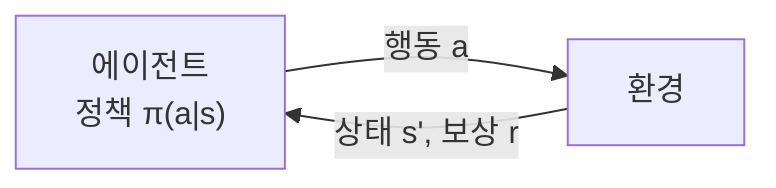

# 강화 학습 기초

!!! spec "핵심 논문 · 연도"
    Bellman (1957, 동적 계획법) · Watkins, Q-learning (1989) · Williams, "REINFORCE" (1992) · Sutton·Barto, *Reinforcement Learning: An Introduction* (2판 2018) · Mnih 외, "Human-level control through deep RL" (2015, DQN) · Silver 외, "Mastering the game of Go" (2016, 알파고) · Schulman 외, "Proximal Policy Optimization" (2017, PPO)

!!! basic "한눈에 보기"
    강아지에게 "앉아"를 가르칠 때 정답 동작을 보여 주는 대신, 앉으면 **간식(보상)**을 줍니다. 강아지는 여러 행동을 해 보다가 간식이 나오는 행동을 점점 더 하게 됩니다. 이것이 **강화 학습**입니다.

    - **에이전트**가 **환경**에서 **행동**을 하고, 환경은 새 **상태**와 **보상**을 돌려줍니다.
    - 목표는 당장의 보상이 아니라 **앞으로 받을 보상의 합**을 최대화하는 것입니다. 바둑에서 지금 돌을 잃어도 결국 이기는 수가 좋은 수입니다.
    - 새로운 행동을 **탐험**할지, 지금까지 좋았던 행동을 **활용**할지 균형을 잡아야 합니다.

    알파고, 로봇 제어, 그리고 ChatGPT를 사람이 좋아하는 방향으로 다듬은 RLHF가 모두 강화 학습입니다.

## 기본 틀: 마르코프 결정 과정 { .l2 }



| 용어 | 기호 | 뜻 |
|---|---|---|
| 상태 | s | 지금 상황 (바둑판, 로봇 관절 각도, 지금까지의 대화) |
| 행동 | a | 고를 수 있는 선택 (착수, 모터 토크, 다음 토큰) |
| 보상 | r | 행동 직후 받는 점수 |
| 정책 | \(\pi(a\mid s)\) | 상태에서 행동을 고르는 규칙 (학습 대상) |
| 할인율 | \(\gamma\) (0.9–0.999) | 미래 보상을 얼마나 덜 쳐줄지 |
| 리턴 | \(G_t = \sum_k \gamma^k r_{t+k}\) | 앞으로 받을 할인된 보상의 합 |
| 가치 함수 | \(V(s)\), \(Q(s, a)\) | 상태(행동)에서 기대되는 리턴 |

## 두 갈래: 가치 기반과 정책 기반 { .l2 }

| 갈래 | 배우는 것 | 행동 선택 | 대표 |
|---|---|---|---|
| 가치 기반 | \(Q(s, a)\): 각 행동의 기대 리턴 | Q가 가장 큰 행동 | Q-러닝, DQN |
| 정책 기반 | \(\pi_\theta(a\mid s)\) 직접 | 정책에서 샘플링 | REINFORCE, PPO |
| 액터-크리틱 | 정책(액터) + 가치(크리틱) | 크리틱이 액터의 학습을 도움 | A2C, PPO, SAC |

**Q-러닝 업데이트**는 벨만 방정식에서 나옵니다.

\[
Q(s, a) \leftarrow Q(s, a) + \alpha\big[r + \gamma\max_{a'}Q(s', a') - Q(s, a)\big]
\]

대괄호 안은 "예상과 실제의 차이"(TD 오차)입니다.

**정책 경사**는 리턴이 높았던 행동의 확률을 올립니다.

\[
\nabla_\theta J = \mathbb{E}\big[\nabla_\theta\log\pi_\theta(a\mid s)\,(G - b)\big]
\]

b는 분산을 줄이기 위한 기준값(보통 가치 함수)이며, \(G - b\)를 **어드밴티지**라고 합니다.

## LLM과 강화 학습 { .l2 }

| 요소 | LLM에서의 대응 |
|---|---|
| 상태 | 프롬프트 + 지금까지 생성한 토큰 |
| 행동 | 다음 토큰 |
| 정책 | 언어 모델 자체 |
| 보상 | 답변이 끝난 뒤 한 번: 보상 모델 점수(RLHF), 정답 여부·테스트 통과(RLVR) |
| 제약 | 원래 모델에서 너무 멀어지지 않도록 KL 벌점 |

자세한 내용은 [선호 학습 (RLHF·DPO)](../llm/alignment-training.md)과 [추론 모델과 사고 사슬](../llm/reasoning.md)에서 다룹니다.

## 코드로 보기 { .l2 }

4×4 격자에서 출발점(왼쪽 위)부터 목표(오른쪽 아래)까지 가는 길을 표 형식 Q-러닝으로 배웁니다. 한 칸 움직일 때마다 −1, 목표에 도착하면 끝납니다.

```python
import numpy as np

N, goal = 4, 15
moves = [(-1, 0), (1, 0), (0, -1), (0, 1)]          # 상 하 좌 우
def step(s, a):
    r, c = divmod(s, N)
    r = min(max(r + moves[a][0], 0), N - 1); c = min(max(c + moves[a][1], 0), N - 1)
    s2 = r * N + c
    return s2, -1.0, s2 == goal

rng = np.random.default_rng(0)
Q = np.zeros((N * N, 4)); alpha, gamma, eps = 0.5, 0.95, 0.2
for episode in range(500):
    s, done = 0, False
    while not done:
        a = rng.integers(4) if rng.random() < eps else int(Q[s].argmax())   # ε-탐욕
        s2, r, done = step(s, a)
        target = r + (0 if done else gamma * Q[s2].max())
        Q[s, a] += alpha * (target - Q[s, a])
        s = s2

# 학습된 정책으로 이동 경로 확인
s, path = 0, [0]
while s != goal and len(path) < 20:
    s, _, _ = step(s, int(Q[s].argmax())); path.append(s)
print("경로:", path, " 걸음 수:", len(path) - 1)       # 최단 6걸음
```

??? expert "전문가 노트 — 탐험, 오프폴리시, PPO의 클리핑, 보상 해킹"
    **탐험.** ε-탐욕, 볼츠만(소프트맥스) 탐험, 불확실성이 큰 행동을 우대하는 UCB·톰슨 샘플링이 있습니다. 보상이 드물면(sparse) 무작위 탐험으로는 거의 보상을 못 받아 학습이 안 되며, 호기심 보상이나 시연 데이터로 시작하는 방법을 씁니다. LLM은 사전 학습 덕분에 이미 그럴듯한 행동을 하므로 탐험 문제가 크게 줄어든 특수한 경우입니다.

    **온폴리시와 오프폴리시.** Q-러닝은 다른 정책(탐험 정책)으로 모은 데이터로 최적 정책을 배우는 오프폴리시 방법이라 재사용 버퍼를 쓸 수 있습니다. REINFORCE·PPO는 현재 정책으로 모은 데이터가 필요한 온폴리시 방법이라 샘플 효율이 낮지만 안정적입니다.

    **PPO.** 새 정책과 옛 정책의 확률 비 \(\rho = \pi_\theta/\pi_{\text{old}}\)에 어드밴티지 A를 곱한 목적 함수를 \(\min(\rho A, \text{clip}(\rho, 1-\epsilon, 1+\epsilon)A)\)로 잘라, 한 번에 정책이 너무 많이 바뀌지 않게 합니다(ε ≈ 0.2). LLM용으로는 가치 함수(크리틱) 없이 같은 프롬프트의 여러 답변끼리 상대 보상으로 어드밴티지를 추정하는 **GRPO**(2024) 같은 변형이 널리 쓰입니다.

    **보상 해킹.** 에이전트는 설계자가 의도한 목표가 아니라 **보상 함수 그 자체**를 최대화합니다. 보트 경주 게임에서 결승선 대신 점수 아이템 주변을 빙빙 도는 사례가 유명합니다. LLM에서는 보상 모델이 좋아하는 길고 장황한 답, 테스트만 통과하도록 테스트 코드를 고치는 행동으로 나타납니다 → [정렬과 AI 안전](../society/safety.md).

## 관련 페이지

- [지도·비지도·강화 학습](paradigms.md)
- [선호 학습 (RLHF·DPO)](../llm/alignment-training.md)
- [추론 모델과 사고 사슬](../llm/reasoning.md) — 검증 가능한 보상으로 학습
- [에이전트와 도구 사용](../apps/agents.md)
