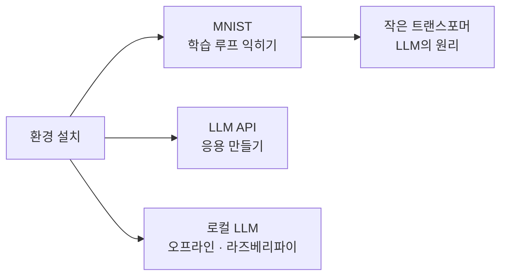

# 실습

읽기만 해서는 잘 와닿지 않던 개념도 직접 코드를 돌려 보면 분명해집니다. 이 섹션은 환경 설치부터 첫 신경망, 직접 만든 작은 GPT, 대형 모델 API, 그리고 라즈베리파이에서 돌리는 로컬 LLM까지 **손으로 해 보는** 다섯 가지 실습입니다. 대부분 GPU 없이 CPU만으로 몇 초~몇 분이면 끝납니다.

| 실습 | 무엇을 하나 | 필요한 것 | 시간 |
|---|---|---|---|
| [파이썬과 PyTorch 환경](setup.md) | 가상환경, PyTorch 설치와 확인 | PC 또는 라즈베리파이 | 30분 |
| [손글씨 숫자 분류 (MNIST)](mnist.md) | 작은 CNN을 학습시켜 98% 정확도 | CPU | 40분 |
| [작은 트랜스포머 직접 만들기](mini-transformer.md) | 글자 단위 GPT를 60줄로 구현·학습·생성 | CPU | 1시간 |
| [LLM API 쓰기](llm-api.md) | 대형 모델 API 호출, 스트리밍, 비용 계산 | API 키 | 40분 |
| [로컬 LLM 실행 (라즈베리파이 포함)](local-llm.md) | Ollama·llama.cpp로 오프라인 LLM | PC 또는 라즈베리파이 5 | 1시간 |

!!! basic "실습 코드에 대하여"
    이 책의 모든 페이지에 있는 파이썬 코드(` ```python ` 블록)는 출판 전에 실제로 실행해 출력을 확인했습니다. 본문의 숫자는 그 실행 결과입니다. 라이브러리 버전이나 하드웨어에 따라 소수점 아래 숫자가 조금 다를 수 있지만 경향은 같아야 합니다. API 키나 외부 서버가 필요한 코드는 따로 표시했습니다.

## 추천 경로 { .l2 }



- **원리를 이해하고 싶다면**: 환경 → MNIST → 작은 트랜스포머 순서로, 각 실습의 "해 볼 만한 실험"까지 해 보세요.
- **바로 무언가를 만들고 싶다면**: 환경 → LLM API → [RAG](../apps/rag.md)·[에이전트](../apps/agents.md) 페이지의 코드로 넘어가세요.
- **라즈베리파이로 시작한다면**: 환경 → 로컬 LLM부터 해도 좋습니다. MNIST와 작은 트랜스포머도 파이 5에서 (조금 느리지만) 돌아갑니다.
