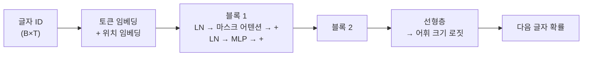

# 작은 트랜스포머 직접 만들기

!!! spec "준비물 · 소요 시간"
    [파이썬과 PyTorch 환경](setup.md) · CPU로 충분 (실행 약 10–30초) · 약 1시간. 관련 이론: [어텐션](../arch/attention.md), [트랜스포머](../arch/transformer.md), [토큰화](../llm/tokenization.md), [사전 학습과 스케일링 법칙](../llm/pretraining.md)

!!! basic "한눈에 보기"
    ChatGPT 같은 LLM의 핵심은 의외로 단순합니다. "**지금까지의 글을 보고 다음 글자(토큰)를 맞히기**"를 엄청나게 많이 반복해 학습한 트랜스포머입니다.

    이 실습에서는 그 축소판, 파라미터 11만 개짜리 **글자 단위 GPT**를 60줄 남짓으로 직접 만듭니다. GPT-3(1,750억 개)보다 약 150만 배 작지만 구조는 같습니다.

    - **토큰화**: 글자 하나를 토큰 하나로 씁니다(실제 LLM은 BPE 같은 하위 단어 토큰).
    - **임베딩 + 위치 임베딩**: 각 글자와 위치를 벡터로 바꿉니다.
    - **트랜스포머 블록 ×2**: 마스크된 셀프 어텐션 + MLP, 잔차 연결과 LayerNorm.
    - **출력층**: 다음 글자의 확률 분포.
    - **생성**: 확률에 따라 한 글자 뽑고, 붙이고, 다시 예측하기를 반복.

    학습 데이터로는 저작권 걱정이 없는 애국가 가사를 씁니다. 데이터가 아주 작아서 모델은 가사를 **외우게** 되는데, 이것이 오히려 "언어 모델이 학습 데이터의 패턴을 배운다"는 것을 눈으로 확인하기 좋습니다.

## 구조 { .l2 }



| 설정 | 이 실습 | GPT-2 small (2019) | 비고 |
|---|---|---|---|
| 어휘 | 75 (글자) | 50,257 (BPE) | |
| 문맥 길이 T | 32 | 1,024 | |
| 임베딩 D | 64 | 768 | |
| 헤드 H | 4 | 12 | 헤드당 차원 16 / 64 |
| 층 L | 2 | 12 | |
| 파라미터 | 약 11만 | 1억 2,400만 | |

## 코드로 보기 { .l2 }

```python
import torch, torch.nn as nn, torch.nn.functional as F
torch.manual_seed(0)

text = ("동해 물과 백두산이 마르고 닳도록 하느님이 보우하사 우리나라 만세. "
        "무궁화 삼천리 화려 강산 대한 사람 대한으로 길이 보전하세. "
        "남산 위에 저 소나무 철갑을 두른 듯 바람 서리 불변함은 우리 기상일세. "
        "가을 하늘 공활한데 높고 구름 없이 밝은 달은 우리 가슴 일편단심일세. ") * 20
chars = sorted(set(text)); V = len(chars)
stoi = {c: i for i, c in enumerate(chars)}
data = torch.tensor([stoi[c] for c in text])
T, D, H, L = 32, 64, 4, 2                       # 문맥 길이, 임베딩, 헤드, 층

class Block(nn.Module):
    def __init__(self):
        super().__init__()
        self.ln1, self.ln2 = nn.LayerNorm(D), nn.LayerNorm(D)
        self.attn = nn.MultiheadAttention(D, H, batch_first=True)
        self.mlp = nn.Sequential(nn.Linear(D, 4 * D), nn.GELU(), nn.Linear(4 * D, D))
    def forward(self, x):
        n = x.size(1)
        mask = torch.triu(torch.ones(n, n, dtype=torch.bool), 1)   # 미래 토큰 가리기
        h = self.ln1(x)
        x = x + self.attn(h, h, h, attn_mask=mask, need_weights=False)[0]
        return x + self.mlp(self.ln2(x))

class TinyGPT(nn.Module):
    def __init__(self):
        super().__init__()
        self.tok, self.pos = nn.Embedding(V, D), nn.Embedding(T, D)
        self.blocks = nn.Sequential(*[Block() for _ in range(L)])
        self.head = nn.Linear(D, V)
    def forward(self, idx):
        x = self.tok(idx) + self.pos(torch.arange(idx.size(1)))
        return self.head(self.blocks(x))

model = TinyGPT()
opt = torch.optim.AdamW(model.parameters(), lr=3e-3)
print("어휘", V, "글자 / 파라미터", sum(p.numel() for p in model.parameters()))

for step in range(601):
    ix = torch.randint(len(data) - T - 1, (32,))
    x = torch.stack([data[i:i + T] for i in ix]); y = torch.stack([data[i + 1:i + T + 1] for i in ix])
    loss = F.cross_entropy(model(x).reshape(-1, V), y.reshape(-1))   # 다음 글자 예측
    opt.zero_grad(); loss.backward(); opt.step()
    if step % 200 == 0:
        print(f"step {step}  loss {loss.item():.3f}")

@torch.no_grad()
def generate(prompt, n=40, temp=0.8):
    idx = torch.tensor([[stoi[c] for c in prompt]])
    for _ in range(n):
        logits = model(idx[:, -T:])[:, -1] / temp
        idx = torch.cat([idx, torch.multinomial(F.softmax(logits, -1), 1)], 1)
    return "".join(chars[i] for i in idx[0])

model.eval()
print(generate("남산 위에"))
```

처음 손실 4.626은 75개 글자 중 무작위로 고를 때의 값 ln 75 ≈ 4.32와 비슷합니다. 즉 모델이 아무것도 모르는 상태입니다. 200스텝 만에 손실이 0.05 아래로 떨어지고, "남산 위에"로 시작하면 **"남산 위에 저 소나무 철갑을 두른 듯 바람 서리 불변함은 우리 기상일세. 가을 하"**처럼 가사를 정확히 이어 갑니다. 같은 가사가 20번 반복된 작은 데이터라 일반화가 아니라 **암기**를 한 것입니다. 2절 끝에서 3절로 자연스럽게 넘어가는 것도 학습 데이터의 순서를 외웠기 때문입니다.

## 코드 읽기 { .l2 }

| 부분 | 하는 일 | 실제 LLM에서는 |
|---|---|---|
| `chars`, `stoi` | 글자 ↔ 정수 ID 사전 | BPE 토크나이저 (→ [토큰화](../llm/tokenization.md)) |
| `x`, `y` | y는 x를 한 칸 민 것. 모든 위치에서 동시에 다음 글자 예측 | 같음. 문서 수조 토큰 |
| `torch.triu(..., 1)` | 위 삼각을 True로 → 미래 위치에 어텐션 금지 | 같음 (인과 마스크) |
| `x + self.attn(...)` | 잔차 연결. LayerNorm을 앞에 두는 Pre-LN | 같음. 보통 RMSNorm |
| `nn.Embedding(T, D)` | 학습형 위치 임베딩 | RoPE가 주류 |
| `temp=0.8` | 온도. 낮을수록 확신 있는 글자만 | 온도, top-p 샘플링 |
| `idx[:, -T:]` | 문맥 길이를 넘으면 앞을 잘라 냄 | 문맥 창 수십만~백만 토큰 + KV 캐시 |

## 해 볼 만한 실험 { .l2 }

1. `temp`를 0.2와 2.0으로 바꿔 생성 결과를 비교하세요. 높은 온도에서는 가사에 없는 조합이 나옵니다.
2. `text`를 더 긴 글(공유 저작물, 직접 쓴 일기 등 수십만 글자)로 바꾸고 스텝을 늘려 보세요. 암기 대신 **그럴듯한 새 문장**을 만들기 시작하는 시점을 관찰할 수 있습니다.
3. 학습용과 검증용으로 텍스트를 9:1로 나눠 검증 손실을 함께 출력하면 과적합을 직접 볼 수 있습니다.
4. `mask`를 빼고 학습해 보세요. 학습 손실은 쉽게 0에 가까워지지만 생성은 엉망이 됩니다. 정답(미래 글자)을 훔쳐보며 학습했기 때문입니다.

??? expert "전문가 노트 — 직접 구현한 어텐션, 현대 LLM과의 차이, 다음 단계"
    **어텐션 직접 구현.** `nn.MultiheadAttention` 대신 직접 쓰면 원리가 더 잘 보입니다. `q, k, v = self.qkv(h).split(D, -1)`로 나누고 `(B, T, H, D/H)`로 바꿔 헤드 차원을 앞으로 옮긴 뒤 `F.scaled_dot_product_attention(q, k, v, is_causal=True)`를 부르면 됩니다. 이 함수는 가능한 경우 FlashAttention 커널을 자동으로 씁니다 → [어텐션](../arch/attention.md).

    **현대 LLM과의 차이.** 2026년의 오픈 LLM은 위 구조에 몇 가지를 바꿨습니다. RMSNorm, SwiGLU MLP, RoPE 위치 인코딩, GQA(키·값 헤드 공유), 바이어스 제거, 임베딩과 출력층의 가중치 공유(작은 모델), 그리고 대형 모델은 MoE를 씁니다 → [트랜스포머](../arch/transformer.md), [MoE](../llm/moe.md). 학습 쪽에서는 학습률 워밍업과 코사인 감쇠, 기울기 클리핑, 혼합 정밀도, 대규모 데이터 파이프라인이 추가됩니다.

    **다음 단계.** Andrej Karpathy의 nanoGPT·build-nanogpt 강의는 이 실습을 GPT-2 재현까지 확장하는 좋은 길잡이입니다. 사전학습된 작은 모델(수억 개 파라미터)을 Hugging Face Transformers로 불러와 LoRA로 미세 조정해 보는 것도 권합니다 → [미세 조정 (SFT·LoRA)](../llm/finetuning.md).

## 관련 페이지

- [트랜스포머](../arch/transformer.md) — 구조의 이론
- [사전 학습과 스케일링 법칙](../llm/pretraining.md) — 이 실습을 1억 배 키우면
- [LLM API 쓰기](llm-api.md) — 완성된 대형 모델 사용하기
