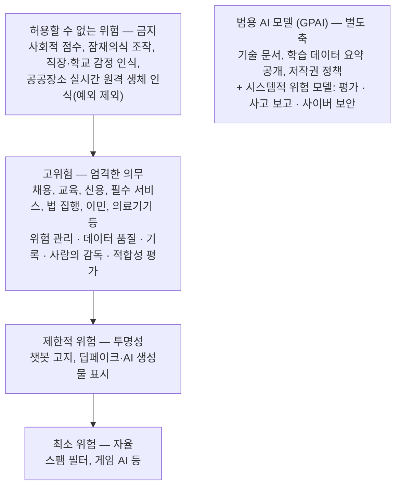

# AI 규제 (EU AI Act·AI 기본법)

!!! spec "핵심 문서 · 연도"
    OECD, "AI 원칙" (2019) · 중국, "생성형 AI 서비스 관리 잠정 방법" (2023) · 미국, 행정명령 14110 (2023, 2025년 폐지) · 「블레츨리 선언」 (2023) · EU, "AI Act (Regulation 2024/1689)" (2024) · 대한민국, 「인공지능 발전과 신뢰 기반 조성 등에 관한 기본법」 (2025년 1월 공포, 2026년 1월 시행) · EU, "범용 AI 행동 강령 (GPAI Code of Practice)" (2025) · 미국 캘리포니아, SB 53 (2025)

!!! basic "한눈에 보기"
    자동차가 처음 나왔을 때는 신호등도 운전면허도 없었습니다. 사고가 늘고 쓰임이 넓어지면서 도로교통법이 생겼습니다. AI도 비슷한 길을 걷고 있습니다. 채용, 대출, 의료, 법 집행처럼 사람의 삶에 큰 영향을 주는 곳에 AI가 쓰이면서, 각국이 **규칙**을 만들고 있습니다.

    대부분의 AI 규제는 **위험 기반 접근**을 따릅니다. 모든 AI를 똑같이 다루지 않고, 위험이 클수록 의무를 무겁게 합니다.

    - 영화 추천, 스팸 필터: 거의 규제 없음
    - 챗봇, 생성 이미지: "AI임을 알려라"는 투명성 의무
    - 채용, 신용 평가, 의료 기기: 위험 관리, 데이터 품질, 사람의 감독, 기록 의무
    - 사회적 점수 매기기, 잠재의식 조작: 금지

    그리고 최신 대형 모델처럼 여러 용도로 쓰이는 **범용 AI 모델** 자체에 대한 의무가 새로 생겼습니다. 규제는 빠르게 바뀌므로, 이 페이지의 내용은 **2026년 11월 기준**이며 실제 적용 전에는 최신 법령과 지침을 확인해야 합니다. 법률 자문이 아니라 개요입니다.

## 주요국 비교 { .l2 }

| 지역 | 핵심 법·정책 | 접근 방식 | 특징 |
|---|---|---|---|
| EU | AI Act (2024년 8월 발효, 단계적 적용) | 포괄적 위험 기반 법률 | 금지 → 범용 AI → 고위험 순으로 적용. 위반 시 전 세계 매출 최대 7% 과징금 |
| 한국 | AI 기본법 (2026년 1월 22일 시행) | 진흥 + 신뢰 기반의 기본법 | 고영향 AI, 생성형 AI 표시, 국내 대리인 지정. 과태료는 계도 기간을 두고 운영 |
| 미국 | 연방 포괄법 없음. 2025년 행정명령 14110 폐지 후 「AI 행동 계획」(2025.7) | 혁신 우선, 분야별 기존 법 적용 | 주 법이 활발: 캘리포니아 SB 53(프런티어 모델 투명성), 콜로라도 AI법 등 |
| 중국 | 알고리즘 추천·딥페이크·생성형 AI 규정, AI 생성물 표시 규정(2025.9 시행) | 서비스별 신속한 행정 규정 | 서비스 출시 전 등록·안전 평가, 콘텐츠 규제 |
| 영국·일본 | 기존 규제 기관 중심, 가이드라인·자율 규제 | 원칙 기반, 유연한 접근 | 일본은 2025년 AI 추진법 제정 |

## EU AI Act의 구조 { .l2 }



| 적용 시점 | 내용 |
|---|---|
| 2025년 2월 | 금지 조항, AI 리터러시 의무 |
| 2025년 8월 | 범용 AI 모델 의무 (기존 모델은 2027년 8월까지 유예), 행동 강령 |
| 2026년 8월 (예정) | 고위험 AI 의무 대부분. 다만 2025년 11월 EU 집행위원회가 '디지털 옴니버스'로 고위험 의무 적용 연기를 제안해 일정 변동 가능 |
| 2027년 8월 | 제품 안전 법규에 포함된 고위험 AI |

## 한국 AI 기본법의 요점 { .l2 }

| 항목 | 내용 |
|---|---|
| 고영향 AI | 에너지, 보건의료, 채용, 대출 심사, 교육 등에서 생명·안전·기본권에 중대한 영향을 줄 수 있는 AI. 위험 관리, 설명 방안, 이용자 보호, 사람의 관리·감독, 문서화 의무 |
| 생성형 AI | 생성형 AI 기반임을 이용자에게 사전 고지, 결과물이 AI 생성물임을 표시. 실제와 구분하기 어려운 결과물(딥페이크)은 명확히 표시 |
| 고성능 AI 안전성 | 학습 누적 연산량이 기준 이상인 AI에 위험 식별·평가·완화 체계 의무 (기준은 시행령) |
| 국내 대리인 | 일정 규모 이상의 해외 사업자는 국내 대리인 지정 |
| 진흥 | 국가 AI 위원회, 기본 계획, 데이터센터·인력·중소기업 지원, AI 안전연구소의 법적 근거 |
| 제재 | 고지·표시 의무 위반, 대리인 미지정 등에 과태료(최대 3천만 원). 정부는 시행 초기 계도 기간을 두겠다고 밝힘 |

## 코드로 보기 { .l2 }

여러 규제가 최신 대형 모델을 가려내는 기준으로 **학습 연산량**(FLOP)을 씁니다. 트랜스포머 학습 연산량은 대략 **6 × 파라미터 수 × 학습 토큰 수**입니다(→ [사전 학습과 스케일링 법칙](../llm/pretraining.md)).

```python
def train_flops(params, tokens):
    return 6 * params * tokens          # 순전파 2 + 역전파 4 FLOP / 파라미터 / 토큰

thresholds = {"EU AI Act 시스템적 위험 GPAI 추정": 1e25,
              "캘리포니아 SB 53 '프런티어 모델'": 1e26}
models = {"8B × 15T 토큰": (8e9, 15e12),
          "70B × 15T 토큰": (70e9, 15e12),
          "405B × 15.6T 토큰": (405e9, 15.6e12),
          "가상의 2T × 40T 토큰": (2e12, 40e12)}
for name, (n, d) in models.items():
    f = train_flops(n, d)
    flags = [k.split()[0] for k, th in thresholds.items() if f >= th]
    print(f"{name:20s} {f:.1e} FLOP  →  {', '.join(flags) or '기준 미만'}")
```

8B 모델(7.2×10²³)과 70B 모델(6.3×10²⁴)은 두 기준 모두 미만이고, Llama 3.1 405B 규모(3.8×10²⁵)는 EU AI Act의 **시스템적 위험 추정 기준(10²⁵ FLOP)**을 넘습니다. 10²⁶ FLOP을 넘는 것은 2T 파라미터를 40T 토큰으로 학습한 가상의 모델 같은 최전선 규모뿐입니다. 연산량 기준은 측정이 쉽고 사전에 알 수 있다는 장점이 있지만, 효율이 좋아질수록 같은 능력을 더 적은 연산으로 얻게 되어 능력과의 연결이 느슨해집니다. 그래서 EU는 연산량을 "추정" 기준으로 두고 집행위원회가 능력 평가로 지정할 수 있게 했습니다.

??? expert "전문가 노트 — 범용 AI 의무의 실제, 오픈소스 예외, 실무 준비"
    **범용 AI 의무의 실제.** EU의 범용 AI 모델 제공자는 기술 문서 작성, 하류 사업자에게 정보 제공, 저작권 준수 정책(TDM 거부 의사 존중), 학습 데이터의 **충분히 상세한 요약** 공개(집행위원회 양식) 의무를 집니다. 시스템적 위험 모델은 여기에 최신 평가(적대적 테스트 포함), 위험 평가·완화, 중대 사고 보고, 사이버 보안을 더합니다. 2025년 7월 공개된 행동 강령(투명성, 저작권, 안전·보안 세 장)에 주요 개발사 다수가 서명해 의무 이행의 기준으로 쓰이고 있습니다.

    **오픈소스 예외.** EU AI Act는 가중치를 공개하고 수익화하지 않는 오픈소스 모델에 기술 문서 의무 등을 일부 면제하지만, 시스템적 위험 모델이면 면제되지 않습니다. 저작권 정책과 학습 데이터 요약 의무는 남습니다. "오픈 웨이트"와 "오픈소스"의 정의 문제는 [오픈 웨이트 모델](../next/open-weights.md)에서 다룹니다.

    **미국 주 법.** 캘리포니아 SB 53(2025년 9월 서명)은 10²⁶ FLOP 이상으로 학습한 프런티어 모델 개발사(대형은 연 매출 5억 달러 이상)에 안전 프레임워크 공개, 중대 안전 사고 보고, 내부 고발자 보호를 요구합니다. 연방 차원에서는 주 법의 난립을 막으려는 선점(preemption) 논의가 이어지고 있습니다.

    **실무 준비.** AI를 제품에 넣는 기업이 할 일은 대체로 비슷합니다. ① 사용 중인 AI 시스템 목록과 용도 파악, ② 고위험/고영향 해당 여부 분류, ③ 생성형 AI 고지·표시 적용, ④ 모델 카드·데이터 출처·평가 결과 문서화, ⑤ 사람의 감독 절차와 이의 제기 경로 마련, ⑥ 사고 대응 체계. 국제 표준 ISO/IEC 42001(AI 경영 시스템)과 NIST AI RMF가 체계를 잡는 데 자주 쓰입니다.

## 관련 페이지

- [정렬과 AI 안전](safety.md) — 위험 능력 평가와 안전 기관
- [저작권과 개인정보](copyright-privacy.md) — 학습 데이터와 표시 의무
- [편향과 공정성](fairness.md) — 고위험 영역의 공정성 요구
- [2025–2026 모델 지형](../next/landscape-2026.md)
