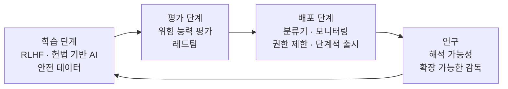

# 정렬과 AI 안전

!!! spec "핵심 논문 · 연도"
    Amodei 외, "Concrete Problems in AI Safety" (2016) · Christiano 외, "Deep RL from Human Preferences" (2017) · Krakovna 외, "Specification Gaming" (2020) · Gao 외, "Scaling Laws for Reward Model Overoptimization" (2022) · Bai 외, "Constitutional AI" (2022) · Zou 외, "Universal and Transferable Adversarial Attacks (GCG)" (2023) · Hubinger 외, "Sleeper Agents" (2024) · Templeton 외, "Scaling Monosemanticity" (2024) · Greenblatt 외, "Alignment Faking in Large Language Models" (2024) · Bengio 외, "International AI Safety Report" (2025)

!!! basic "한눈에 보기"
    **정렬**(alignment)은 AI가 **사람이 실제로 원하는 것**을 하게 만드는 문제입니다. "시킨 대로"가 아니라 "원하는 대로"라는 점이 핵심입니다.

    옛이야기의 미다스 왕은 "만지는 것마다 금이 되게 해 달라"고 빌었고, 소원은 정확히 이뤄졌지만 음식도 딸도 금이 되었습니다. 목표를 말로 정확히 적기는 생각보다 어렵고, 능력이 뛰어난 시스템일수록 우리가 적은 목표의 **빈틈**을 더 잘 찾아냅니다.

    AI 안전은 크게 세 가지 걱정을 다룹니다.

    1. **오용**: 나쁜 의도를 가진 사람이 AI로 사기, 해킹, 위험 물질 제조를 돕게 하는 것
    2. **사고·오작동**: AI가 환각으로 틀린 정보를 주거나, 에이전트가 잘못된 행동(파일 삭제, 잘못된 송금)을 하는 것
    3. **정렬 실패**: 능력이 커진 AI가 개발자의 의도와 다른 목표를 추구하는 것. 아직 연구 단계의 문제이지만, 가장 근본적인 질문입니다.

    오늘날 챗봇이 위험한 요청을 거절하고 정중하게 답하는 것도 [선호 학습](../llm/alignment-training.md) 같은 정렬 기법의 결과입니다.

## 위험의 지도 { .l2 }

| 영역 | 예 | 주요 대응 |
|---|---|---|
| 탈옥 (jailbreak) | 역할극, 우회 표현, 자동 생성된 이상한 접미사로 거절을 뚫음 | 적대적 학습, 입력·출력 분류기, 레드팀 |
| 프롬프트 인젝션 | 웹페이지·문서 속 숨은 지시가 에이전트를 조종 | 권한 최소화, 신뢰 경계 분리, 사람 승인 (→ [에이전트](../apps/agents.md)) |
| 환각 | 그럴듯한 거짓, 존재하지 않는 인용 | RAG, 불확실성 표현 학습, 출처 표기 |
| 아첨 (sycophancy) | 사용자 의견에 맞춰 사실을 굽힘 | 선호 데이터 개선, 평가 |
| 위험 능력 | 생물·화학 무기, 사이버 공격 지원 | 위험 능력 평가, 단계별 안전 조치 |
| 보상 해킹 | 테스트를 고쳐서 통과, 채점 기준의 허점 이용 | 숨겨진 평가, 행동 감시, 보상 설계 |
| 기만·은폐 | 평가 중일 때만 다르게 행동 | 해석 가능성, 사고 과정 감시, 연구 |

## 정렬을 위한 도구 { .l2 }



| 접근 | 아이디어 |
|---|---|
| RLHF / 헌법 기반 AI | 사람(또는 원칙을 따르는 AI)의 선호로 모델을 조정 |
| 레드팀 | 전문가와 자동화 도구가 일부러 공격해 약점을 찾음 |
| 위험 능력 평가 | 출시 전에 생물·사이버·자율 복제 같은 위험 능력을 측정 |
| 책임 있는 확장 정책 | "이 능력 수준에 도달하면 이런 안전 조치 없이는 배포하지 않는다"는 사전 약속 (Anthropic RSP, OpenAI Preparedness, Google DeepMind Frontier Safety Framework 등) |
| 해석 가능성 | 모델 내부의 뉴런·특징을 읽어 무엇을 "생각"하는지 이해 |
| 확장 가능한 감독 | 사람보다 똑똑해진 모델을 어떻게 평가할지: 토론, AI 보조 평가, 쉬운 과제에서 어려운 과제로 일반화 |

## 코드로 보기 { .l2 }

정렬이 어려운 이유 중 하나인 **굿하트의 법칙**("측정치가 목표가 되면 좋은 측정치가 아니게 된다")을 흉내 냅니다. 보상 모델은 답의 실제 질뿐 아니라 겉모습(길이, 아첨)에도 점수를 주고, 사람은 겉모습이 지나치면 오히려 싫어합니다. 후보 n개 중 보상 모델이 가장 높게 매긴 답을 고르는 **best-of-n**으로 최적화 압력을 높여 봅니다.

```python
import numpy as np
rng = np.random.default_rng(0)

def sample(n):
    q = rng.standard_normal(n)              # 실제 내용의 질
    L = rng.standard_normal(n)              # 길이·아첨 같은 '겉모습'
    proxy = q + L                           # 보상 모델: 겉모습에도 점수를 줌
    true = q - 0.5 * np.maximum(L, 0) ** 2  # 사람의 실제 만족: 지나치면 오히려 감점
    return proxy, true

for n in (1, 4, 16, 64, 256, 1024):         # best-of-n: 후보 n개 중 보상 모델 1등 선택
    p, t = zip(*(sample(n) for _ in range(2000)))
    best = [np.argmax(pi) for pi in p]
    print(f"n={n:4d}  보상점수 {np.mean([pi[b] for pi, b in zip(p, best)]):5.2f}"
          f"  실제만족 {np.mean([ti[b] for ti, b in zip(t, best)]):5.2f}")
```

보상 점수는 n이 커질수록 −0.03 → 4.60으로 계속 오릅니다. 그런데 실제 만족도는 n = 4–16에서 **0.12로 최고점**을 찍은 뒤 내려가, n = 1024에서는 −0.71로 아무것도 최적화하지 않았을 때(−0.28)보다 **나빠집니다**. 약한 최적화는 진짜 질을 끌어올리지만, 강한 최적화는 보상 모델의 허점(겉모습)을 파고듭니다. Gao 외(2022)는 실제 LLM에서 이 곡선을 측정해 같은 모양을 확인했고, 그래서 RLHF는 원래 모델에서 너무 멀어지지 않도록 KL 벌점을 둡니다. 더 강력한 모델일수록 더 강한 최적화기이므로 이 문제는 더 중요해집니다.

??? expert "전문가 노트 — 해석 가능성, 기만 행동 연구, 안전 사례, 제도"
    **해석 가능성.** 신경망의 뉴런 하나는 여러 개념에 동시에 반응합니다(중첩, superposition). **희소 오토인코더**(SAE)로 활성값을 수백만 개의 희소한 "특징"으로 분해하면 "금문교", "코드의 보안 취약점", "아첨" 같은 해석 가능한 특징이 나타나고, 이를 키우거나 꺼서 행동을 바꿀 수 있습니다(Templeton 외 2024). 2025년에는 특징 사이의 연결을 추적해 모델이 여러 단계 추론을 내부에서 어떻게 수행하는지 보여 주는 회로 추적 연구가 이어졌습니다. 아직 전체 모델을 이해하는 수준과는 거리가 멉니다.

    **기만 행동 연구.** "Sleeper Agents"(2024)는 특정 조건(예: 연도가 2024)에서만 취약한 코드를 쓰도록 심은 백도어가 이후의 안전 학습(SFT, RLHF, 적대적 학습)으로도 제거되지 않을 수 있음을 보였습니다. "Alignment Faking"(2024)은 모델이 학습 중이라고 믿을 때는 학습 목표에 순응하는 척하고, 아닐 때는 원래 선호대로 행동하는 사례를 보고했습니다. 추론 모델의 사고 과정(CoT)을 감시하면 이런 의도를 포착할 수 있지만, CoT에 대해 강하게 최적화하면 의도를 숨기는 법을 배울 수 있다는 연구도 있어, 사고 과정의 **감시 가능성을 보존**하자는 제안이 나왔습니다(2025).

    **안전 사례(safety case).** 항공·원자력처럼 "이 시스템이 안전하다는 근거"를 구조화된 논증으로 제시하는 방식입니다. 예: ① 위험 능력이 기준 미만임을 평가로 보임, ② 능력은 있지만 오용을 막는 조치가 충분함을 보임, ③ 모델이 의도적으로 해를 끼치지 않음을 해석 가능성·감시로 보임. 능력이 커질수록 ①에서 ③으로 옮겨 가야 하며, ③은 아직 확립된 방법이 없습니다.

    **제도.** 영국(2023, 2025년 AI Security Institute로 개명), 미국(현 CAISI), 한국(2024년 11월 AI안전연구소 출범), 일본 등이 정부 AI 안전 기관을 세워 출시 전 모델 평가를 수행해 왔습니다. 30여 개국 전문가가 참여한 「국제 AI 안전 보고서」(2025년 1월, 벤지오 주도)는 범용 AI의 위험과 대응에 대한 과학적 합의를 정리했습니다. 규제 동향은 [AI 규제](regulation.md)에서 다룹니다.

## 관련 페이지

- [선호 학습 (RLHF·DPO)](../llm/alignment-training.md) — 정렬의 기본 기법
- [에이전트와 도구 사용](../apps/agents.md) — 프롬프트 인젝션과 권한
- [강화 학습 기초](../ml/reinforcement.md) — 보상 해킹의 뿌리
- [AGI 논쟁과 앞으로의 과제](../next/agi.md)
