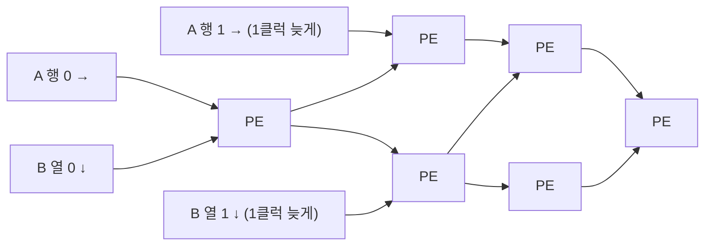
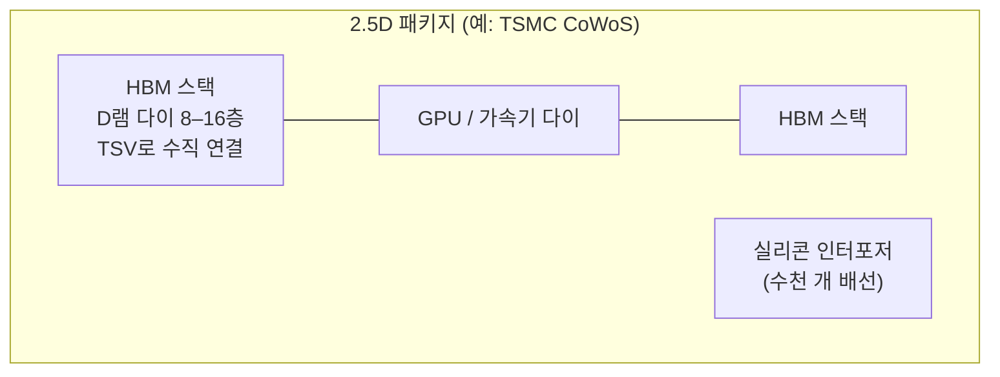

# AI 반도체와 메모리 (HBM)

!!! spec "핵심 논문 · 연도"
    Kung, "Why Systolic Architectures?" (1982) · Jouppi 외, "In-Datacenter Performance Analysis of a Tensor Processing Unit" (2017) · JEDEC, "HBM 표준 (JESD235)" (2013) · Jouppi 외, "TPU v4: An Optically Reconfigurable Supercomputer" (2023) · Gholami 외, "AI and Memory Wall" (2024) · Cerebras, "Wafer-Scale Engine" (2019–2024) · Google, "Ironwood (TPU v7)" (2025)

!!! basic "한눈에 보기"
    AI의 발전은 반도체 산업의 지도를 바꿨습니다. 2026년 11월 기준 AI 가속기와 이를 위한 메모리는 반도체 산업에서 가장 빠르게 성장하는 분야이고, 국가 간 기술 경쟁과 수출 통제의 대상이기도 합니다.

    AI 칩은 크게 세 부류입니다.

    - **GPU** (NVIDIA, AMD): 범용 병렬 프로세서. 소프트웨어 생태계(CUDA)가 가장 강력해 학습 시장의 대부분을 차지합니다.
    - **전용 가속기(ASIC)**: Google TPU, AWS Trainium처럼 클라우드 회사가 자기 서비스용으로 직접 설계한 칩, 그리고 추론 전용 스타트업 칩. 행렬 곱에 필요 없는 회로를 빼서 전력 효율을 높입니다.
    - **NPU**: 스마트폰·PC 안의 저전력 가속기 (→ [NPU와 온디바이스 AI](npu.md)).

    그리고 이 모든 칩의 성능을 가르는 숨은 주인공이 **메모리**입니다. [GPU 페이지](gpu.md)에서 본 것처럼 LLM은 계산보다 메모리에서 데이터를 가져오는 속도에 막히는 경우가 많습니다. 그래서 D램을 수직으로 쌓아 칩 바로 옆에 붙인 **HBM**(고대역폭 메모리)이 AI 반도체의 핵심 부품이 되었고, 한국 기업들이 이 분야를 이끌고 있습니다.

## 시스톨릭 배열: 행렬 곱 전용 회로 { .l2 }

TPU를 비롯한 많은 AI 가속기의 심장은 **시스톨릭 배열**입니다. 곱셈-누적 장치(PE)를 바둑판처럼 놓고, 데이터를 심장 박동(systole)처럼 한 클럭에 한 칸씩 옆으로 흘려 보냅니다. 각 PE는 들어온 두 값을 곱해 자기 칸에 더하고, 값을 이웃에게 넘깁니다. 한 번 읽은 데이터를 수많은 PE가 차례로 재사용하므로 메모리 접근이 극적으로 줄어듭니다.



1세대 TPU(2015년 배치)는 256×256 = 65,536개의 int8 PE로 이루어진 시스톨릭 배열 하나가 칩의 대부분이었습니다. 이후 세대는 BF16·FP8 지원, 여러 배열, HBM, 칩 수천 개를 잇는 광 스위치 네트워크를 더했습니다.

## 주요 가속기 (2026년 11월 기준) { .l2 }

수치는 공개 자료 기준의 대략적인 값이며, 형식(밀집/희소, FP8/BF16)에 따라 크게 달라집니다.

| 칩 | 회사 · 출시 | 메모리 | 대역폭 | 특징 |
|---|---|---|---|---|
| H100 / H200 | NVIDIA · 2022 / 2024 | 80GB / 141GB | 3.35 / 4.8TB/s | 2023–2024년 AI 붐의 주력 |
| B200 / B300 | NVIDIA · 2024 / 2025 | 약 180GB / 288GB HBM3e | 약 8TB/s | FP4, NVL72 랙(72개 GPU를 NVLink로 하나처럼) |
| Rubin | NVIDIA · 2026 하반기 예정 발표 | HBM4 | — | 차세대, HBM4 첫 세대 |
| MI300X / MI355X | AMD · 2023 / 2025 | 192GB / 288GB | 5.3 / 8TB/s | 큰 메모리, ROCm 생태계 |
| TPU v7 (Ironwood) | Google · 2025 | 192GB HBM3e | 약 7.4TB/s | 추론 중심 설계, 최대 9,216칩 포드 |
| Trainium2 / 3 | AWS · 2024 / 2025 | 96GB / 144GB | 약 2.9 / 4.9TB/s | 자체 클라우드용, 대규모 클러스터 |
| WSE-3 | Cerebras · 2024 | 칩 안 SRAM 44GB | 수 PB/s (온칩) | 웨이퍼 한 장이 칩 하나, 초고속 디코딩 |
| Ascend 910C 계열 | Huawei · 2024– | HBM | — | 수출 통제 아래 중국의 대안 |
| ATOM·REBEL / RNGD | 리벨리온 / 퓨리오사AI · 한국 | ATOM은 GDDR6, REBEL은 HBM3E / RNGD는 HBM3 | — | 데이터센터 추론, 전력 효율 |

## HBM: 왜 메모리가 핵심인가 { .l2 }



일반 D램(DDR, GDDR)은 칩에서 떨어진 기판 위에 놓이고 데이터 선이 수십 개 수준입니다. **HBM**은 D램 다이를 수직으로 쌓아 **TSV**(실리콘 관통 전극)로 잇고, 가속기 바로 옆 실리콘 인터포저 위에 붙여 스택 하나당 **1,024개**(HBM4는 2,048개)의 데이터 선을 씁니다. 길이 짧고 폭이 넓은 고속도로를 깐 셈이라, 적은 전력으로 막대한 대역폭을 냅니다.

| 세대 | 스택당 대역폭 (대략) | 스택 용량 | 대표 사용처 |
|---|---|---|---|
| HBM2e | 약 0.4TB/s | 16GB | A100 |
| HBM3 | 약 0.8TB/s | 16–24GB | H100 |
| HBM3E | 약 1.2TB/s | 24–36GB | H200, B200, MI355X, TPU v7 |
| HBM4 | 2TB/s 이상 | 36–48GB 이상 | 2026년부터 차세대 가속기 |

HBM은 생산이 어렵습니다. 다이를 얇게 갈아 쌓고, 수천 개의 TSV가 모두 정상이어야 하며, 쌓은 뒤의 수율과 발열 관리가 관건입니다. 2024–2025년 기준 **SK하이닉스**가 HBM 시장 점유율 1위로 NVIDIA의 주요 공급사이며, **삼성전자**와 **마이크론**이 뒤를 잇습니다. HBM과 가속기를 한 패키지로 묶는 **첨단 패키징**(TSMC CoWoS 등)의 생산 능력도 AI 칩 공급의 병목이었습니다.

## 코드로 보기 { .l2 }

4×4 시스톨릭 배열을 시뮬레이션해 행렬 곱을 계산합니다. A는 왼쪽에서, B는 위에서, 행·열마다 한 클럭씩 늦게 들어가 PE(i, j)에서 짝이 맞는 A[i, k]와 B[k, j]가 정확히 만납니다.

```python
import numpy as np

def systolic_matmul(A, B):
    """N×N 출력 고정형(output-stationary) 시스톨릭 배열 시뮬레이션"""
    n, k = A.shape; m = B.shape[1]
    C = np.zeros((n, m)); a_reg = np.zeros((n, m)); b_reg = np.zeros((n, m))
    for t in range(n + m + k - 2):                  # 데이터가 대각선으로 흘러가는 시간
        a_reg = np.roll(a_reg, 1, axis=1)           # A는 왼쪽→오른쪽으로 한 칸
        b_reg = np.roll(b_reg, 1, axis=0)           # B는 위→아래로 한 칸
        for i in range(n):                          # 왼쪽 가장자리로 A 행 i를 i클럭 늦게 넣음
            a_reg[i, 0] = A[i, t - i] if 0 <= t - i < k else 0
        for j in range(m):                          # 위쪽 가장자리로 B 열 j를 j클럭 늦게 넣음
            b_reg[0, j] = B[t - j, j] if 0 <= t - j < k else 0
        C += a_reg * b_reg                          # 모든 PE가 동시에 곱하고 자기 칸에 누적
    return C, t + 1

rng = np.random.default_rng(0)
A, B = rng.integers(-3, 4, (4, 6)), rng.integers(-3, 4, (6, 4))
C, cycles = systolic_matmul(A, B)
print("결과 일치:", np.array_equal(C, A @ B), "| 클럭 수:", cycles, "| PE 수:", 16, "| MAC 수:", 4 * 4 * 6)
```

결과는 `A @ B`와 정확히 일치하고, 곱셈-누적 96번을 PE 16개가 **12클럭**에 끝냅니다. 핵심은 A와 B의 각 원소를 메모리에서 **한 번만** 읽었는데 4개의 PE가 차례로 재사용했다는 점입니다. 배열이 256×256이면 한 번 읽은 값을 256번 재사용하므로, [루프라인](gpu.md)의 산술 강도가 그만큼 높아집니다. 시작과 끝에 일부 PE가 노는 시간(여기서는 12클럭 중 6클럭이 채우고 비우는 시간)은 행렬이 클수록 비중이 작아집니다.

??? expert "전문가 노트 — 메모리 벽, 칩 설계의 선택, 공급망과 전력"
    **메모리 벽.** Gholami 외(2024)의 분석에 따르면 지난 20년간 하드웨어 최대 연산 성능은 2년마다 약 3배 늘었지만, D램 대역폭은 1.6배, 칩 간 연결 대역폭은 1.4배 늘었습니다. 연산과 메모리의 격차가 계속 벌어지면서, 모델 구조(GQA, MoE, 양자화)와 시스템(배칭, 캐시)이 이 격차를 메우는 방향으로 진화하고 있습니다.

    **설계의 갈림길.** ① **HBM 중심** (GPU, TPU): 큰 메모리에 모델을 싣고 배치로 효율을 냄. 범용성 높음. ② **SRAM 중심** (Cerebras, Groq 등): 칩 안 SRAM에 가중치를 올려 대역폭을 수십 배 높이고 사용자당 디코딩 속도를 극대화. 대신 SRAM 용량이 작아 큰 모델에는 칩이 많이 필요함. ③ **스케일업 도메인 확대**: NVL72처럼 랙 하나를 거대한 GPU 하나처럼 묶어 텐서·전문가 병렬의 통신을 빠르게 함. 2026년 기준 경쟁의 초점은 단일 칩보다 **랙과 데이터센터 단위 시스템**으로 옮겨 갔습니다.

    **소프트웨어가 해자다.** 하드웨어 사양이 좋아도 PyTorch 모델이 바로 빠르게 돌지 않으면 쓰이지 않습니다. NVIDIA의 강점은 CUDA, cuDNN, NCCL, TensorRT로 이어진 15년 넘는 생태계입니다. 경쟁사들은 PyTorch·JAX 백엔드, Triton 같은 하드웨어 중립 커널 언어, vLLM 지원으로 이 격차를 줄이려 합니다.

    **공급망·지정학·전력.** 최첨단 AI 칩은 대부분 대만 TSMC의 공정과 패키징에서 만들어지고, HBM은 한국과 미국 기업이 공급합니다. 미국은 2022년부터 첨단 AI 칩과 장비의 중국 수출을 단계적으로 통제해 왔고, 중국은 자국 칩 개발을 서두르고 있습니다. 또한 대형 학습 클러스터는 수백 MW에서 GW급 전력을 요구해, **전력과 냉각**(액체 냉각)이 칩만큼 중요한 제약이 되었습니다 → [최신 동향](../next/landscape-2026.md).

## 관련 페이지

- [GPU와 행렬 연산](gpu.md) — 루프라인과 메모리 계층
- [추론 최적화](inference.md) — 메모리 대역폭이 디코딩 속도를 정하는 이유
- [분산 학습](distributed.md) — 칩 간 연결의 중요성
- [NPU와 온디바이스 AI](npu.md)
