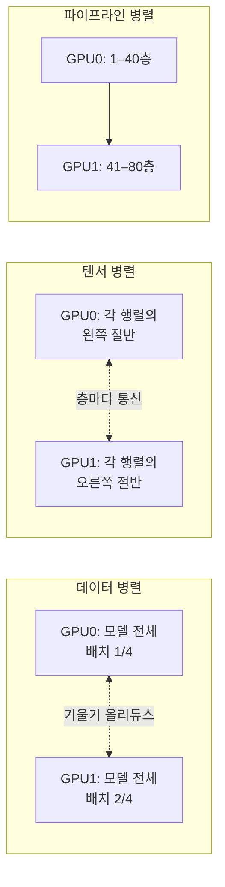

# 분산 학습 (데이터·텐서·파이프라인 병렬)

!!! spec "핵심 논문 · 연도"
    Dean 외, "Large Scale Distributed Deep Networks (DistBelief)" (2012) · Goyal 외, "Accurate, Large Minibatch SGD" (2017) · Huang 외, "GPipe" (2018) · Shoeybi 외, "Megatron-LM" (2019) · Rajbhandari 외, "ZeRO" (2019) · Narayanan 외, "Efficient Large-Scale Training with Megatron-LM (3D 병렬)" (2021) · Zhao 외, "PyTorch FSDP" (2023) · Liu 외, "Ring Attention" (2023) · DeepSeek-AI, "DeepSeek-V3 Technical Report" (2024)

!!! basic "한눈에 보기"
    최신 LLM 하나를 GPU 1장으로 학습하면 수백 년이 걸리고, 애초에 모델이 GPU 메모리에 들어가지도 않습니다. 그래서 GPU 수천~수십만 장에 일을 나눠 맡깁니다.

    큰 책 한 권을 여러 명이 번역하는 상황에 비유할 수 있습니다.

    - **데이터 병렬**: 모두가 같은 사전(모델)을 한 권씩 들고 서로 다른 장을 번역한 뒤, 배운 점(기울기)을 모아 평균 냅니다.
    - **텐서 병렬**: 문장 하나가 너무 길어서, 한 문장을 여러 명이 조각내 동시에 번역합니다.
    - **파이프라인 병렬**: 조립 라인처럼 1번 사람은 초벌, 2번은 교정, 3번은 편집을 맡습니다(모델의 층을 나눔).

    실제 대규모 학습은 이 셋(과 그 밖의 방식)을 **동시에** 섞어 씁니다. 그리고 계산보다 **GPU 사이의 통신**이 병목이 되지 않게 하는 것이 핵심 기술입니다.

## 병렬화 방식 { .l2 }



| 방식 | 나누는 것 | 통신 | 장점 | 단점 |
|---|---|---|---|---|
| 데이터 병렬 (DP) | 배치 | 스텝마다 기울기 올리듀스 | 단순, 확장 쉬움 | GPU마다 모델 전체 복사 → 메모리 낭비 |
| ZeRO / FSDP | 옵티마이저 상태·기울기·가중치 | 필요할 때 모으고(all-gather) 흩음(reduce-scatter) | DP의 메모리 낭비 제거 | 통신량 증가 |
| 텐서 병렬 (TP) | 층 안의 행렬 | 층마다 (매우 잦음) | 큰 층도 나눌 수 있음 | 빠른 연결(NVLink) 필수 → 서버 안에서만 |
| 파이프라인 병렬 (PP) | 층 묶음 | 단계 경계에서 활성값 전달 | 통신량 적음, 서버 간 가능 | **거품**(놀고 있는 GPU) |
| 시퀀스/문맥 병렬 (SP/CP) | 토큰 위치 | 어텐션 계산 시 K·V 교환 | 긴 문맥 학습 | 구현 복잡 |
| 전문가 병렬 (EP) | MoE 전문가 | 토큰을 전문가 GPU로 보내고 받음(all-to-all) | 거대 MoE 가능 | 부하 불균형, 통신 폭증 (→ [MoE](../llm/moe.md)) |

일반적인 조합(**3D/4D 병렬**)은 서버 안 8장은 텐서 병렬, 서버 몇 대를 잇는 파이프라인 병렬, 그리고 그 묶음 전체를 다시 데이터 병렬(FSDP)로 복제하는 구조입니다. **빠른 통신이 필요한 것일수록 가까운 GPU끼리** 묶는 것이 원칙입니다.

## 메모리는 어디에 쓰이나 { .l2 }

혼합 정밀도 + Adam 학습에서 파라미터 하나당 약 **16바이트**가 필요합니다.

| 항목 | 바이트/파라미터 | 70B 모델 |
|---|---|---|
| BF16 가중치 | 2 | 140GB |
| BF16 기울기 | 2 | 140GB |
| FP32 마스터 가중치 | 4 | 280GB |
| Adam 1차·2차 모멘트 (FP32) | 4 + 4 | 560GB |
| **합계** | **16** | **1,120GB** |
| 활성값 | 배치·문맥 길이에 비례 | 수백 GB 이상 가능 → 재계산(activation checkpointing)으로 절약 |

## 코드로 보기 { .l2 }

① ZeRO 단계별로 GPU 한 장이 지는 메모리를 계산하고, ② 데이터 병렬에서 각 GPU 기울기의 평균(올리듀스)이 전체 배치 기울기와 **정확히 같다**는 것을 확인합니다.

```python
def train_memory_gb(n_params, n_gpus, zero_stage):
    """혼합 정밀도 + Adam: 가중치 2B, 기울기 2B, FP32 마스터·m·v 12B = 파라미터당 16B"""
    w, g, opt = 2 * n_params, 2 * n_params, 12 * n_params
    if zero_stage >= 1: opt /= n_gpus     # 옵티마이저 상태를 나눠 가짐
    if zero_stage >= 2: g /= n_gpus       # 기울기도 나눔
    if zero_stage >= 3: w /= n_gpus       # 가중치까지 나눔 (FSDP)
    return (w + g + opt) / 1e9

N = 70e9                                  # 70B 모델, GPU 64장
for z in range(4):
    print(f"ZeRO-{z}: GPU당 {train_memory_gb(N, 64, z):7.1f} GB (활성값 제외)")

import torch
torch.manual_seed(0)
X, y = torch.randn(64, 10), torch.randn(64, 1)
w = torch.zeros(10, 1, requires_grad=True)
full = torch.autograd.grad(((X @ w - y) ** 2).mean(), w)[0]          # 배치 전체
shards = [torch.autograd.grad(((Xs @ w - ys) ** 2).mean(), w)[0]      # GPU 4장에 나눔
          for Xs, ys in zip(X.chunk(4), y.chunk(4))]
allreduce = torch.stack(shards).mean(0)                               # 올리듀스(평균)
print("데이터 병렬 기울기 = 전체 배치 기울기:", torch.allclose(full, allreduce, atol=1e-6))
```

일반 데이터 병렬(ZeRO-0)이면 GPU마다 **1,120GB**가 필요해 80GB GPU에 들어갈 수 없습니다. 옵티마이저 상태만 64조각으로 나눠도(ZeRO-1) 293GB, 기울기까지 나누면 155GB, 가중치까지 나누면(ZeRO-3, FSDP) **17.5GB**로 줄어 활성값을 넣을 여유가 생깁니다. 두 번째 결과 `True`는 데이터 병렬이 근사가 아니라 큰 배치 학습과 **수학적으로 동일**하다는 뜻입니다(각 조각의 크기가 같을 때). 그래서 GPU를 늘리는 것은 곧 배치를 키우는 것이고, 배치가 너무 커지면 학습률 조정(워밍업, 선형 스케일링)이 필요합니다.

??? expert "전문가 노트 — 집합 통신, 파이프라인 거품, 대규모 클러스터의 현실"
    **집합 통신.** 올리듀스는 보통 **링 알고리즘**으로 구현합니다. N개 GPU가 고리로 연결되어 데이터를 N조각으로 나눠 reduce-scatter 후 all-gather 하면, GPU 하나가 보내는 양은 데이터 크기 S에 대해 2(N−1)/N·S ≈ 2S로 GPU 수와 거의 무관합니다. 그래서 데이터 병렬은 확장성이 좋습니다. NCCL 같은 라이브러리가 토폴로지에 맞춰 링·트리 알고리즘을 고르며, 역전파 도중 이미 계산된 층의 기울기부터 통신을 시작해 계산과 통신을 **겹칩니다**.

    **텐서 병렬의 원리.** MLP의 첫 행렬을 열 방향으로, 둘째 행렬을 행 방향으로 나누면(Megatron 방식), 각 GPU가 독립적으로 계산한 뒤 블록 끝에서 올리듀스 한 번만 하면 됩니다. 어텐션은 헤드 단위로 나눕니다. 그래도 층마다 통신이 생기므로 NVLink로 묶인 서버 안(보통 8장, GB200 NVL72 같은 랙 규모 시스템에서는 72장)에서만 씁니다.

    **파이프라인 거품.** 단계가 p개이고 배치를 m개 마이크로배치로 나누면, 순진한 스케줄(GPipe)에서 놀고 있는 시간 비율은 약 (p−1)/(m+p−1)입니다. 마이크로배치를 늘리고, 순전파와 역전파를 교대로 진행하는 1F1B 스케줄, 한 GPU에 여러 비연속 단계를 맡기는 인터리빙, DeepSeek-V3의 DualPipe(계산과 통신의 양방향 겹침)로 거품을 줄입니다.

    **대규모 클러스터의 현실.** GPU 수만 장 규모에서는 **장애가 일상**입니다. Meta는 Llama 3 405B 학습(GPU 16,384장, 54일) 동안 예기치 않은 중단이 419번, 약 3시간에 한 번꼴로 있었다고 보고했고, 원인의 절반 가까이가 GPU와 HBM 문제였습니다. 그래서 주기적 체크포인트, 빠른 재시작, 느린 노드 감지(straggler detection)가 학습 효율을 좌우합니다. 2026년 11월 기준 최전선 학습은 GPU 10만 장 이상, 수백 MW급 전력을 쓰는 데이터센터에서 이뤄지며, 여러 데이터센터를 묶는 학습도 시도되고 있습니다.

## 관련 페이지

- [GPU와 행렬 연산](gpu.md) — 한 장 안에서의 효율
- [사전학습](../llm/pretraining.md) — 계산 예산과 스케일링 법칙
- [옵티마이저](../dl/optimizers.md) — Adam 상태가 메모리를 차지하는 이유
- [Mixture of Experts](../llm/moe.md) — 전문가 병렬
