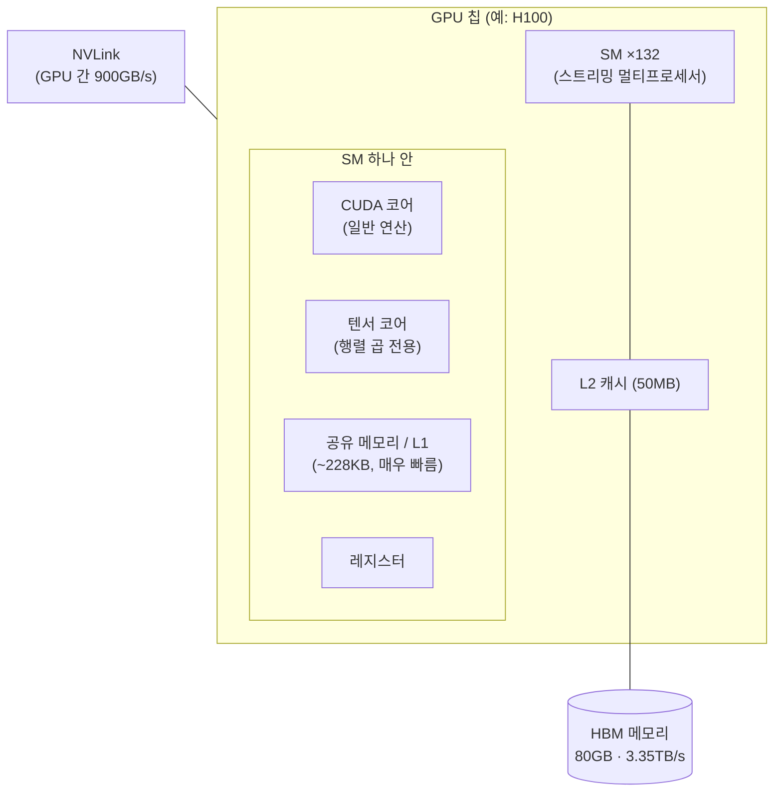
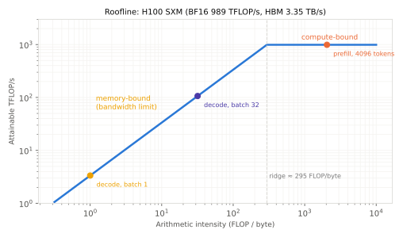

# GPU와 행렬 연산

!!! spec "핵심 논문 · 연도"
    Raina·Madhavan·Ng, "Large-scale Deep Unsupervised Learning using Graphics Processors" (2009) · Krizhevsky 외, "AlexNet" (2012, GPU 2장으로 학습) · Williams 외, "Roofline: An Insightful Visual Performance Model" (2009) · NVIDIA, "Volta 텐서 코어" (2017) · Micikevicius 외, "Mixed Precision Training" (2017) · Dao 외, "FlashAttention" (2022) · NVIDIA, "Hopper H100" (2022) · NVIDIA, "Blackwell B200" (2024)

!!! basic "한눈에 보기"
    신경망 계산의 90% 이상은 **행렬 곱셈**, 즉 "곱하고 더하기"를 엄청나게 많이 반복하는 일입니다. 각 곱셈은 서로 독립이라 **동시에** 할 수 있습니다.

    - **CPU**는 똑똑한 교수 몇 명입니다. 복잡한 일을 순서대로 빠르게 처리하지만 사람 수가 적습니다.
    - **GPU**는 단순 계산을 하는 학생 수만 명입니다. 하나하나는 단순하지만, 같은 계산을 한꺼번에 시키면 압도적으로 빠릅니다.

    원래 게임 화면의 픽셀 수백만 개를 동시에 계산하려고 만든 GPU가, 2012년 AlexNet 이후 딥러닝의 엔진이 되었습니다. 오늘날 AI 성능의 상당 부분은 알고리즘만큼이나 **하드웨어를 얼마나 잘 쓰느냐**에 달려 있습니다.

    그런데 GPU의 진짜 병목은 계산 속도가 아니라 **메모리에서 데이터를 가져오는 속도**인 경우가 많습니다. 학생이 아무리 많아도 문제지가 늦게 도착하면 놀게 됩니다. 이 페이지의 핵심은 이 "계산 대 메모리"의 균형입니다.

## GPU의 구조 { .l2 }



| 계층 | 크기 (H100 기준) | 속도 | 역할 |
|---|---|---|---|
| 레지스터 | SM당 256KB | 가장 빠름 | 스레드가 지금 계산 중인 값 |
| 공유 메모리 / L1 | SM당 최대 228KB | 수십 TB/s | 블록 안 스레드가 데이터를 나눠 씀 (타일링) |
| L2 캐시 | 50MB | 약 10TB/s 안팎 | 전체 SM이 공유 |
| HBM | 80GB | 3.35TB/s | 가중치, 활성값, KV 캐시 저장 |
| NVLink | GPU 간 | 900GB/s (양방향 합) | 같은 서버 안 GPU끼리 통신 |
| 네트워크 (InfiniBand/이더넷) | 서버 간 | GPU당 400Gb/s급 | 서버끼리 통신 |

**텐서 코어**는 작은 행렬 곱(예: 16×16 블록)을 한 번에 처리하는 전용 회로입니다. 일반 CUDA 코어보다 행렬 곱에서 수 배~수십 배 빠르며, 저정밀도(BF16, FP8, FP4)일수록 더 빠릅니다. 그래서 딥러닝은 FP32 대신 **혼합 정밀도**(계산은 BF16/FP8, 중요한 누적은 FP32)를 씁니다.

## 숫자 형식 { .l2 }

| 형식 | 비트 (부호·지수·가수) | 범위·정밀도 | 주 용도 |
|---|---|---|---|
| FP32 | 1·8·23 | 넓음·정밀 | 마스터 가중치, 누적 |
| FP16 | 1·5·10 | 좁음(최대 65504) | 초기 혼합 정밀도, 손실 스케일링 필요 |
| BF16 | 1·8·7 | FP32와 같은 범위, 낮은 정밀도 | 현재 학습의 표준 |
| FP8 (E4M3/E5M2) | 1·4·3 / 1·5·2 | 매우 좁음, 스케일 필요 | H100 이후 학습·추론 |
| FP4 (MXFP4/NVFP4) | 1·2·1 + 블록 스케일 | 블록마다 공유 스케일 | Blackwell 이후 추론, 일부 학습 |
| INT8 / INT4 | 정수 | 스케일과 함께 사용 | 추론 양자화 (→ [양자화](quantization.md)) |

## 루프라인: 계산이 병목인가, 메모리가 병목인가 { .l2 }

어떤 연산이 GPU를 얼마나 잘 쓰는지는 **산술 강도**(메모리에서 1바이트 읽을 때마다 하는 연산 수, FLOP/byte)로 정해집니다. H100은 초당 989조 번 연산하지만 HBM에서는 초당 3.35조 바이트만 읽습니다. 따라서 1바이트당 약 **295번** 이상 계산해야 계산 장치가 쉬지 않습니다. 이보다 낮으면 **메모리 대역폭이 한계**(memory-bound), 높으면 **연산 성능이 한계**(compute-bound)입니다.



LLM에서 이 구분은 결정적입니다. 프롬프트 전체를 한꺼번에 처리하는 **프리필**은 산술 강도가 높아 연산이 한계이고, 토큰을 하나씩 만드는 **디코딩**은 매 토큰마다 가중치 전체를 읽어야 해서 메모리가 한계입니다. 그래서 추론 최적화의 대부분은 "같은 가중치를 읽을 때 더 많은 일을 시키는" 방향(배칭, 추측 디코딩, 양자화)입니다 → [추론 최적화](inference.md).

## 코드로 보기 { .l2 }

행렬 곱의 산술 강도를 계산해 루프라인에서 어디에 놓이는지 봅니다. LLM의 선형층 하나(8192×8192)를 예로 듭니다.

```python
# 행렬 곱 C(M×N) = A(M×K) · B(K×N) 의 산술 강도와 루프라인 한계
peak_flops = 989e12      # H100 SXM BF16 밀집 연산 (FLOP/s)
bandwidth = 3.35e12      # HBM3 대역폭 (byte/s)
ridge = peak_flops / bandwidth
print(f"능선점: {ridge:.0f} FLOP/byte 이상이어야 연산이 한계")

def matmul(M, N, K, bytes_per=2):
    flops = 2 * M * N * K                              # 곱셈+덧셈
    traffic = bytes_per * (M * K + K * N + M * N)      # 각 행렬을 한 번씩 읽고 씀
    ai = flops / traffic
    attainable = min(peak_flops, ai * bandwidth)       # 루프라인
    return ai, attainable / peak_flops

for name, (M, N, K) in {
    "디코딩 (토큰 1개)":   (1, 8192, 8192),
    "배치 32 디코딩":      (32, 8192, 8192),
    "프리필 (토큰 4096)":  (4096, 8192, 8192),
}.items():
    ai, util = matmul(M, N, K)
    print(f"{name:14s} 산술강도 {ai:7.1f}  최대 활용률 {util:5.1%}")
```

토큰 1개를 디코딩할 때 산술 강도는 **1.0**으로, GPU 연산 능력의 **0.3%**밖에 쓰지 못합니다. 가중치 하나(BF16, 2바이트)를 읽어 곱셈·덧셈 한 번(2 FLOP)만 하고 버리기 때문입니다. 요청 32개를 묶으면 같은 가중치로 32배 일을 해서 10.8%까지 오르고, 4096토큰 프리필은 2048로 능선점을 훌쩍 넘어 연산 한계(100%)에 도달합니다. 같은 GPU, 같은 층인데 쓰는 방식에 따라 효율이 300배 차이 납니다.

??? expert "전문가 노트 — 실행 모델, 커널 최적화, 세대별 변화"
    **실행 모델.** CUDA 프로그램(커널)은 수많은 스레드를 **블록** 단위로 묶어 SM에 배정합니다. SM 안에서는 32개 스레드가 **워프** 하나로 같은 명령을 동시에 실행합니다(SIMT). 분기로 워프 안 스레드가 다른 길을 가면 순차 실행되어 느려집니다. HBM 지연(수백 사이클)을 숨기려면 SM마다 충분한 워프가 대기해야 하며(점유율), 메모리 접근은 인접 스레드가 인접 주소를 읽도록(병합 접근) 배치해야 합니다.

    **타일링과 커널 융합.** 행렬 곱은 큰 행렬을 타일로 잘라 공유 메모리에 올린 뒤 재사용해 HBM 접근을 줄입니다. 소프트맥스, 정규화, 활성화 같은 원소별 연산은 산술 강도가 낮아 메모리가 병목이므로, 여러 연산을 한 커널로 합쳐(**커널 융합**) 중간 결과를 HBM에 쓰지 않게 합니다. FlashAttention은 어텐션 전체를 타일 단위로 융합해 N×N 어텐션 행렬을 HBM에 만들지 않는 대표 사례입니다 → [어텐션](../arch/attention.md). 오늘날은 `torch.compile`, Triton, CUTLASS 같은 도구로 이런 커널을 만듭니다.

    **MFU.** 학습 효율은 **MFU**(Model FLOPs Utilization: 실제 모델 연산량 ÷ 하드웨어 이론 최대치)로 잽니다. 대규모 학습에서 BF16 기준 MFU 35–50%면 잘 된 편입니다. 나머지는 통신 대기, 메모리 병목 연산, 파이프라인 거품, 장애 복구에 쓰입니다.

    **세대별 변화.** 대략적인 수치로, V100(2017, 텐서 코어 도입) → A100(2020, BF16·TF32, 80GB HBM2e 2TB/s) → H100(2022, FP8, 80GB HBM3 3.35TB/s, BF16 밀집 약 1 PFLOP/s) → B200(2024, FP4, 약 180GB HBM3e 8TB/s, BF16 밀집 약 2.2 PFLOP/s)으로 발전했습니다. 연산 성능은 세대마다 2–3배씩 늘었지만 메모리 대역폭은 그보다 느리게 늘어, **메모리 벽**은 갈수록 높아지고 있습니다 → [AI 반도체와 메모리](ai-chips.md). 2026년 11월 기준 NVIDIA는 Blackwell Ultra(B300)를 공급 중이고, HBM4를 쓰는 차세대 Rubin을 2026년 하반기 출하 예정으로 발표했습니다.

## 관련 페이지

- [선형대수](../math/linear-algebra.md) — 행렬 곱의 의미
- [분산 학습](distributed.md) — GPU 수천 장을 묶는 방법
- [추론 최적화](inference.md) — 메모리 한계를 넘는 기법
- [AI 반도체와 메모리 (HBM)](ai-chips.md) — GPU 밖의 선택지
