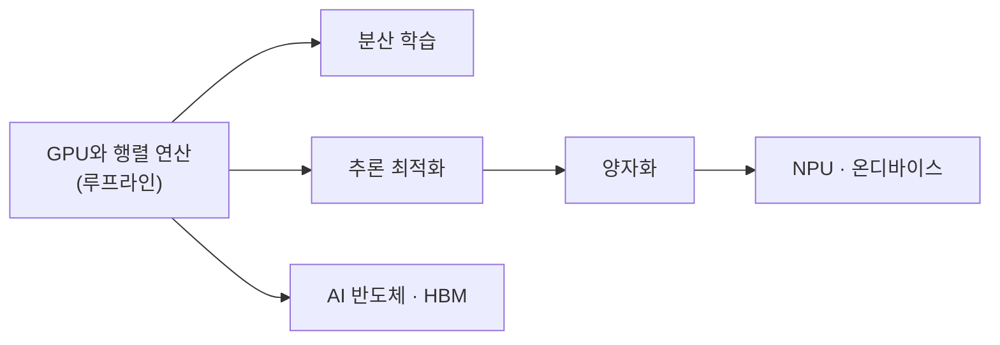

# 시스템과 하드웨어

AI의 발전은 알고리즘만큼이나 **계산 능력**에서 왔습니다. 이 섹션은 모델이 실제로 돌아가는 바닥, 즉 GPU 한 장 안에서 무슨 일이 일어나는지부터 수만 장을 묶는 학습, 사용자에게 빠르고 싸게 답하는 서빙, 모델을 작게 만드는 양자화, 스마트폰 속 NPU, 그리고 이 모든 것을 떠받치는 반도체와 HBM 메모리까지 다룹니다.

| 페이지 | 핵심 질문 |
|---|---|
| [GPU와 행렬 연산](gpu.md) | 왜 GPU인가? 연산이 병목인지 메모리가 병목인지 어떻게 판단하나? |
| [분산 학습](distributed.md) | 모델과 데이터를 GPU 수천 장에 어떻게 나누고, 통신은 어떻게 감당하나? |
| [추론 최적화](inference.md) | KV 캐시, 배칭, 추측 디코딩은 왜 필요하고 얼마나 빨라지나? |
| [양자화와 경량화](quantization.md) | 16비트를 4비트로 줄여도 왜 괜찮고, 언제 문제가 되나? |
| [NPU와 온디바이스 AI](npu.md) | 스마트폰과 PC에서 AI를 돌리려면 무엇이 달라야 하나? |
| [AI 반도체와 메모리 (HBM)](ai-chips.md) | TPU 같은 전용 칩과 HBM은 어떻게 동작하고, 왜 산업의 중심이 되었나? |

!!! basic "이 섹션을 관통하는 한 가지 질문"
    "**계산이 느린가, 데이터 이동이 느린가?**"

    현대 AI 하드웨어에서 곱셈 자체는 싸고, 메모리에서 데이터를 가져오는 일이 비쌉니다. 이 섹션의 거의 모든 기법은 같은 데이터를 한 번 가져와서 최대한 많이 쓰거나(배칭, 타일링, 시스톨릭 배열), 가져올 데이터 자체를 줄이는(양자화, GQA, KV 캐시 압축) 방법입니다. [GPU와 행렬 연산](gpu.md)의 **루프라인**을 먼저 읽으면 나머지 페이지가 훨씬 쉽게 읽힙니다.

## 읽는 순서 { .l2 }

- **AI를 쓰는 개발자**라면 GPU → 추론 최적화 → 양자화 순서가 실용적입니다.
- **반도체·하드웨어 분야**라면 GPU → AI 반도체·HBM → NPU 순서를 추천합니다.
- **대규모 학습**에 관심이 있다면 GPU → 분산 학습을 먼저 읽고 [사전 학습과 스케일링 법칙](../llm/pretraining.md)과 함께 보세요.
