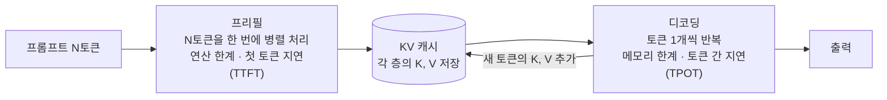

# 추론 최적화 (KV 캐시·배칭·추측 디코딩)

!!! spec "핵심 논문 · 연도"
    Pope 외, "Efficiently Scaling Transformer Inference" (2022) · Leviathan 외 / Chen 외, "Speculative Decoding / Sampling" (2022·2023) · Yu 외, "Orca: Continuous Batching" (2022) · Kwon 외, "vLLM: PagedAttention" (2023) · Ainslie 외, "GQA" (2023) · Dao, "FlashAttention-2" (2023) · Zheng 외, "SGLang: RadixAttention" (2023) · Li 외, "EAGLE" (2024) · DeepSeek-AI, "Multi-head Latent Attention (DeepSeek-V2)" (2024)

!!! basic "한눈에 보기"
    모델을 한 번 학습하면 끝이지만, **추론**(사용자의 질문에 답하는 일)은 서비스가 살아 있는 한 매일 수억 번 일어납니다. 2026년 11월 기준 AI 회사 계산량의 큰 몫이 추론에 쓰이고, 추론 모델과 에이전트가 긴 답을 생성하면서 그 비중은 더 커지고 있습니다.

    LLM은 답을 **한 토큰씩** 만듭니다. 토큰 하나를 만들 때마다 수백억 개 가중치를 메모리에서 전부 읽어야 하는데, 정작 계산은 조금밖에 하지 않습니다. 식당에 비유하면 요리사(GPU 연산)는 빠른데, 주문 하나 처리할 때마다 창고(메모리)에 가서 재료 전부를 가져와야 하는 상황입니다.

    그래서 추론 최적화의 핵심 아이디어는 세 가지입니다.

    1. **한 번 계산한 건 저장해 두기** — KV 캐시
    2. **창고에 한 번 갈 때 여러 주문을 같이 처리하기** — 배칭
    3. **빠른 견습생이 미리 만들고 요리사는 검사만 하기** — 추측 디코딩

## 두 단계: 프리필과 디코딩 { .l2 }



| 지표 | 뜻 | 좌우하는 것 |
|---|---|---|
| TTFT (Time To First Token) | 첫 토큰까지 시간 | 프리필 연산량, 대기열 |
| TPOT / ITL | 토큰 사이 간격 | 메모리 대역폭, 배치 크기 |
| 처리량 (토큰/s) | GPU 한 장이 초당 만드는 전체 토큰 | 배치 크기, KV 캐시 용량 |
| 비용 ($/100만 토큰) | 처리량 × GPU 가격 | 위 전부 |

지연과 처리량은 **맞바꾸는 관계**입니다. 배치를 키우면 GPU당 처리량은 오르지만 사용자 한 명이 체감하는 속도는 느려집니다.

## 주요 기법 { .l2 }

| 기법 | 원리 | 효과 |
|---|---|---|
| **KV 캐시** | 이전 토큰의 K·V를 저장해 다시 계산하지 않음 | 디코딩 계산량 O(N²) → O(N). 대신 메모리를 많이 씀 |
| **GQA / MQA / MLA** | 여러 쿼리 헤드가 K·V 헤드를 공유 / 저차원으로 압축 | KV 캐시 수 배~수십 배 감소 |
| **연속 배칭** | 끝난 요청을 빼고 새 요청을 토큰 단위로 즉시 끼움 | GPU 유휴 시간 감소, 처리량 수 배 |
| **PagedAttention** | KV 캐시를 OS 가상 메모리처럼 고정 크기 블록으로 관리 | 메모리 단편화 제거, 배치 확대 |
| **프리픽스 캐싱** | 같은 시스템 프롬프트·문서의 KV를 요청 간 재사용 | 긴 공통 앞부분의 프리필 생략, 비용·TTFT 감소 |
| **FlashAttention** | 어텐션을 타일 단위로 융합 | 메모리 이동 감소, 긴 문맥 가속 |
| **추측 디코딩** | 작은 초안 모델이 k토큰 제안 → 큰 모델이 한 번에 검증 | 출력 분포 그대로, 지연 2–3배 감소 |
| **양자화** | 가중치·KV를 8/4비트로 | 읽을 바이트 감소 → 직접 가속 (→ [양자화](quantization.md)) |
| **프리필·디코딩 분리** | 두 단계를 다른 GPU 풀에서 실행 | 서로 간섭 없이 각각 최적화 |

## 코드로 보기 { .l2 }

① KV 캐시가 얼마나 큰지, ② 메모리 대역폭이 디코딩 속도의 상한을 어떻게 정하는지, ③ 추측 디코딩이 스텝당 몇 토큰을 버는지 계산합니다.

```python
def kv_cache_gb(layers, kv_heads, head_dim, seq, batch, bytes_per=2):
    return 2 * layers * kv_heads * head_dim * seq * batch * bytes_per / 1e9   # K와 V

# Llama 3 70B 형태: 80층, KV 헤드 8개(GQA), 헤드 차원 128
print("KV 캐시, 문맥 8K × 배치 1 :", round(kv_cache_gb(80, 8, 128, 8192, 1), 2), "GB")
print("KV 캐시, 문맥 128K × 배치 8:", round(kv_cache_gb(80, 8, 128, 131072, 8), 1), "GB")
print("GQA 없이(헤드 64개) 128K×8 :", round(kv_cache_gb(80, 64, 128, 131072, 8), 1), "GB")

weights_gb, bw = 70 * 2, 3.35e3          # BF16 70B 가중치 140GB, HBM 3.35 TB/s(=3350 GB/s)
for batch in (1, 8, 64):
    t = weights_gb / bw                   # 디코딩 1스텝마다 가중치 전체를 한 번 읽음
    print(f"배치 {batch:2d}: 스텝당 {t*1000:.0f} ms 이상 → 최대 {batch / t:6.0f} 토큰/s")

alpha, gamma = 0.8, 4                     # 추측 디코딩: 수락률, 초안 길이
print("추측 디코딩 기대 토큰/스텝:", round((1 - alpha ** (gamma + 1)) / (1 - alpha), 2))
```

8K 문맥 요청 하나의 KV 캐시는 **2.68GB**지만, 128K 문맥 요청 8개면 **344GB**로 모델 가중치(140GB)보다 훨씬 큽니다. GQA가 없었다면 2.7TB가 필요했습니다. 긴 문맥 서비스에서는 가중치가 아니라 **KV 캐시가 메모리를 지배**합니다.

디코딩은 매 스텝 가중치 140GB를 읽어야 하므로 H100 한 장 대역폭으로는 스텝당 최소 42ms, 사용자 한 명에게 **초당 24토큰**이 상한입니다(140GB는 80GB GPU 한 장에 들어가지도 않으므로 실제로는 여러 장에 나눠 싣고, 각 GPU가 자기 몫만 동시에 읽어 그만큼 빨라집니다). 배치 64면 같은 42ms에 64명분을 만들어 처리량이 64배가 됩니다. 단, 이 계산은 KV 캐시 읽기를 뺀 것이라 문맥이 길수록 실제 이득은 줄어듭니다. 추측 디코딩은 초안 토큰의 수락률이 80%, 초안 4개일 때 큰 모델 한 번 실행으로 평균 **3.36토큰**을 얻습니다.

??? expert "전문가 노트 — 추측 디코딩의 정확성, KV 압축, 서빙 시스템"
    **추측 디코딩이 분포를 바꾸지 않는 이유.** 초안 모델 q가 토큰 x를 제안하면 큰 모델 p로 min(1, p(x)/q(x)) 확률로 수락하고, 거절되면 정규화한 max(0, p−q) 분포에서 다시 뽑습니다. 이 거절 샘플링 덕분에 최종 출력은 큰 모델 p에서 직접 뽑은 것과 **정확히 같은 분포**입니다. 수락률이 α, 초안 길이가 γ이면 검증 1회당 기대 토큰 수는 (1−α^(γ+1))/(1−α)입니다. 별도 초안 모델 대신 큰 모델 위에 가벼운 예측 헤드를 붙이는 Medusa·EAGLE, 여러 토큰을 동시에 예측하도록 학습하는 MTP(DeepSeek-V3)가 널리 쓰입니다.

    **KV 캐시 줄이기.** GQA는 쿼리 헤드 64개가 K·V 헤드 8개를 나눠 써서 8배를 줄입니다. DeepSeek의 **MLA**는 K·V를 저차원 잠재 벡터로 압축해 저장하고 계산 시 복원해, GQA보다 더 작은 캐시로 품질을 유지합니다. 그 밖에 KV를 FP8로 양자화, 일부 층만 전체 어텐션을 쓰고 나머지는 슬라이딩 윈도·선형 어텐션(상태 공간 모델 계열)을 쓰는 하이브리드 구조, 중요도가 낮은 토큰의 KV를 버리는 방법이 있습니다 → [긴 문맥과 메모리](../llm/long-context.md).

    **서빙 시스템.** vLLM, SGLang, TensorRT-LLM, llama.cpp(로컬)가 대표적입니다. 이들은 연속 배칭, PagedAttention, 프리픽스 캐시(SGLang은 기수 트리로 공통 앞부분을 공유), 추측 디코딩, 양자화 커널, 텐서·전문가 병렬을 함께 제공합니다. 대규모 서비스는 프리필 전용 GPU와 디코딩 전용 GPU를 나누고 KV 캐시를 네트워크로 넘기는 **분리형(disaggregated) 서빙**을 쓰며, KV 캐시를 CPU 메모리·SSD까지 계층적으로 보관해 재사용률을 높입니다.

    **추론 계산과 경제.** 추론 모델은 답 하나에 수천~수만 토큰을 "생각"에 쓰므로 디코딩 효율이 곧 비용입니다. 지연이 중요한 대화형은 작은 배치, 비동기 대량 처리(배치 API)는 큰 배치로 운영해 가격을 낮춥니다. 같은 품질의 응답 가격은 2023–2025년 사이 해마다 수십 배씩 떨어졌다는 분석이 있으며, 하드웨어·소프트웨어·작은 모델 증류가 모두 기여했습니다.

## 관련 페이지

- [GPU와 행렬 연산](gpu.md) — 디코딩이 메모리 한계인 이유
- [어텐션](../arch/attention.md) — K, V, 마스크
- [양자화와 경량화](quantization.md)
- [로컬 LLM 실행](../practice/local-llm.md) — llama.cpp로 직접 실행
