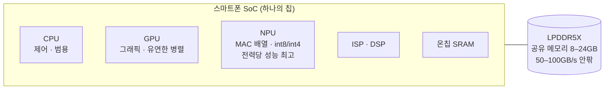

# NPU와 온디바이스 AI

!!! spec "핵심 논문 · 연도"
    Chen 외, "DianNao" (2014) · Chen 외, "Eyeriss" (2016) · Howard 외, "MobileNets" (2017) · Jacob 외, "Integer-Arithmetic-Only Inference" (2017) · Apple, "Neural Engine (A11)" (2017) · Tan·Le, "EfficientNet" (2019) · Gunter 외, "Apple Intelligence Foundation Language Models" (2024) · Gemma Team, "Gemma 3" (2025)

!!! basic "한눈에 보기"
    **NPU**(Neural Processing Unit)는 신경망 계산만을 위해 만든 작은 전용 칩입니다. 스마트폰, 노트북, 자동차, 카메라, 가전 안에 들어가 **인터넷 연결 없이 기기 안에서** AI를 돌립니다. 이를 **온디바이스 AI**라고 합니다.

    GPU가 수백 와트를 쓰는 대형 트럭이라면, NPU는 몇 와트로 움직이는 전기 스쿠터입니다. 짐(모델)을 많이 싣지는 못하지만, 배터리로 하루 종일 다닐 수 있습니다.

    기기 안에서 돌리면 좋은 점이 분명합니다.

    - **개인정보**: 사진, 음성, 메시지가 기기 밖으로 나가지 않습니다.
    - **속도**: 서버 왕복이 없어 즉시 반응합니다(카메라 보정, 음성 호출어).
    - **비용·가용성**: 서버 비용이 없고, 비행기 안이나 지하에서도 됩니다.

    대신 **메모리와 전력**이 매우 제한됩니다. 그래서 작은 모델, 강한 양자화, 정수 연산이 온디바이스 AI의 기본 도구입니다.

## NPU는 무엇이 다른가 { .l2 }



| 항목 | 데이터센터 GPU | 모바일 NPU |
|---|---|---|
| 전력 | 700–1,200W | 수 W |
| 메모리 | HBM 80–288GB, 3–8TB/s | LPDDR 공유 8–24GB, 수십~100GB/s 안팎 |
| 주 연산 형식 | BF16, FP8, FP4 | INT8, INT4, FP16 |
| 강점 | 학습, 대규모 서빙 | 전력 효율, 상시 동작 |
| 프로그래밍 | CUDA 등 범용 | 제조사 SDK, 지원 연산자 제한 |

NPU는 수천 개의 **MAC**(곱셈-누적) 장치를 배열로 놓고, 데이터를 칩 안 SRAM에 최대한 오래 머물게 해서 비싼 DRAM 접근을 줄입니다. DRAM에서 데이터를 한 번 가져오는 에너지는 정수 곱셈 한 번보다 **수백 배** 큽니다. 그래서 온디바이스 설계는 "계산을 줄이기"보다 "**데이터 이동을 줄이기**"가 핵심입니다.

## 온디바이스 LLM의 현실 { .l2 }

| 기기 | 메모리 | 현실적인 모델 (2026년 11월 기준) |
|---|---|---|
| 스마트폰 | 8–16GB (OS·앱과 공유) | 1–4B 파라미터, 4비트. 요약, 답장 제안, 받아쓰기 |
| AI PC / 노트북 | 16–64GB | 7–14B 4비트 쾌적, 30B급 MoE 가능 |
| 고메모리 데스크톱·워크스테이션 | 64–512GB 통합 메모리 | 70B 이상, 큰 MoE |
| 라즈베리파이 5 (8–16GB) | 8–16GB, CPU 추론 | 1–4B 4비트, 초당 수 토큰 (→ [로컬 LLM 실행](../practice/local-llm.md)) |

현재 주류는 **하이브리드**입니다. 간단하고 민감한 일은 기기 안의 작은 모델이, 어려운 일은 클라우드의 큰 모델이 처리합니다. 스마트폰 운영체제 차원의 AI 기능들이 대부분 이 구조를 씁니다. 디코딩 속도는 여기서도 메모리 대역폭이 정합니다. 대역폭 60GB/s 기기에서 4비트 3B 모델(1.5GB)은 초당 최대 약 40토큰입니다.

## 코드로 보기 { .l2 }

NPU 안에서 일어나는 **정수 전용 추론**을 흉내 냅니다. 활성값은 uint8, 가중치는 int8로 바꾸고, 곱셈과 누적을 모두 정수로 한 뒤 마지막에 스케일만 한 번 곱합니다.

```python
import numpy as np
rng = np.random.default_rng(1)
x = rng.uniform(0, 6, 64).astype(np.float32)            # ReLU6 뒤 활성값(0~6)
W = rng.normal(0, 0.1, (16, 64)).astype(np.float32)

sx = 6 / 255                                            # 활성값: uint8, 비대칭 범위 [0, 6]
sw = np.abs(W).max(1, keepdims=True) / 127              # 가중치: int8, 출력 채널별 대칭
xq = np.round(x / sx).astype(np.int32)                  # 0..255
Wq = np.round(W / sw).astype(np.int32)                  # -127..127

acc = Wq @ xq                                           # NPU 안: 정수 곱셈·int32 누적만
y_int = acc * (sw[:, 0] * sx)                           # 마지막에 스케일 한 번 곱해 실수로
y_ref = W @ x
print("int32 누적값 범위:", acc.min(), "~", acc.max())
print("상대오차:", round(float(np.linalg.norm(y_int - y_ref) / np.linalg.norm(y_ref)), 4))

for name, params, bits in [("3B 모델 int4", 3e9, 4), ("8B 모델 int4", 8e9, 4), ("8B 모델 FP16", 8e9, 16)]:
    print(f"{name}: 가중치 {params * bits / 8 / 1e9:.1f} GB")
```

정수 누적값은 −111,184~86,367 범위로, 8비트×8비트 곱을 64번 더하면 16비트를 훌쩍 넘기 때문에 **누적기는 32비트**여야 합니다. 이렇게 정수로만 계산해도 실수 계산과의 상대오차는 **0.46%**에 불과합니다. 정수 MAC은 같은 면적과 전력으로 부동소수점보다 훨씬 많이 넣을 수 있어 NPU가 int8·int4를 선호합니다. 아래 결과는 메모리 예산입니다. 8B 모델은 FP16이면 16GB라 스마트폰에 들어갈 수 없지만, 4비트로 4GB가 되면 고급 스마트폰에서 가능해지고, 3B 4비트(1.5GB)는 보급형에서도 돌아갑니다.

??? expert "전문가 노트 — 컴파일러, 연산자 지원, 한국의 NPU, 에지 설계"
    **컴파일러가 성능을 좌우한다.** NPU는 GPU처럼 아무 코드나 돌리지 못합니다. 모델(PyTorch, ONNX)을 제조사 컴파일러(Core ML, Qualcomm AI Engine/QNN, LiteRT, ExecuTorch, OpenVINO 등)가 NPU 명령으로 바꾸는데, 이때 연산자 융합, 메모리 배치, 타일링이 결정됩니다. NPU가 지원하지 않는 연산자(특이한 활성화, 동적 형태)가 하나만 있어도 그 부분은 CPU로 넘어가고 데이터가 오가면서 느려집니다. 그래서 온디바이스 모델은 설계 단계부터 **하드웨어 친화적 연산**만 쓰도록 만듭니다.

    **LLM과 NPU의 궁합.** 전통적 NPU는 CNN처럼 고정 크기 입력·높은 재사용에 최적화되어 있었습니다. LLM 디코딩은 메모리 한계이고 KV 캐시처럼 동적으로 커지는 상태가 있어 NPU 활용이 어렵습니다. 그래서 프리필은 NPU, 디코딩은 GPU/CPU로 나누거나, 4비트 가중치를 칩 안에서 풀어 쓰는 전용 회로, 큰 SRAM을 넣는 방향으로 설계가 바뀌고 있습니다.

    **한국의 NPU.** 국내에서는 리벨리온(ATOM, REBEL; 2024년 사피온과 합병), 퓨리오사AI(Warboy, RNGD) 같은 스타트업이 데이터센터 추론용 NPU를 개발해 왔고, 삼성전자는 엑시노스 SoC에 NPU를 내장해 왔습니다. 이들은 GPU 대비 전력 효율을 앞세워 추론 시장을 겨냥합니다 → [AI 반도체와 메모리](ai-chips.md).

    **에지 설계 원칙.** ① 모델 크기보다 **최대 메모리 사용량**과 지연을 먼저 정한다, ② 깊이별 분리 합성곱(MobileNet)처럼 연산량이 적은 구조를 쓴다, ③ 양자화 인식 학습으로 int8/int4 정확도를 확보한다, ④ 실제 기기에서 프로파일링한다(시뮬레이터와 실기기 차이가 큼), ⑤ 발열로 인한 성능 저하(서멀 스로틀링)를 고려해 지속 성능을 측정한다.

## 관련 페이지

- [양자화와 경량화](quantization.md) — int8/int4 변환 원리
- [CNN](../arch/cnn.md) — 온디바이스 비전 모델의 기반
- [AI 반도체와 메모리 (HBM)](ai-chips.md) — 데이터센터 가속기
- [로컬 LLM 실행](../practice/local-llm.md) — 라즈베리파이에서 LLM 돌리기
